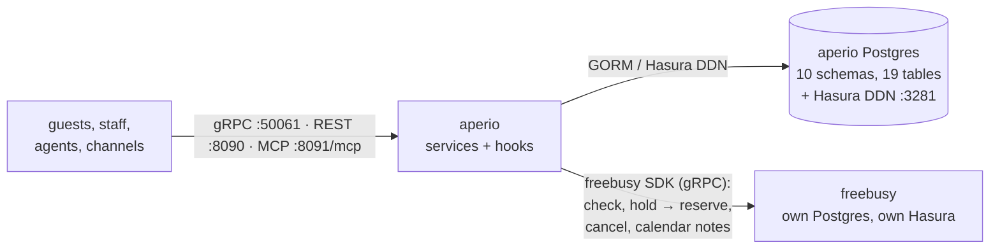

<!-- Copyright 2026 Srikanth K. -->
<!-- SPDX-License-Identifier: AGPL-3.0-or-later -->

# aperio

The venue backend: stays, events and their sessions, leads, quotes for plate
menus and fixed packages, seasonal pricing, GST invoices, payments in any
currency, building documents and service requests -- for a beach resort and a
wedding and event hall, from one deployable, on gRPC, REST and MCP.

Availability is [freebusy](https://github.com/shokki-engineering/freebusy)'s:
every room and hall booked here is a freebusy hold made into a reservation
first. aperio keeps the business -- who is coming, what they eat, what they
pay -- in its own Postgres; freebusy keeps the time in its own.

What is built and what is next: [docs/roadmap.md](docs/roadmap.md).

## Contents

- [How it works](#how-it-works)
- [Layout](#layout)
- [Running it](#running-it)
- [Configuration](#configuration)
- [Developing aperio](#developing-aperio)

## How it works



The schema is aperio's own protos (`protobuf/aperio`), written in the
OpenTravel vocabulary of protobuf-ota whose types they import. Everything that
touches the database is generated from them -- models, repositories, caches,
the Hasura client, the Prisma schema, the AIP service layer; the hand-written
code is business logic in hooks and custom methods.

## Layout

It follows freebusy's.

| Path | What |
|---|---|
| `main.go`, `app.go`, `build.go` | the binary: telemetry, config, server lifecycle, version |
| `internal/config` | configuration: `aperio.release.toml`, `aperio.dev.toml`, `APERIO_` overrides |
| `internal/telemetry` | logs, traces and metrics (OTLP) |
| `internal/server` | the HybridServer: services assembled and registered on gRPC, REST and MCP |
| `internal/database` | the connection (GORM or Hasura); generated models, repositories, caches, Hasura client beneath |
| `internal/service/<domain>` | business logic over the generated services: `stay`, `event`, `guest`, `pricing`, `sales`, `finance`, `concierge` |
| `internal/booking` | what the stay and event services share in taking rooms and halls from freebusy |
| `internal/service/generated` | the generated AIP services |
| `internal/engine` | freebusy, through its Go SDK |
| `internal/pricing`, `internal/calendar` | the price rules, exact money and GST; calendar notes |
| `protobuf/aperio` | the protos; `protobuf/generated` their Go, Prisma and MCP output |
| `test/live` | what the live suites share |
| `tools/` | `just` modules, buf templates, the calendar-links tool |
| `deploy/` | Compose (Postgres) and the Hasura DDN project |
| `docs/` | the roadmap |

## Running it

```sh
just db up                 # Postgres on 127.0.0.1:5433
just db deploy             # apply the Prisma migrations
just run                   # gRPC :50061, REST :8090, MCP :8091/mcp
curl localhost:8090/health
curl 'localhost:8090/v1/venues?pageSize=10'
```

Booking needs freebusy running (`just run` in its checkout, gRPC :50051).

Agents connect to every service's tools at once at `http://localhost:8091/mcp`
(streamable HTTP): 101 tools, 0.9 MB of schemas. The schemas are trimmed for
an agent's context (`tools/protobuf/buf/go.buf.gen.yaml`): shared types once
under `$defs`, OpenTravel code lists over 64 values as patterns, short nested
descriptions, no output schemas. The server validates every request in full.

## Configuration

Layered as freebusy's: the embedded `internal/config/aperio.release.toml`,
then `aperio.dev.toml` in a checkout (or with `APERIO_PROFILE=dev`), then
environment variables, `APERIO_<SECTION>__<KEY>`:

```sh
APERIO_DATABASE__POSTGRES__HOST=db APERIO_DATABASE__POSTGRES__PASSWORD=... \
APERIO_FREEBUSY__ENDPOINT=freebusy:50051 ./aperio
```

| Section | Keys |
|---|---|
| `[server]` | environment, enable_http / enable_mcp, ports, cors, tls |
| `[database]` | provider (`gorm` or `hasura`), postgres, hasura |
| `[cache]` | Redis / Dragonfly for the generated caches (off) |
| `[freebusy]` | endpoint, insecure / ca_file, timeout_seconds, public_url, feeds_secret |

## Developing aperio

| Recipe | What |
|---|---|
| `just lint` | buf format and lint, then api-linter |
| `just gen` | regenerate everything from the protos (`go`, `prisma`, `store`, `service`) |
| `just db migrate <name>` | the next Prisma migration (interactive terminal) |
| `just hasura regen` | Hasura metadata, after a schema change |
| `just test` / `just test-live` | unit tests; every suite against Postgres and Hasura |
| `just calendar-links` | each space's subscribe link for Google Calendar |

CLAUDE.md holds the rules the code follows: no import aliases, generated code
never edited, files under 200 lines.
