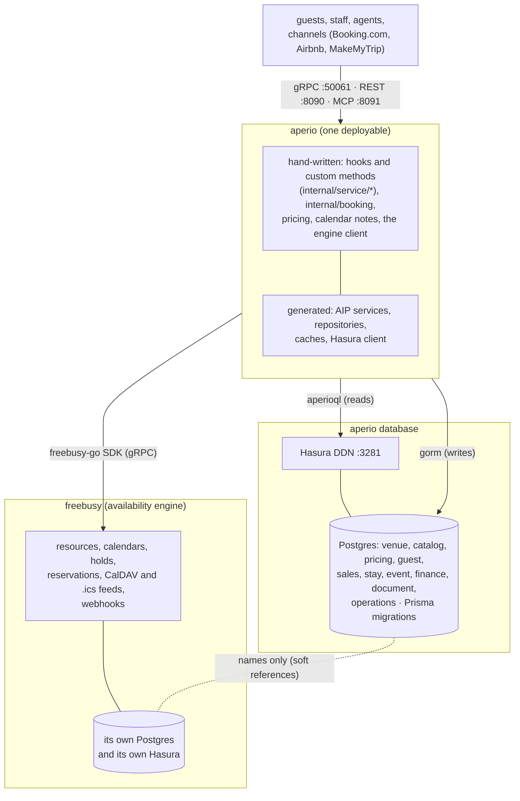

# aperio roadmap

Where aperio is, what is left to build end to end, and in what order. Status
is as of 28 October 2026. Update this file when a milestone lands or a
decision is made; it is the one place the plan lives.

## What aperio is

One deployable backend for the venues aperio sells -- a beach resort (rooms,
any-currency payments) and a wedding and event hall -- on gRPC, REST and MCP:
stays, events and their sessions, leads, quotes for plate menus and fixed
packages, seasonal pricing, GST invoices, payments, building documents, and
service requests (pantry, housekeeping) inside the venue.

## Architecture: two systems, two databases

- **aperio owns the business**: who is coming, what they pay, what they eat,
  what was quoted and invoiced. Its schema is aperio's own protos
  (`protobuf/aperio`), in the OpenTravel vocabulary of protobuf-ota whose
  types it imports; OpenTravel structures are stored whole as JSONB
  documents.
- **freebusy owns time**: whether a room or a hall is free, and taking it.
  Every stay and session is a freebusy hold made into a reservation first;
  aperio keeps only the names (`Reservation.freebusy_reservations`,
  `Session.freebusy_reservation`, `Space.resources`).
- **No shared database and no cross-database foreign keys.** The two agree
  through the API: idempotent booking keys, compensation when a step fails
  (`internal/service/stay`, `event`), and -- still to build -- webhooks and a
  reconciler for drift.
- **Hasura DDN** puts a typed GraphQL API over aperio's database
  (connector `aperio_pgsql`, engine `:3281`), which the generated
  repositories read through (`aperioql`) and which reporting and the
  frontend can query directly. freebusy keeps its own Hasura over its own
  database.

## Status at a glance

The API is one service per part of the business, each with only the methods
its resources' lifecycles allow (28 October 2026): venue (8), catalog (12),
pricing (11), guest (5), sales (16), stay (9), event (12), finance (16),
operations (8), document (5) and concierge (7) -- 109 methods, served on
gRPC, REST and MCP (109 tools at :8091/mcp).

| Area | Status | What exists | What is missing |
|---|---|---|---|
| Schema (protos) | Done | 11 packages, 42 files, lint-clean (buf, api-linter) | `Space` base price and tax (decision) |
| Generated layer | Done | models, stores, repositories, caches, Hasura client, Prisma schema, AIP services, MCP tools, OpenSearch indices | Count / group-by on repositories; join tables for repeated references (see bugs) |
| Database | Done | Prisma migrations (4), 20 tables in 7 schemas incl. the `stay_nights` read model; live round-trip tests (gorm + Hasura) | -- |
| Hasura DDN | Done (dev) | metadata, local engine | role permissions (spec written, needs generator support -- M5) |
| freebusy connection | Done | `internal/engine`: availability, book, cancel, notes, holds, lookups, webhook subscription; `internal/freebusysync`: webhooks in, reconciler | republishing freebusy's images in step |
| Bookings | Done | stays and sessions with compensation; state methods; lead holds; an accepted event holds its hall; changes made in freebusy settled | -- |
| Pricing and quotes | Done | seasons, rules, `CalculatePrice`; quotes through Send (with a ttl), Decline, Revise, Accept; expiry job | PDF proposal |
| Invoices (GST) | Done | CGST/SGST/IGST, series, Issue / Cancel / Credit (credit notes settle and reduce their invoice); receipt vouchers on advances | raising from a quote, e-invoice IRN, refund vouchers |
| Payments | Done | any currency; Razorpay: payment links (`RequestPayment`), refunds, signed webhook at `/webhooks/razorpay`; cheque clearing (`ClearPayment`); the money loop end to end in one test | Stripe for foreign cards (decision); pending bank transfers |
| Guests and leads | Done | contacts by phone, `SummarizeContact`; leads, activities, `SummarizePipeline` | dedupe contacts; venue-scoped lead names |
| Service requests | Done | state methods; department notifications (log, signed webhook, WhatsApp); charges posted to the booking's bill; `SummarizeServiceRequests` | push / email notifiers |
| Documents | Generated only | metadata (category, uri, sha256, expiry) | uploads, expiry reminders -- waiting on the owner's design |
| Channels | Built, not certified | `internal/channel`: the adapter interface; Booking.com OTA XML in (`/channels/bookingcom/reservations`), rates and availability messages out | a pull poller and an outbound sender for Booking.com; Airbnb / MakeMyTrip (decision) |
| Server | Done | HybridServer on :50061 / :8090 / :8091; Redis list caches; query tracing; pool monitor; background jobs; webhooks beside the REST gateway | a `/metrics` endpoint (OTLP only today) |
| Auth | Done | OIDC (any issuer), six roles with a rule for every RPC, per-venue access, guests' signed links; gRPC, REST and MCP | Hasura roles (generator support); off until `[auth] issuer` is set |
| Read models and search | Done | `stay.v1.StayNight` in Postgres with an optional OpenSearch copy (`[search] provider`), rebuilt and reindexed when empty | more read models as reports need them |
| Deploy / CI | Done (not yet released) | images by Bazel (rules_oci: the server on scratch, the Prisma migrations on distroless Node; amd64 + arm64); Compose for the whole stack (`just stack up`); Helm chart verified on kind; CI: lint, build, unit, live (Postgres + Redis), generated-code drift, image, chart; release workflow (GHCR images and chart, signed); Dependabot | first tagged release; a production cluster |
| Load (k6) | Done | `test/load`: staff reads, guest bookings through real freebusy holds, requests and MCP agents at once; smoke, day, stress and soak profiles with latency budgets. A busy day (80 req/s, 4 bookings/s) on the Compose stack: 0 errors, p95 under 40 ms everywhere; five times that (286 req/s average, 14 bookings/s): 0 errors, every budget kept, ConfirmStay p95 356 ms the first to slow | the breaking point (more than 5x); a run on production-sized hardware; k6 in CI against the stack |
| Concierge / voice | In progress | the seven concierge methods with elicitation | event bookings beyond the enquiry; a LiveKit demo (M9) |
| Agents (MCP) | Done | a task tool per service, each a few indexed reads: `SummarizeDay`, `SummarizeContact`, `SummarizeSessions`, `SummarizePipeline`, `SummarizeReceivables`, `SummarizeServiceRequests`; tools/list 0.9 MB | documents; reservation tools still ~250 KB |

## Milestones

Each milestone ends with something a person can use. Order matters: money
before channels, a running server before anyone outside can use any of it.

### M1 -- Billing: GST invoices (done, 27 October 2026)

- `Venue.invoice_prefix` (done in the proto): series `SBR/2627/0042` for tax
  invoices, `SBR/CN2627/007` credit notes, `SBR/PF2627/015` proformas; gap-
  free per venue, kind and financial year (April to March), at most 16
  characters.
- Draft invoices priced on create and edit: taxable value per line (less its
  discount), CGST + SGST when the place of supply is the venue's state, IGST
  otherwise; the total rounded to the rupee.
- `IssueInvoice` numbers and dates it in the venue's time zone (retrying on
  a number clash), `CancelInvoice` keeps the number used, `CreditInvoice`
  drafts a credit note that `corrects` it. Only drafts are edited or deleted.
- Exit, met: a live test issuing, cancelling and crediting, with the series
  and the GST split checked (`internal/service/finance`).
- Left for later: raising an invoice from an accepted quote (quote discount
  lines must become line discounts first); the e-invoice IRN; `paid` and
  `due` from payments (M2).

### M2 -- Payments and the money loop (done, 28 October 2026)

- Done: Razorpay (`internal/gateway/razorpay`) -- payment links through
  `RequestPayment`, refunds, its webhook at `/webhooks/razorpay` (signature
  checked, idempotent); `ClearPayment` for a cheque; a receipt voucher for
  each advance; credit notes settle on issue and reduce what their invoice
  is due; a tax invoice supersedes its proformas. Exit met:
  `TestLiveMoneyLoop` (quote, accept, advance paid by link, booking
  confirmed, tax invoice issued and paid). Left: Stripe; pending bank
  transfers; refund vouchers (rule 51); raising the invoice from the quote.

- Done: recording payments in any currency (`base_amount` at
  `exchange_rate`); `paid`, `due` and PAID on the invoice, summed afresh
  from its payments; the first receipt confirming a PENDING stay or a
  TENTATIVE event; a `Gateway` interface and `Settle(outcome)` for its
  webhook, idempotent on (gateway, gateway_reference); `RefundPayment`
  through the gateway, `VoidPayment` for anything else.
- Left: a gateway adapter for Indian cards and UPI (Razorpay or Cashfree;
  decide) -- its webhook route and signature check, payment links -- and
  Stripe for foreign cards if wanted; clearing a cheque (the API has no
  method that moves a PENDING cheque to SUCCEEDED -- a proto change).
- A receipt voucher for an advance (GST on advances).
- Exit: quote -> accept -> advance paid online -> booking confirmed ->
  invoice issued and paid, end to end in one test.

### M3 -- A running server (done, 28 October 2026)

- Done: Redis list caches over venues, the catalog and pricing, moved on
  by every write; query tracing (the generated gorm plugin); the pool
  monitor; background jobs (quote expiry, the freebusy reconciler); the
  Dockerfile (runtime and migrate images) and Compose for the whole stack;
  CI with a generated-code drift check. Exit met: `just stack up` gives an
  aperio a frontend can call (health, REST, MCP, CORS checked).

- Done (27 October 2026): the layout follows freebusy's; `main.go` serves
  every service on gRPC :50061 and REST :8090 through runtime-go's
  HybridServer, with config (koanf, `APERIO_` overrides), telemetry (OTLP),
  health, protovalidate and CORS / TLS when configured; CI workflows.
- MCP is on: protoc-gen-mcp now writes a message shared by several fields,
  or on a cycle, once under the tool's `$defs` (grpc-mcp-gateway,
  `plugin/generator/schema_defs.go`). The booking service's tools/list went
  from 16.7 MB -- past the MCP SDK's 16 MB frame -- to 5 MB; all 7 services
  serve 108 tools.
- Left: the cache backend (Redis or Dragonfly) wired into the generated
  caches; query tracing (freebusy's generated `Instrument`); an image --
  freebusy builds its with Bazel -- or a Dockerfile.
- Background jobs: expire sent quotes past `expire_time`; release lead holds;
  reconcile with freebusy (below).
- Compose for the whole stack (aperio, freebusy, both Postgres, both
  Hasura, Redis); a generated-code drift check in CI.
- Exit: `docker compose up` gives a working aperio a frontend can call.

### M4 -- Staying in step with freebusy (done, 28 October 2026)

- Done (`internal/freebusysync`): freebusy's webhooks at
  `/webhooks/freebusy` (signed, de-duplicated), settling a stay or event
  whose reservation was cancelled or moved in freebusy; the subscription
  ensured at startup; the reconciler (repairs or flags, with a guard
  against the wrong freebusy); lead holds; an accepted event holds its
  hall, so a second acceptance of the same hall and day fails. Exit met in
  live tests. Left: a hall hold cancelled in freebusy is not seen
  (`Event.freebusy_holds` would let the reconciler check it).

- Subscribe to freebusy's WebhookService: a reservation cancelled or moved in
  freebusy (by an operator, or over CalDAV) updates the aperio booking.
- A reconciler that walks recent bookings and repairs or flags any whose
  freebusy reservation is missing or different.
- Lead holds: a lead's dates held in freebusy (`Lead.hold`) while it is
  negotiated, released when it is won or lost.
- Holding the hall on acceptance: an accepted event quote holds its spaces
  for the event dates until sessions with times replace the hold.
- Exit: cancelling in freebusy shows in aperio within a minute; a test that
  breaks the link is caught by the reconciler.

### M5 -- Auth and access (done, 28 October 2026; off until configured)

- Done (`internal/auth`): OIDC from any issuer; six roles with a rule for
  every RPC (a test fails on an unguarded one); per-venue access;
  guests' signed links to one quote, stay or invoice; enforced on gRPC,
  REST and MCP (the MCP token is carried by `auth.MCPService()`). Exit
  met: the kitchen sees requests and diets, not invoices. Left: Hasura
  role permissions (a spec is ready; needs generator support); lead names
  scoped to a venue.

- Staff identity (OIDC), roles (owner, front desk, sales, kitchen,
  housekeeping, accounts) and per-venue access, enforced in the service
  layer.
- Guest-facing access for a quote or a booking by signed link.
- Hasura roles mirroring them, so direct GraphQL reads see only what the
  role may.
- Exit: a kitchen login sees service requests and dietary needs, not
  invoices.

### M6 -- Operations inside the venue (done except documents)

- Done: the request states; notifications through `internal/notify` (log,
  signed webhook, WhatsApp Business); a completed request's charge posted
  once to its booking's draft invoice; the daily views as task tools
  (`SummarizeDay`, `SummarizeSessions`, `SummarizeServiceRequests`).
  Left: documents (the owner's design to come); push and email.

- Service requests: Acknowledge / Start / Complete / Cancel, with quantities
  ("3 black coffees to room 204"); notifications to the department (push,
  WhatsApp); charges posted to the booking.
- Documents: uploads to object storage (S3-compatible), signed download
  URLs, expiry reminders for licences and certificates.
- Daily views: arrivals, departures, in-house guests, today's sessions with
  covers and dietary counts for the kitchen.

### M7 -- Channels (Booking.com built, not certified)

- Done (`internal/channel`, `bookingcom`): OTA_HotelResNotif in --
  new, modify (in place or rebooked), cancel, idempotent on the channel's
  reference -- with basic auth at `/channels/bookingcom/reservations`;
  OTA_HotelRateAmountNotif and OTA_HotelAvailNotif built from prices and
  availability. Left for certification: Booking.com's pull model (a
  poller), an outbound sender, restrictions, occupancy pricing, and the
  availability push on every booking change.

- Booking.com over OTA (the schema already speaks it): rates, availability
  and restrictions out (`OTA_HotelRateAmountNotif`, `OTA_HotelAvailNotif`),
  reservations in (`OTA_HotelResNotif`), mapped to aperio stays booked in
  freebusy.
- Airbnb and MakeMyTrip through their APIs or a channel manager (decide);
  one adapter interface for all.
- Rates pushed from price rules, so a season changes every channel at once.
- Exit: a booking made on Booking.com appears in aperio, takes the room in
  freebusy, and closes it on the other channels.

### M8 -- Agents and reporting

- MCP: done -- tools/list is 0.9 MB (from over 16 MB): `$defs` for shared
  messages and enums, and protoc-gen-mcp's max_enum_values=64,
  short_descriptions and output_schema=false. A reservation tool is still
  ~250 KB, half structure and half descriptions of the OpenTravel RoomStay
  vocabulary; the next cut is describing the OpenTravel document fields
  (room_stays, res_guests) loosely for agents, or task tools that do not
  take them. Add task tools -- today's arrivals, the week's events, quote a
  wedding for 300 in December.
- Task tools on read models, one service at a time (documents last). Stay,
  done: `StayNight` (a row per night of every live stay, kept in the
  reservation's transaction) and `SummarizeDay` (arrivals, departures, who
  stays, rooms taken: four indexed reads, an 890-byte tool). Guest, done:
  `SummarizeContact` (stays and nights by room type, last and next visit,
  events, open leads and quotes, paid and due, past requests; from a day
  for "this year"), read through the other services' list methods by the
  indexed contact, all at once. Event, sales, finance and operations,
  done: `SummarizeSessions` (the kitchen's next days: sessions, covers,
  plates by diet), `SummarizePipeline` (leads by stage, won and lost
  lately, follow-ups due, uncontacted leads, quotes expiring),
  `SummarizeReceivables` (outstanding, overdue, aging, debtors, collected
  this month) and `SummarizeServiceRequests` (open requests by department,
  overdue, oldest first, done today). Next: documents.
- Read models as freebusy's: Postgres tables under the generated projection
  runtime, with an optional OpenSearch copy (`[search] provider`), a
  change-feed indexer, alias-swap reindex, and every read falling back to
  Postgres on an error or after 500 ms.
- Reports over Hasura: occupancy, revenue by season, GST returns (GSTR-1
  data), lead conversion.
- Proposals and invoices as PDFs.

### M9 -- Voice: aperio on a phone call

- A concierge API for agents on a call (`aperio.concierge.v1`): flat,
  speakable task methods over the existing services -- FindStay, HoldStay,
  ConfirmStay, EnquireEvent, FindBooking, CancelBooking, RequestService --
  two-step consent for anything that books or charges, a `spoken` sentence
  in every reply, the caller known from the call. Design: [voice.md](voice.md).
- protoc-gen-mcp and runtime-go: elicitation that asks only what is missing
  (`ask_missing_only`), and questions the server raises (`mcp.Ask`, with the
  amount in them). Built and tested against local checkouts; to release.
- A voice agent on a test number, one language, inbound reservations first.

## Gaps and risks

- **Two databases drift.** Compensation covers failures inside a call, not
  changes made in freebusy directly. Until M4, an operator cancelling in
  freebusy leaves the aperio booking looking held.
- **An accepted event does not hold its hall** until sessions with times are
  added. Two quotes for the same date can both be accepted. (M4)
- **Spaces have no price or tax.** A hall's hire or a room's night is priced
  only by a fixed-price rule, and its quote line needs GST set by hand.
- **Quote ttl is lost.** `Quote.ttl` is input-only and not stored, so every
  sent quote stands 14 days.
- **No auth.** Nothing can face a network before M5. freebusy's CalDAV is
  unauthenticated too; only its signed `.ics` feeds are safe to expose.
- **Document columns are NOT NULL.** The database made `Venue.gst` and
  `address` NOT NULL, so every venue must carry them; check how the store
  generates nullability for document columns before an optional one bites.
- **MCP size.** tools/list is 0.9 MB, but a reservation tool's schema is
  still ~250 KB -- heavy in an agent's context.
- **The SDK path.** aperio uses `oh-tarnished/freebusy-go-sdk` through a
  `replace`; fix the SDK's module path to drop it, and drop Organizations and
  Sites from its services.

## Decisions to make

Taken on 28 October 2026 to finish the milestones, each easy to change:

| Decision | Taken | Still open |
|---|---|---|
| Payment gateway | Razorpay (Indian cards, UPI), behind finance's `Gateway` | Stripe for foreign cards |
| Identity provider | standard OIDC, any issuer (Google Workspace, Keycloak, Clerk) | which issuer |
| Cache backend | Redis (Dragonfly works unchanged) | -- |
| Notifications | a `Notifier`: log, signed webhook, WhatsApp Business Cloud API | push, email |
| `SendQuoteRequest.ttl` | added; 14 days when unset | -- |
| Channel strategy | Booking.com over OTA XML first; an `Adapter` interface for the rest | Airbnb / MakeMyTrip: direct APIs or a channel manager |

Still to decide:

| Decision | Options | Needed by |
|---|---|---|
| `Space` base price and tax | add to the proto, or keep fixed-price rules | M1 |
| Documents | storage and access design | M6 |
| Pending bank transfers | how one is recorded before it clears | M2 |

## Definition of done

For every feature:

- Protos lint clean (`just lint`); generated code regenerated (`just gen`),
  never edited; schema changes as Prisma migrations (`just db migrate`) and
  Hasura metadata regenerated (`just hasura regen`).
- Business logic only in hooks and custom methods; files under 200 lines,
  documented.
- Unit tests for pure logic, live tests against the dev database for flows.
- This roadmap updated.

## Done so far

- Schema: aperio's protos over OpenTravel types; documents mode (protokit,
  protoc-gen-store, protoc-gen-cache fixes) took the store from 1,660
  tables to 19 and Hasura from 6,647 files to 85.
- Freebusy: `internal/engine` (check, hold -> reserve, cancel, notes);
  freebusy's read-only signed `.ics` feeds (`internal/caldav/feed.go` in
  freebusy).
- Bookings: `internal/service/stay` and `event` (sharing `internal/booking`) -- stays, sessions, events, state
  methods, compensation; live tests.
- Calendars: notes with guest count, names, emails, phones, address, diet and
  requests on the booked rooms' calendars; `tools/calendar (`just calendar-links`)`.
- Pricing and quotes: `internal/pricing`, `internal/service/pricing` and `sales` --
  seasons, rules, GST, quotes through Send / Decline / Revise / Accept;
  unit and live tests.
- GST invoices: `internal/service/finance` -- CGST/SGST/IGST, numbering
  (`Venue.invoice_prefix`, migration `20261026190511_invoice_prefix`),
  Issue / Cancel / Credit; live test.
- Payments: any currency, invoice paid / due, advance confirms the booking,
  gateway settle / refund, void; live test.
