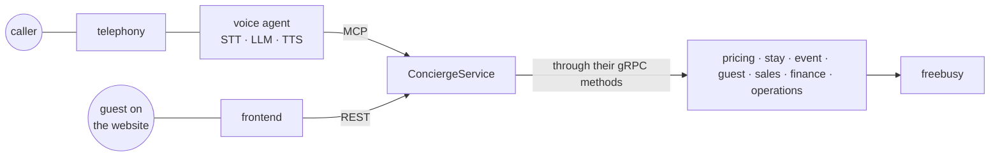
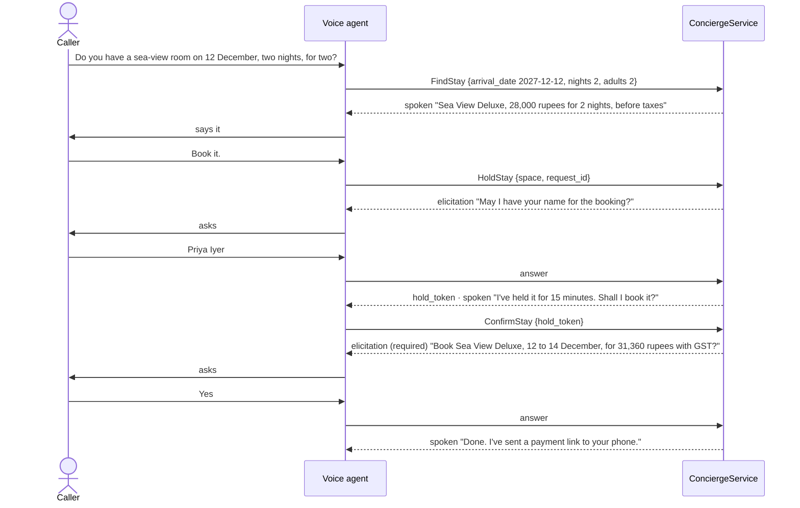

# aperio on a phone call

A design for taking bookings, event enquiries and in-house requests over an
agentic voice call: a caller rings the resort or the hall, a voice agent
(speech-to-text, an LLM, text-to-speech) answers, and the LLM works aperio
through MCP -- asking the caller, through MCP elicitation, for what it does
not know and for consent before anything is taken or charged.

Status, 27 October 2026: `FindStay`, `HoldStay`, `ConfirmStay`, `FindBooking`
and `CancelBooking` are built
(`internal/service/concierge`) and served on REST, gRPC and MCP -- for the
website first, a LiveKit voice agent later. A guest's missing details come
back as a structured error naming the field, which a frontend shows as a form
and an agent asks for. The rest -- more tasks, elicitation in the plugin, the
voice agent -- is [roadmap.md](roadmap.md), M9.

## Why the existing tools do not work by voice

aperio's MCP tools today are its AIP resource methods, generated one per RPC:
`CreateReservation`, `UpdateQuote`, `ListSessions`. They are right for staff
screens and integrations, and wrong for a conversation:

| On a call, a tool must | The resource tools |
|---|---|
| take a few flat answers ("12 December, two nights, two adults") | take a whole `Reservation`, OpenTravel `room_stays` and `res_guests` inside |
| be cheap to read into a voice model's context, which is re-sent every turn | are up to ~250 KB of schema each, 0.9 MB for all 108 |
| do one thing a caller asks for ("is there a sea-view room") | do one thing a database does (create, update, list) |
| answer in a sentence the agent can say | answer in a resource the agent must summarise, numbers and all |
| never charge or book without the caller's spoken yes | take effect on the call |

And elicitation, as protoc-gen-mcp generates it today, is a fixed form per
RPC: the same static question ("Are you sure?"), every field asked whether or
not the caller already said it.

## The shape: a concierge API beside the resource APIs

A new package, `aperio.concierge.v1`, of task methods over the existing
services -- the resource APIs stay as they are, for staff and integrations.
Its MCP tools are the only ones a voice agent is given.



### Rules for every concierge method

1. **Flat, few, speakable inputs.** Strings, numbers, booleans and small
   enums -- which is also all an MCP elicitation form can hold -- and no
   more than about eight. Dates as `YYYY-MM-DD` strings; a room preference
   as an enum of the venue's room types, not an OpenTravel code list.
2. **Two steps for anything that takes or charges.** A *hold* step that is
   reversible and expires (a freebusy hold, a draft) and returns what it will
   cost; a *confirm* step that needs the hold's `confirmation_token`. The LLM
   cannot skip from asking to booking, with or without elicitation.
3. **Consent by elicitation, with the real numbers.** The confirm step asks
   the caller "Hold two sea-view rooms, 12 to 14 December, for twenty-eight
   thousand rupees?" through elicitation, `required: true`: a decline or a
   client without elicitation does not book.
4. **Every reply carries `spoken`.** A sentence the agent can say as is --
   amounts in words, dates as a person says them, in the caller's language --
   beside the structured fields.
5. **The caller is known from the call.** The caller's number arrives with
   the call (telephony metadata, passed to MCP as an extra property, not a
   tool argument the LLM fills): it finds or makes the contact, and is never
   asked for.
6. **No card details by voice.** Money is a payment link sent to the caller's
   phone (SMS or WhatsApp); the gateway's webhook confirms the booking
   (finance's `Settle`, already built).
7. **Idempotent turns.** Every taking method takes a `request_id`, so a
   retried turn -- a dropped packet, a repeated utterance -- does not book
   twice.

### Methods

| Method | Does | Asks the caller (elicitation) |
|---|---|---|
| `FindStay` | rooms free and priced for dates and guests, cheapest first | -- |
| `HoldStay` | holds rooms in freebusy (15 min), drafts a PENDING stay, prices it | name, if the contact has none; email, optional |
| `ConfirmStay` | books the hold, sends the advance payment link | **consent**, with the dates, rooms and amount |
| `EnquireEvent` | a lead and a draft quote for an occasion, date and guest count, with menus that fit their diet | occasion, guests, diet, if missing |
| `SendQuote` | sends the quote by WhatsApp or email | **consent** to send |
| `FindBooking` | the caller's bookings, by their number (and a date or reference) | -- |
| `CancelBooking` | cancels, after reading the policy and refund | **consent**, with the refund amount |
| `RequestService` | in-house: "two black coffees to room 204" | quantity and place, if missing |
| `AskVenue` | answers from the venue's documents and policies (check-in, parking, pets) | -- |
| `HandOff` | transfers to a person, with a summary of the call | -- |

`AskVenue` is backed by MCP resources -- the venue's policies, amenities and
menus, read from documents and the venue's OpenTravel `hotel_info` -- so the
model can quote them rather than invent them. Call scripts ("inbound
reservations", "event enquiry") are MCP prompts.

### A call, end to end



## The protos (sketch)

```protobuf
// aperio/concierge/v1/concierge_service.proto
service ConciergeService {
  option (mcp.v1.service) = {...};

  // Rooms free and priced for the dates, cheapest first.
  rpc FindStay(FindStayRequest) returns (FindStayResponse) {
    option (google.api.http) = {post: "/v1/{venue=venues/*}:findStay" body: "*"};
  }

  // Holds a stay option for 15 minutes and prices it.
  rpc HoldStay(HoldStayRequest) returns (HoldStayResponse) {
    option (google.api.http) = {post: "/v1/{venue=venues/*}:holdStay" body: "*"};
    option (mcp.v1.elicitation) = {
      message: "May I have the name for the booking?"
      schema: "aperio.concierge.v1.GuestDetails"
      ask_missing_only: true           // proposed: see "What the plugin needs"
    };
  }

  // Books a held stay and sends the payment link: never without the caller's yes.
  rpc ConfirmStay(ConfirmStayRequest) returns (ConfirmStayResponse) {
    option (google.api.http) = {post: "/v1/{venue=venues/*}:confirmStay" body: "*"};
    // The question is the server's -- it carries the amount -- so it is
    // raised by the handler (proposed), not written here.
  }
}

message FindStayRequest {
  string venue = 1;                    // the line called decides it; filled by the agent's config
  string arrival_date = 2 [(mcp.v1.field) = {format: DATE}];
  int32 nights = 3;
  int32 adults = 4;
  int32 children = 5;
  RoomPreference preference = 6;       // a handful: ANY, SEA_VIEW, GARDEN, SUITE
  string language = 7;                 // BCP 47, for `spoken`: en-IN, kn-IN, hi-IN, ml-IN
}

message StayOption {
  string option = 1;                   // a short id the agent passes back
  string room_type = 2;                // "Sea View Deluxe"
  int32 rooms = 3;
  google.type.Money nightly = 4;
  google.type.Money total = 5;         // with GST
  string spoken = 6;
}

message FindStayResponse {
  repeated StayOption options = 1;     // at most three: a caller cannot hold more in mind
  string spoken = 2;
}

message GuestDetails {                 // the elicitation form: flat, all strings
  string guest_name = 1 [(google.api.field_behavior) = REQUIRED];
  string email = 2;
}
```

Every message is flat and small, so the concierge's tools are a few
kilobytes each -- the schema-size problem does not arise for the voice agent
at all.

## What the plugin and runtime need

Three changes to protoc-gen-mcp and runtime-go's agents, each generic:

1. **Ask only what is missing** (`ask_missing_only: true` on
   `mcp.v1.elicitation`). Today every form field is asked on every call; the
   generated handler should drop fields the arguments already carry, and skip
   the elicitation when none is left. `ElicitHook` would need the call's
   arguments to do it by hand.
2. **Questions the server raises.** A consent question must carry what only
   the server knows -- the amount, the refund, the dates as booked -- so it
   cannot be a static string in the proto. A handler returns a gRPC error
   with an `ElicitationRequired` detail (message, flat fields); the generated
   MCP layer turns it into an elicitation, merges the answer into the
   arguments and calls the handler again (the multi-round-trip flow,
   SEP-2322, the runtime already uses). The business logic stays in the
   hook; over gRPC and REST the same error tells a client what to ask.
3. **The caller from the call.** A documented extra property (`caller_phone`,
   through `ExtraProperties`) that the voice platform sets from telephony
   metadata, read in the handler from the context.

Without elicitation support in the voice client, the design still holds: the
two steps and the `confirmation_token` make the LLM ask and the caller agree
before `ConfirmStay` -- elicitation makes that consent explicit and auditable.

## The voice side

Outside aperio, and to choose:

| Piece | Options |
|---|---|
| Telephony (Indian numbers) | Exotel, Plivo, Twilio |
| Voice agent with an MCP client | LiveKit Agents, Pipecat, Vapi, Retell |
| Speech in the venues' languages | English, Kannada, Hindi, Malayalam, Konkani, Tulu (Mangaluru) |
| Elicitation on a call | the agent speaks the elicitation message, fills the form from the answer, reads it back |

## Order of work

1. `ConciergeService` with `FindStay`, `HoldStay`, `ConfirmStay`; the
   payment link; `spoken` in English. Tested by an MCP client script, no
   telephony.
2. Plugin: `ask_missing_only` and server-raised elicitation.
3. A voice agent on a test number, one language, inbound reservations only.
4. `EnquireEvent` / `SendQuote`, `FindBooking`, `CancelBooking`.
5. In-house `RequestService` (a room's own line), `AskVenue`, `HandOff`.
6. More languages; call summaries on the contact's activity log.

## Open questions

- Which voice platform and telephony provider -- it decides how elicitation
  is spoken and how the caller's number reaches MCP.
- Which languages first, and whether `spoken` is aperio's (templates per
  language) or the voice model's (it rephrases structured fields).
- How long a voice hold lasts (15 minutes proposed) and whether an unpaid
  confirmed stay lapses.
- Decided: a booking is found or cancelled by the guest's phone and its
  reference (or, to find it, its day of arrival) -- never by a number alone.
