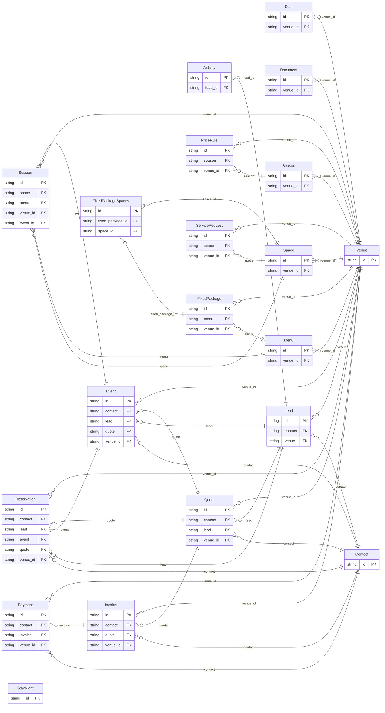

<!-- Code generated by protoc-gen-store. DO NOT EDIT. -->

# `aperio` — GORM models

Go structs with GORM struct tags — one package per schema.

Generated from Protobuf by protoc-gen-store. Source of truth is the `.proto` files — regenerate rather than editing.

| Models | Enums |
| ---: | ---: |
| 20 | 26 |

## Entity relationships

## Output

- `<schema>/models.go` — one Go package per schema, one struct per table.
- `migrate.go` — a factory `Registry` (with a preloaded `Default`) that migrates every model in one call; emitted when the `go_module` opt is set. Call `Default.EnsureSchemas(db)` before `Default.Migrate(db)` so the schema-qualified tables have their Postgres schemas.
- Nullable columns are pointer types; proto enums become string-typed Go enums.
- Attach in main: `Default.EnsureSchemas(db)` then `Default.Migrate(db)`, or wire the structs into a `*gorm.DB` and run AutoMigrate yourself.
- `<schema>/<model>_store.go` — a typed CRUD store per resource (Create, GetByID, List, Count, Update, DeleteByID, plus GetBy/ListBy finders for unique and foreign-key columns); emitted when the `stores` opt is set (which also requires `go_module`). Requires `gorm.io/gorm`.
- `gormx/gormx.go` — the shared runtime every store imports: `ListOptions`, the generic `Store[M]` interface every store satisfies, a `GenericStore[M]` engine that runs CRUD for any model with no per-entity code, and `EnsureSchemas`. Lets one generic engine drive every entity.
- `telemetry/telemetry.go` — the first-party telemetry adapter: `New(o)` wraps an SDK handle as the `gormx.Telemetry` the stores observe through (`WithTelemetry(telemetry.New(o))`), and `Plugin(o)` is the SQL-level gorm plugin. Emitted with the `telemetry` opt; requires `github.com/the-protobuf-project/telemetry/telemetry-go`.
- `Registry.Instrument(db, o)` in `migrate.go` — installs the generated telemetry gorm plugin so every query emits a span (and metric) through the SDK handle.

## Schema `catalog`

### `Dish` → `dishes`

A Dish is one item a venue's kitchen makes: paneer tikka, dal makhani, a live chaat counter, a mocktail. It is the catalogue menus are made from, so a dish is described once -- its course, the diets it suits, its allergens -- and every menu that offers it says the same. A dish has its own price only when it is sold on its own: à la carte, room service, an add-on to a menu.

| Column | Type | Null |
| --- | --- | --- |
| `id` | `CHAR(26)` | not null |
| `name` | `VARCHAR(255)` | not null |
| `display_name` | `VARCHAR(255)` | not null |
| `description` | `VARCHAR(255)` | nullable |
| `course` | `Course` | not null |
| `cuisine` | `VARCHAR(255)` | nullable |
| `diets` | `` | nullable |
| `allergens` | `` | nullable |
| `price` | `JSONB` | nullable |
| `tax` | `JSONB` | nullable |
| `image_uri` | `VARCHAR(255)` | nullable |
| `available` | `BOOLEAN` | nullable |
| `create_time` | `TIMESTAMPTZ` | not null |
| `update_time` | `TIMESTAMPTZ` | not null |
| `etag` | `VARCHAR(255)` | nullable |
| `venue_id` | `CHAR(26)` | not null |

### `Menu` → `menus`

A Menu is a plate menu sold for events at a price per plate: "Silver Vegetarian -- 2 welcome drinks, any 3 of 6 starters, 4 mains, breads, rice, 2 desserts". It is a set of courses, each a choice among dishes, with add-ons priced per plate on top. Its plate_price is the base price. What a plate costs on a given date is the base price with the venue's price rules applied (PriceRule), so a wedding-season surcharge needs no edit to the menu.

| Column | Type | Null |
| --- | --- | --- |
| `id` | `CHAR(26)` | not null |
| `name` | `VARCHAR(255)` | not null |
| `display_name` | `VARCHAR(255)` | not null |
| `description` | `VARCHAR(255)` | nullable |
| `diets` | `` | nullable |
| `courses` | `JSONB` | not null |
| `add_ons` | `JSONB` | nullable |
| `plate_price` | `JSONB` | not null |
| `min_plates` | `INTEGER` | nullable |
| `tax` | `JSONB` | not null |
| `active` | `BOOLEAN` | nullable |
| `create_time` | `TIMESTAMPTZ` | not null |
| `update_time` | `TIMESTAMPTZ` | not null |
| `etag` | `VARCHAR(255)` | nullable |
| `venue_id` | `CHAR(26)` | not null |

### `FixedPackage` → `fixed_packages`

A FixedPackage is a fixed-price bundle: "Wedding Gold -- the ballroom for 8 hours, stage and floral decor, DJ, 300 plates of Silver Vegetarian". It includes so many guests, and charges each guest beyond them. Its price is the base price; what it costs on a date is the base price with the venue's price rules applied, as a menu's is.

| Column | Type | Null |
| --- | --- | --- |
| `id` | `CHAR(26)` | not null |
| `name` | `VARCHAR(255)` | not null |
| `display_name` | `VARCHAR(255)` | not null |
| `description` | `VARCHAR(255)` | nullable |
| `duration` | `INTERVAL` | nullable |
| `menu` | `VARCHAR(255)` | nullable |
| `inclusions` | `JSONB` | nullable |
| `included_guests` | `INTEGER` | not null |
| `price` | `JSONB` | not null |
| `extra_guest_price` | `JSONB` | nullable |
| `tax` | `JSONB` | not null |
| `active` | `BOOLEAN` | nullable |
| `create_time` | `TIMESTAMPTZ` | not null |
| `update_time` | `TIMESTAMPTZ` | not null |
| `etag` | `VARCHAR(255)` | nullable |
| `venue_id` | `CHAR(26)` | not null |

### `FixedPackageSpaces` → `fixed_package_spaces`

Join table for the many-to-many relation FixedPackage.spaces ↔ Space.

| Column | Type | Null |
| --- | --- | --- |
| `id` | `CHAR(26)` | not null |
| `fixed_package_id` | `CHAR(26)` | not null |
| `space_id` | `CHAR(26)` | not null |
| `space_name` | `TEXT` | not null |

### Enums

- `Course`: WELCOME_DRINK, STARTER, SOUP, SALAD, MAIN, BREAD, RICE, SIDE, DESSERT, BEVERAGE, LIVE_COUNTER, OTHER

## Schema `document`

### `Document` → `resource`

A Document is a file kept at a venue: the floor plan of the ballroom, the parking layout, the Wi-Fi and network sheet, the fire licence, a signed contract, a guest's ID at check-in, the menu card. The file is in object storage; the document is its record -- what it is, what it is about, who may see it, and when it lapses -- so a venue's papers are found in one place, by category or by what they concern.

| Column | Type | Null |
| --- | --- | --- |
| `id` | `CHAR(26)` | not null |
| `name` | `VARCHAR(255)` | not null |
| `display_name` | `VARCHAR(255)` | not null |
| `category` | `Category` | not null |
| `subject` | `VARCHAR(255)` | nullable |
| `uri` | `VARCHAR(255)` | not null |
| `mime_type` | `VARCHAR(255)` | nullable |
| `size_bytes` | `BIGINT` | nullable |
| `sha256` | `VARCHAR(255)` | nullable |
| `visibility` | `Visibility` | nullable |
| `expiry_date` | `DATE` | nullable |
| `tags` | `VARCHAR(255)[]` | nullable |
| `notes` | `VARCHAR(255)` | nullable |
| `create_time` | `TIMESTAMPTZ` | not null |
| `update_time` | `TIMESTAMPTZ` | not null |
| `etag` | `VARCHAR(255)` | nullable |
| `venue_id` | `CHAR(26)` | not null |

### Enums

- `Category`: FLOOR_PLAN, PARKING, IT_NETWORK, SAFETY, LICENCE, INSURANCE, CONTRACT, IDENTITY, MENU, BROCHURE, MEDIA, OTHER
- `Visibility`: STAFF, GUEST, PUBLIC

## Schema `event`

### `Event` → `resource`

An Event is an occasion held at a venue: a wedding, a conference, a birthday. It is the booking a hall lead becomes, and it may run over days, as its sessions do -- a wedding is a mehendi, a sangeet, a ceremony and a reception, each in its own space at its own time. Rooms for its guests are reservations naming the event.

| Column | Type | Null |
| --- | --- | --- |
| `id` | `CHAR(26)` | not null |
| `name` | `VARCHAR(255)` | not null |
| `display_name` | `VARCHAR(255)` | not null |
| `contact` | `CHAR(26)` | not null |
| `lead` | `CHAR(26)` | nullable |
| `event_type` | `EventType` | not null |
| `state` | `State` | nullable |
| `dates` | `JSONB` | not null |
| `guests` | `INTEGER` | nullable |
| `quote` | `VARCHAR(255)` | nullable |
| `special_requests` | `JSONB` | nullable |
| `coordinator` | `VARCHAR(255)` | nullable |
| `notes` | `VARCHAR(255)` | nullable |
| `cancel_reason` | `VARCHAR(255)` | nullable |
| `cancel_time` | `TIMESTAMPTZ` | nullable |
| `create_time` | `TIMESTAMPTZ` | not null |
| `update_time` | `TIMESTAMPTZ` | not null |
| `etag` | `VARCHAR(255)` | nullable |
| `freebusy_holds` | `VARCHAR(255)[]` | nullable |
| `venue_id` | `CHAR(26)` | not null |

### `Session` → `sessions`

A Session is one part of an event, in one space at one time -- what an Indian wedding calls a function: the sangeet on the lawn on Friday evening, the reception in the ballroom on Saturday night; a conference's keynote and its gala dinner. Each has its own layout, headcount and menu, and its own dietary counts for the kitchen. (Not "Function": that word is reserved in too many languages to be a field name.)

| Column | Type | Null |
| --- | --- | --- |
| `id` | `CHAR(26)` | not null |
| `name` | `VARCHAR(255)` | not null |
| `display_name` | `VARCHAR(255)` | not null |
| `event_type` | `EventType` | nullable |
| `space` | `VARCHAR(255)` | not null |
| `start_time` | `TIMESTAMPTZ` | not null |
| `end_time` | `TIMESTAMPTZ` | not null |
| `setup_time` | `TIMESTAMPTZ` | nullable |
| `teardown_time` | `TIMESTAMPTZ` | nullable |
| `layout` | `Layout` | nullable |
| `guests` | `INTEGER` | not null |
| `guaranteed_guests` | `INTEGER` | nullable |
| `menu` | `VARCHAR(255)` | nullable |
| `dietary_requirements` | `JSONB` | nullable |
| `special_requests` | `JSONB` | nullable |
| `freebusy_reservation` | `VARCHAR(255)` | nullable |
| `notes` | `VARCHAR(255)` | nullable |
| `create_time` | `TIMESTAMPTZ` | not null |
| `update_time` | `TIMESTAMPTZ` | not null |
| `etag` | `VARCHAR(255)` | nullable |
| `venue_id` | `CHAR(26)` | not null |
| `event_id` | `CHAR(26)` | not null |

### Enums

- `EventType`: WEDDING, RECEPTION, ENGAGEMENT, PRE_WEDDING, BIRTHDAY, ANNIVERSARY, SOCIAL, RELIGIOUS, MEETING, CONFERENCE, OFFSITE, LAUNCH, OTHER
- `State`: TENTATIVE, CONFIRMED, COMPLETED, CANCELLED
- `Layout`: THEATRE, BANQUET, CLASSROOM, U_SHAPE, BOARDROOM, COCKTAIL, CABARET, FLOOR

## Schema `finance`

### `Invoice` → `invoices`

An Invoice is a GST document a venue issues: a tax invoice for what it supplied, a proforma before it, a receipt for an advance, or a credit note correcting an issued invoice. A draft is edited freely. IssueInvoice gives it the next number in the venue's series, dates it and fixes it: an issued invoice never changes, and a mistake in one is corrected by a credit note (CreditInvoice), as the law requires. Each line carries its HSN or SAC code and rate; the GST is split into CGST and SGST when the place of supply is in the venue's state, and charged as IGST when it is not.

| Column | Type | Null |
| --- | --- | --- |
| `id` | `CHAR(26)` | not null |
| `name` | `VARCHAR(255)` | not null |
| `number` | `VARCHAR(255)` | nullable |
| `kind` | `InvoiceKind` | not null |
| `state` | `InvoiceState` | nullable |
| `contact` | `CHAR(26)` | not null |
| `buyer_gst` | `JSONB` | nullable |
| `billing_address` | `JSONB` | nullable |
| `booking` | `VARCHAR(255)` | nullable |
| `quote` | `VARCHAR(255)` | nullable |
| `corrects` | `VARCHAR(255)` | nullable |
| `supply_state_code` | `VARCHAR(255)` | not null |
| `lines` | `JSONB` | not null |
| `taxable_total` | `JSONB` | nullable |
| `cgst` | `JSONB` | nullable |
| `sgst` | `JSONB` | nullable |
| `igst` | `JSONB` | nullable |
| `total` | `JSONB` | nullable |
| `paid` | `JSONB` | nullable |
| `due` | `JSONB` | nullable |
| `issue_date` | `DATE` | nullable |
| `due_date` | `DATE` | nullable |
| `irn` | `VARCHAR(255)` | nullable |
| `notes` | `VARCHAR(255)` | nullable |
| `cancel_reason` | `VARCHAR(255)` | nullable |
| `create_time` | `TIMESTAMPTZ` | not null |
| `update_time` | `TIMESTAMPTZ` | not null |
| `etag` | `VARCHAR(255)` | nullable |
| `venue_id` | `CHAR(26)` | not null |

### `Payment` → `payments`

A Payment is one movement of money between a venue and a guest: an advance through the payment gateway, a balance in cash at check-out, a bank transfer from a company, an amount a channel collected, or a refund. It is a ledger: payments are recorded, never edited away, and what a guest owes is what their invoices total less what their payments do. A payment may be in any currency; exchange_rate converts it to the venue's, and base_amount is what the books count. The gateway writes its payments itself, from its webhook; everything paid another way is recorded by staff.

| Column | Type | Null |
| --- | --- | --- |
| `id` | `CHAR(26)` | not null |
| `name` | `VARCHAR(255)` | not null |
| `contact` | `CHAR(26)` | not null |
| `invoice` | `VARCHAR(255)` | nullable |
| `booking` | `VARCHAR(255)` | nullable |
| `kind` | `PaymentKind` | not null |
| `method` | `PaymentMethod` | not null |
| `channel` | `Channel` | nullable |
| `amount` | `JSONB` | not null |
| `exchange_rate` | `NUMERIC` | nullable |
| `base_amount` | `JSONB` | nullable |
| `state` | `PaymentState` | nullable |
| `gateway` | `VARCHAR(255)` | nullable |
| `gateway_reference` | `VARCHAR(255)` | nullable |
| `reference` | `VARCHAR(255)` | nullable |
| `receive_time` | `TIMESTAMPTZ` | nullable |
| `recorder` | `VARCHAR(255)` | nullable |
| `refunds` | `VARCHAR(255)` | nullable |
| `notes` | `VARCHAR(255)` | nullable |
| `create_time` | `TIMESTAMPTZ` | not null |
| `update_time` | `TIMESTAMPTZ` | not null |
| `etag` | `VARCHAR(255)` | nullable |
| `venue_id` | `CHAR(26)` | not null |

### Enums

- `InvoiceKind`: TAX_INVOICE, PROFORMA, RECEIPT_VOUCHER, CREDIT_NOTE
- `InvoiceState`: DRAFT, ISSUED, PAID, CANCELLED
- `PaymentKind`: RECEIPT, REFUND
- `PaymentMethod`: GATEWAY, UPI, CARD, CASH, BANK_TRANSFER, CHEQUE, CHANNEL, OTHER
- `Channel`: WEBSITE, PHONE, WALK_IN, EMAIL, WHATSAPP, INSTAGRAM, FACEBOOK, REFERRAL, BOOKING_COM, AIRBNB, MAKEMYTRIP, GOIBIBO, AGODA, EXPEDIA, CHANNEL_MANAGER, RFP, OTHER
- `PaymentState`: PENDING, SUCCEEDED, FAILED, VOIDED

## Schema `guest`

### `Contact` → `contacts`

A Contact is a person or a company aperio deals with: a guest, a couple booking their wedding, a company booking an offsite, an agent. Leads, bookings, quotes, invoices and payments all name one, so a guest who comes back is the same contact with their history. A person's name and address are OpenTravel's PersonName and Address, the shapes channels send guests in, so a booking from Booking.com fills a contact without translation.

| Column | Type | Null |
| --- | --- | --- |
| `id` | `CHAR(26)` | not null |
| `name` | `VARCHAR(255)` | not null |
| `kind` | `ContactKind` | not null |
| `display_name` | `VARCHAR(255)` | not null |
| `name_parts` | `JSONB` | nullable |
| `company_display_name` | `VARCHAR(255)` | nullable |
| `phones` | `JSONB` | nullable |
| `emails` | `VARCHAR(255)[]` | nullable |
| `addresses` | `JSONB` | nullable |
| `gst` | `JSONB` | nullable |
| `dietary_requirements` | `JSONB` | nullable |
| `marketing_consent` | `BOOLEAN` | nullable |
| `tags` | `VARCHAR(255)[]` | nullable |
| `notes` | `VARCHAR(255)` | nullable |
| `create_time` | `TIMESTAMPTZ` | not null |
| `update_time` | `TIMESTAMPTZ` | not null |
| `etag` | `VARCHAR(255)` | nullable |
| `phone_numbers` | `VARCHAR(255)[]` | nullable |

### Enums

- `ContactKind`: PERSON, COMPANY

## Schema `operations`

### `ServiceRequest` → `service_requests`

A ServiceRequest is something wanted in a room, now or by a time: four black coffees and six waters to Conference Room B, extra chairs on the lawn, a fused bulb in 204, a cake to the bridal suite at midnight. It goes to one department, which is told the moment it is made -- each change is an event (aperio.operations.service_request.*) delivered to the staff's phones or a pantry screen -- and is worked through ACKNOWLEDGED, IN_PROGRESS and DONE, so nobody walks up and down to ask. A guest's request is charged to their booking; a meeting's is not.

| Column | Type | Null |
| --- | --- | --- |
| `id` | `CHAR(26)` | not null |
| `name` | `VARCHAR(255)` | not null |
| `summary` | `VARCHAR(255)` | not null |
| `department` | `Department` | not null |
| `space` | `VARCHAR(255)` | nullable |
| `location` | `VARCHAR(255)` | nullable |
| `items` | `JSONB` | nullable |
| `priority` | `Priority` | nullable |
| `due_time` | `TIMESTAMPTZ` | nullable |
| `requester` | `VARCHAR(255)` | nullable |
| `assignee` | `VARCHAR(255)` | nullable |
| `booking` | `VARCHAR(255)` | nullable |
| `charge` | `JSONB` | nullable |
| `state` | `State` | nullable |
| `notes` | `VARCHAR(255)` | nullable |
| `acknowledge_time` | `TIMESTAMPTZ` | nullable |
| `complete_time` | `TIMESTAMPTZ` | nullable |
| `create_time` | `TIMESTAMPTZ` | not null |
| `update_time` | `TIMESTAMPTZ` | not null |
| `etag` | `VARCHAR(255)` | nullable |
| `venue_id` | `CHAR(26)` | not null |

### Enums

- `Department`: PANTRY, KITCHEN, HOUSEKEEPING, MAINTENANCE, IT_AV, FRONT_DESK, BANQUET, SECURITY
- `Priority`: LOW, NORMAL, URGENT
- `State`: OPEN, ACKNOWLEDGED, IN_PROGRESS, DONE, CANCELLED

## Schema `pricing`

### `Season` → `seasons`

A Season is a named set of dates prices change on: "Wedding season" (November to February), "Diwali week", "Monsoon", "Weekends". Seasons say when; price rules say how much. A season that recurs yearly is matched on month and day, so "Wedding season, 1 Nov -- 28 Feb" is next year's too without anyone editing it.

| Column | Type | Null |
| --- | --- | --- |
| `id` | `CHAR(26)` | not null |
| `name` | `VARCHAR(255)` | not null |
| `display_name` | `VARCHAR(255)` | not null |
| `dates` | `JSONB` | nullable |
| `recurs_yearly` | `BOOLEAN` | nullable |
| `weekdays` | `` | nullable |
| `create_time` | `TIMESTAMPTZ` | not null |
| `update_time` | `TIMESTAMPTZ` | not null |
| `etag` | `VARCHAR(255)` | nullable |
| `venue_id` | `CHAR(26)` | not null |

### `PriceRule` → `price_rules`

A PriceRule changes the price of what a venue sells in a season: "plate menus +15% in wedding season", "the ballroom ₹2,50,000 on weekends", "Deluxe rooms -20% in monsoon", "₹100 off a plate above 500 guests". Prices are never stored per date. The price of anything on a date is its base price with the one matching rule of the highest priority applied -- matching its target, its season and its guest count -- so prices change on their own as the seasons turn, and changing a rule changes every price it covers at once. A quote fixes its prices when it is sent, so a later rule does not change what a guest was offered.

| Column | Type | Null |
| --- | --- | --- |
| `id` | `CHAR(26)` | not null |
| `name` | `VARCHAR(255)` | not null |
| `display_name` | `VARCHAR(255)` | not null |
| `season` | `VARCHAR(255)` | nullable |
| `target` | `PriceTarget` | not null |
| `min_guests` | `INTEGER` | nullable |
| `fixed_price` | `JSONB` | nullable |
| `percent` | `NUMERIC` | nullable |
| `amount` | `JSONB` | nullable |
| `priority` | `INTEGER` | nullable |
| `active` | `BOOLEAN` | nullable |
| `create_time` | `TIMESTAMPTZ` | not null |
| `update_time` | `TIMESTAMPTZ` | not null |
| `etag` | `VARCHAR(255)` | nullable |
| `adjustment_case` | `PriceRuleAdjustmentCase` | nullable |
| `venue_id` | `CHAR(26)` | not null |
| `items` | `VARCHAR(255)[]` | nullable |

### Enums

- `PriceTarget`: MENU, FIXED_PACKAGE, SPACE, DISH
- `PriceRuleAdjustmentCase`: FIXED_PRICE, PERCENT, AMOUNT

## Schema `sales`

### `Lead` → `leads`

A Lead is an enquiry that may become a booking: a couple asking about a December wedding, a company asking for an offsite with forty rooms, a family asking about a week at the resort. It covers both venues and every kind of booking -- a stay, an event, or both, as a wedding with rooms for its guests is. A lead moves through a sales pipeline, from NEW to WON or LOST, owned by one salesperson with a follow-up date. While it is negotiated its dates can be held in freebusy (`hold`), so they are not sold under it; winning it turns the accepted quote into the booking.

| Column | Type | Null |
| --- | --- | --- |
| `id` | `CHAR(26)` | not null |
| `name` | `VARCHAR(255)` | not null |
| `display_name` | `VARCHAR(255)` | not null |
| `contact` | `CHAR(26)` | not null |
| `venue` | `CHAR(26)` | nullable |
| `kind` | `LeadKind` | not null |
| `event_type` | `EventType` | nullable |
| `source` | `Channel` | nullable |
| `source_detail` | `VARCHAR(255)` | nullable |
| `stage` | `Stage` | nullable |
| `dates` | `JSONB` | nullable |
| `dates_flexible` | `BOOLEAN` | nullable |
| `guests` | `INTEGER` | nullable |
| `rooms` | `INTEGER` | nullable |
| `budget` | `JSONB` | nullable |
| `requirements` | `VARCHAR(255)` | nullable |
| `owner` | `VARCHAR(255)` | nullable |
| `next_follow_up_time` | `TIMESTAMPTZ` | nullable |
| `lost_reason` | `LostReason` | nullable |
| `lost_detail` | `VARCHAR(255)` | nullable |
| `hold` | `VARCHAR(255)` | nullable |
| `bookings` | `VARCHAR(255)[]` | nullable |
| `close_time` | `TIMESTAMPTZ` | nullable |
| `create_time` | `TIMESTAMPTZ` | not null |
| `update_time` | `TIMESTAMPTZ` | not null |
| `etag` | `VARCHAR(255)` | nullable |
| `spaces` | `VARCHAR(255)[]` | nullable |

### `Activity` → `activities`

An Activity is one touch on a lead: a call, a WhatsApp, a site visit, a quote sent. The activities of a lead are its history, newest first.

| Column | Type | Null |
| --- | --- | --- |
| `id` | `CHAR(26)` | not null |
| `name` | `VARCHAR(255)` | not null |
| `kind` | `ActivityKind` | not null |
| `occur_time` | `TIMESTAMPTZ` | not null |
| `summary` | `VARCHAR(255)` | not null |
| `details` | `VARCHAR(255)` | nullable |
| `author` | `VARCHAR(255)` | nullable |
| `create_time` | `TIMESTAMPTZ` | not null |
| `update_time` | `TIMESTAMPTZ` | not null |
| `etag` | `VARCHAR(255)` | nullable |
| `lead_id` | `CHAR(26)` | not null |

### `Quote` → `quotes`

A Quote is a priced proposal to a guest: the spaces, rooms, menus and packages they asked for, at the prices of their dates, with GST. A lead usually has several, one superseding the next as the negotiation goes; accepting one makes the booking. A draft's line prices follow the price rules as they change. Sending the quote fixes them, so the guest is held to what they were offered and no rule changed after can change it.

| Column | Type | Null |
| --- | --- | --- |
| `id` | `CHAR(26)` | not null |
| `name` | `VARCHAR(255)` | not null |
| `display_name` | `VARCHAR(255)` | not null |
| `contact` | `CHAR(26)` | not null |
| `lead` | `CHAR(26)` | nullable |
| `supersedes` | `VARCHAR(255)` | nullable |
| `state` | `State` | nullable |
| `event_type` | `EventType` | nullable |
| `dates` | `JSONB` | not null |
| `guests` | `INTEGER` | nullable |
| `lines` | `JSONB` | not null |
| `supply_state_code` | `VARCHAR(255)` | nullable |
| `subtotal` | `JSONB` | nullable |
| `tax_total` | `JSONB` | nullable |
| `total` | `JSONB` | nullable |
| `advance` | `JSONB` | nullable |
| `terms` | `VARCHAR(255)` | nullable |
| `expire_time` | `TIMESTAMPTZ` | nullable |
| `send_time` | `TIMESTAMPTZ` | nullable |
| `accept_time` | `TIMESTAMPTZ` | nullable |
| `booking` | `VARCHAR(255)` | nullable |
| `decline_reason` | `VARCHAR(255)` | nullable |
| `create_time` | `TIMESTAMPTZ` | not null |
| `update_time` | `TIMESTAMPTZ` | not null |
| `etag` | `VARCHAR(255)` | nullable |
| `ttl` | `INTERVAL` | nullable |
| `venue_id` | `CHAR(26)` | not null |

### Enums

- `LeadKind`: STAY, EVENT, EVENT_WITH_STAY
- `Stage`: NEW, CONTACTED, SITE_VISIT, PROPOSAL, NEGOTIATION, WON, LOST
- `LostReason`: PRICE, DATES, COMPETITOR, CAPACITY, CANCELLED_PLANS, NO_RESPONSE, OTHER
- `ActivityKind`: CALL, EMAIL, WHATSAPP, MEETING, SITE_VISIT, QUOTE_SENT, NOTE
- `State`: DRAFT, SENT, ACCEPTED, DECLINED, EXPIRED, SUPERSEDED

## Schema `stay`

### `Reservation` → `reservations`

A Reservation is a stay: rooms at a venue for a span of nights, booked directly, from a lead, or by a channel. What is searched and reported on is aperio's own -- the dates, the rooms, the channel, the state -- and is stored as columns, so "who arrives today" is one indexed read. What a channel sends is kept as it sent it: the room stays and guests are OpenTravel's RoomStay and ResGuest, so an OTA_HotelResNotif from Booking.com is stored without translation and sent back unchanged. The rooms are freebusy's: a reservation is a freebusy hold made into a freebusy reservation for each room line, named in freebusy_reservations.

| Column | Type | Null |
| --- | --- | --- |
| `id` | `CHAR(26)` | not null |
| `name` | `VARCHAR(255)` | not null |
| `contact` | `CHAR(26)` | not null |
| `lead` | `CHAR(26)` | nullable |
| `event` | `VARCHAR(255)` | nullable |
| `channel` | `Channel` | not null |
| `channel_reference` | `VARCHAR(255)` | nullable |
| `state` | `State` | nullable |
| `arrival_date` | `DATE` | not null |
| `departure_date` | `DATE` | not null |
| `adults` | `INTEGER` | not null |
| `children` | `INTEGER` | nullable |
| `rooms` | `JSONB` | not null |
| `room_stays` | `JSONB` | nullable |
| `res_guests` | `JSONB` | nullable |
| `dietary_requirements` | `JSONB` | nullable |
| `special_requests` | `JSONB` | nullable |
| `total` | `JSONB` | nullable |
| `quote` | `VARCHAR(255)` | nullable |
| `notes` | `VARCHAR(255)` | nullable |
| `cancel_reason` | `VARCHAR(255)` | nullable |
| `arrive_time` | `TIMESTAMPTZ` | nullable |
| `depart_time` | `TIMESTAMPTZ` | nullable |
| `cancel_time` | `TIMESTAMPTZ` | nullable |
| `create_time` | `TIMESTAMPTZ` | not null |
| `update_time` | `TIMESTAMPTZ` | not null |
| `etag` | `VARCHAR(255)` | nullable |
| `spaces` | `VARCHAR(255)[]` | nullable |
| `venue_id` | `CHAR(26)` | not null |
| `freebusy_reservations` | `VARCHAR(255)[]` | nullable |

### `StayNight` → `stay_nights`

A StayNight is one night of one stay: the read model the front desk's day, occupancy and a guest's history are read from, instead of every reservation there is -- "who stays tonight" is the rows of one day, under one index. Storage-only, and derived: no RPC takes or returns it. It is a projection of the reservations, rewritten in the same transaction as every write to one: a stay has a row for each night from arrival to the night before departure, and none once it is cancelled or a no-show.

| Column | Type | Null |
| --- | --- | --- |
| `id` | `TEXT` | not null |
| `reservation` | `TEXT` | not null |
| `venue` | `TEXT` | not null |
| `day` | `DATE` | not null |
| `contact` | `TEXT` | not null |
| `spaces` | `TEXT[]` | not null |
| `rooms` | `INTEGER` | not null |
| `guests` | `INTEGER` | not null |
| `first_night` | `BOOLEAN` | not null |
| `last_night` | `BOOLEAN` | not null |
| `state` | `TEXT` | not null |
| `row_version` | `BIGINT` | not null |

### Enums

- `State`: PENDING, CONFIRMED, CHECKED_IN, CHECKED_OUT, CANCELLED, NO_SHOW

## Schema `venue`

### `Venue` → `resource`

A Venue is one property aperio sells: a resort whose rooms are booked by the night, or a hall whose spaces are booked for events. Everything else hangs off a venue -- its spaces, reservations, events, menus, packages, quotes, invoices, payments and documents -- because each venue is its own place of business: its own GSTIN and its own invoice series. The venue is aperio's record; its availability is freebusy's. The venue's rooms and halls are freebusy resources, named by its spaces (Space.resources), and every booking aperio takes is a freebusy hold and reservation on them first.

| Column | Type | Null |
| --- | --- | --- |
| `id` | `CHAR(26)` | not null |
| `name` | `VARCHAR(255)` | not null |
| `display_name` | `VARCHAR(255)` | not null |
| `kind` | `VenueKind` | not null |
| `address` | `JSONB` | not null |
| `time_zone` | `VARCHAR(255)` | not null |
| `currency_code` | `VARCHAR(255)` | not null |
| `gst` | `JSONB` | not null |
| `hotel_info` | `JSONB` | nullable |
| `create_time` | `TIMESTAMPTZ` | not null |
| `update_time` | `TIMESTAMPTZ` | not null |
| `etag` | `VARCHAR(255)` | nullable |
| `invoice_prefix` | `VARCHAR(255)` | nullable |

### `Space` → `spaces`

A Space is what a venue sells a booking of: a room type at the resort, a hall, a lawn, a conference room. A room type stands for many rooms, each a freebusy resource; a hall is usually one.

| Column | Type | Null |
| --- | --- | --- |
| `id` | `CHAR(26)` | not null |
| `name` | `VARCHAR(255)` | not null |
| `display_name` | `VARCHAR(255)` | not null |
| `kind` | `SpaceKind` | not null |
| `capacity` | `JSONB` | nullable |
| `inventory_code` | `VARCHAR(255)` | nullable |
| `create_time` | `TIMESTAMPTZ` | not null |
| `update_time` | `TIMESTAMPTZ` | not null |
| `etag` | `VARCHAR(255)` | nullable |
| `venue_id` | `CHAR(26)` | not null |
| `resources` | `VARCHAR(255)[]` | nullable |

### Enums

- `VenueKind`: STAYS, EVENTS, STAYS_AND_EVENTS, RESTAURANT
- `SpaceKind`: ROOM_TYPE, UNIT, HALL, OUTDOOR, MEETING_ROOM, DINING, TABLE
