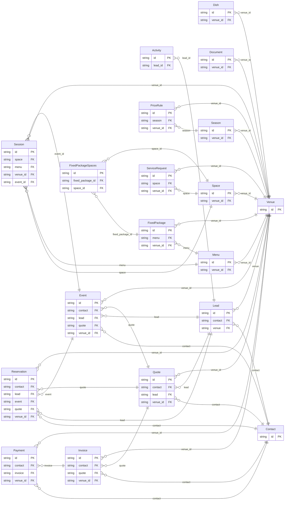

<!-- Code generated by protoc-gen-store. DO NOT EDIT. -->

# `aperio/` — Prisma schema

Generated from Protobuf by protoc-gen-store. Source of truth is the `.proto` files — regenerate rather than editing.

| Models | Enums |
| ---: | ---: |
| 19 | 26 |

## Entity relationships

## Subfolders

- [`catalog/`](./catalog/README.md)
- [`document/`](./document/README.md)
- [`event/`](./event/README.md)
- [`finance/`](./finance/README.md)
- [`guest/`](./guest/README.md)
- [`operations/`](./operations/README.md)
- [`pricing/`](./pricing/README.md)
- [`sales/`](./sales/README.md)
- [`stay/`](./stay/README.md)
- [`type/`](./type/README.md)
- [`venue/`](./venue/README.md)
