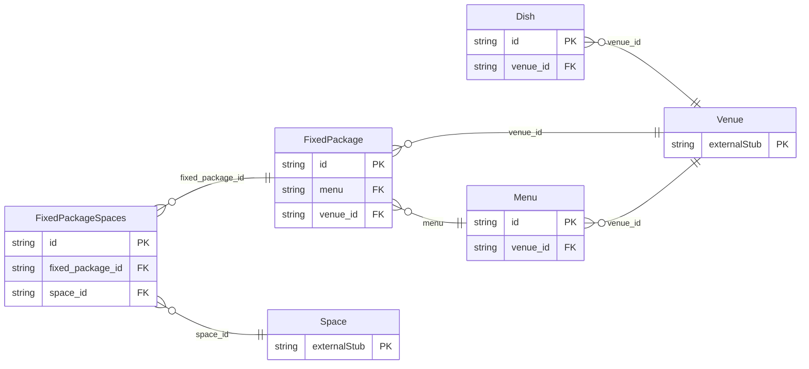

<!-- Code generated by protoc-gen-store. DO NOT EDIT. -->

# `aperio/catalog/catalog/` — Prisma schema

Generated from Protobuf by protoc-gen-store. Source of truth is the `.proto` files — regenerate rather than editing.

| Models | Enums |
| ---: | ---: |
| 4 | 0 |

## Entity relationships

Schema file: [`catalog.postgres.prisma`](./catalog.postgres.prisma)

### `Dish` → `dishes`

A Dish is one item a venue's kitchen makes: paneer tikka, dal makhani, a live chaat counter, a mocktail. It is the catalogue menus are made from, so a dish is described once -- its course, the diets it suits, its allergens -- and every menu that offers it says the same. A dish has its own price only when it is sold on its own: à la carte, room service, an add-on to a menu.

| Column | Type | Null |
| --- | --- | --- |
| `id` | `CHAR(26)` | not null |
| `name` | `VARCHAR(255)` | not null |
| `display_name` | `VARCHAR(255)` | not null |
| `description` | `VARCHAR(255)` | nullable |
| `course` | `Course` | not null |
| `cuisine` | `VARCHAR(255)` | nullable |
| `diets` | `` | nullable |
| `allergens` | `` | nullable |
| `price` | `JSONB` | nullable |
| `tax` | `JSONB` | nullable |
| `image_uri` | `VARCHAR(255)` | nullable |
| `available` | `BOOLEAN` | nullable |
| `create_time` | `TIMESTAMPTZ` | not null |
| `update_time` | `TIMESTAMPTZ` | not null |
| `etag` | `VARCHAR(255)` | nullable |
| `venue_id` | `CHAR(26)` | not null |

### `Menu` → `menus`

A Menu is a plate menu sold for events at a price per plate: "Silver Vegetarian -- 2 welcome drinks, any 3 of 6 starters, 4 mains, breads, rice, 2 desserts". It is a set of courses, each a choice among dishes, with add-ons priced per plate on top. Its plate_price is the base price. What a plate costs on a given date is the base price with the venue's price rules applied (PriceRule), so a wedding-season surcharge needs no edit to the menu.

| Column | Type | Null |
| --- | --- | --- |
| `id` | `CHAR(26)` | not null |
| `name` | `VARCHAR(255)` | not null |
| `display_name` | `VARCHAR(255)` | not null |
| `description` | `VARCHAR(255)` | nullable |
| `diets` | `` | nullable |
| `courses` | `JSONB` | not null |
| `add_ons` | `JSONB` | nullable |
| `plate_price` | `JSONB` | not null |
| `min_plates` | `INTEGER` | nullable |
| `tax` | `JSONB` | not null |
| `active` | `BOOLEAN` | nullable |
| `create_time` | `TIMESTAMPTZ` | not null |
| `update_time` | `TIMESTAMPTZ` | not null |
| `etag` | `VARCHAR(255)` | nullable |
| `venue_id` | `CHAR(26)` | not null |

### `FixedPackage` → `fixed_packages`

A FixedPackage is a fixed-price bundle: "Wedding Gold -- the ballroom for 8 hours, stage and floral decor, DJ, 300 plates of Silver Vegetarian". It includes so many guests, and charges each guest beyond them. Its price is the base price; what it costs on a date is the base price with the venue's price rules applied, as a menu's is.

| Column | Type | Null |
| --- | --- | --- |
| `id` | `CHAR(26)` | not null |
| `name` | `VARCHAR(255)` | not null |
| `display_name` | `VARCHAR(255)` | not null |
| `description` | `VARCHAR(255)` | nullable |
| `duration` | `INTERVAL` | nullable |
| `menu` | `VARCHAR(255)` | nullable |
| `inclusions` | `JSONB` | nullable |
| `included_guests` | `INTEGER` | not null |
| `price` | `JSONB` | not null |
| `extra_guest_price` | `JSONB` | nullable |
| `tax` | `JSONB` | not null |
| `active` | `BOOLEAN` | nullable |
| `create_time` | `TIMESTAMPTZ` | not null |
| `update_time` | `TIMESTAMPTZ` | not null |
| `etag` | `VARCHAR(255)` | nullable |
| `venue_id` | `CHAR(26)` | not null |

### `FixedPackageSpaces` → `fixed_package_spaces`

Join table for the many-to-many relation FixedPackage.spaces ↔ Space.

| Column | Type | Null |
| --- | --- | --- |
| `id` | `CHAR(26)` | not null |
| `fixed_package_id` | `CHAR(26)` | not null |
| `space_id` | `CHAR(26)` | not null |
| `space_name` | `TEXT` | not null |
