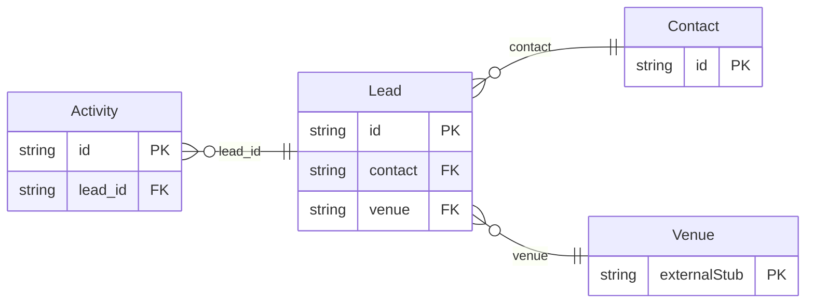

<!-- Code generated by protoc-gen-store. DO NOT EDIT. -->

# `aperio/crm/crm/` — Prisma schema

Generated from Protobuf by protoc-gen-store. Source of truth is the `.proto` files — regenerate rather than editing.

| Models | Enums |
| ---: | ---: |
| 3 | 0 |

## Entity relationships

Schema file: [`crm.postgres.prisma`](./crm.postgres.prisma)

### `Contact` → `contacts`

A Contact is a person or a company aperio deals with: a guest, a couple booking their wedding, a company booking an offsite, an agent. Leads, bookings, quotes, invoices and payments all name one, so a guest who comes back is the same contact with their history. A person's name and address are OpenTravel's PersonName and Address, the shapes channels send guests in, so a booking from Booking.com fills a contact without translation.

| Column | Type | Null |
| --- | --- | --- |
| `id` | `CHAR(26)` | not null |
| `name` | `VARCHAR(255)` | not null |
| `kind` | `ContactKind` | not null |
| `display_name` | `VARCHAR(255)` | not null |
| `name_parts` | `JSONB` | nullable |
| `company_display_name` | `VARCHAR(255)` | nullable |
| `phones` | `JSONB` | nullable |
| `emails` | `VARCHAR(255)[]` | nullable |
| `addresses` | `JSONB` | nullable |
| `gst` | `JSONB` | nullable |
| `dietary_requirements` | `JSONB` | nullable |
| `marketing_consent` | `BOOLEAN` | nullable |
| `tags` | `VARCHAR(255)[]` | nullable |
| `notes` | `VARCHAR(255)` | nullable |
| `create_time` | `TIMESTAMPTZ` | not null |
| `update_time` | `TIMESTAMPTZ` | not null |
| `etag` | `VARCHAR(255)` | nullable |

### `Lead` → `leads`

A Lead is an enquiry that may become a booking: a couple asking about a December wedding, a company asking for an offsite with forty rooms, a family asking about a week at the resort. It covers both venues and every kind of booking -- a stay, an event, or both, as a wedding with rooms for its guests is. A lead moves through a sales pipeline, from NEW to WON or LOST, owned by one salesperson with a follow-up date. While it is negotiated its dates can be held in freebusy (`hold`), so they are not sold under it; winning it turns the accepted quote into the booking.

| Column | Type | Null |
| --- | --- | --- |
| `id` | `CHAR(26)` | not null |
| `name` | `VARCHAR(255)` | not null |
| `display_name` | `VARCHAR(255)` | not null |
| `contact` | `CHAR(26)` | not null |
| `venue` | `CHAR(26)` | nullable |
| `kind` | `LeadKind` | not null |
| `event_type` | `EventType` | nullable |
| `source` | `Channel` | nullable |
| `source_detail` | `VARCHAR(255)` | nullable |
| `stage` | `Stage` | nullable |
| `dates` | `JSONB` | nullable |
| `dates_flexible` | `BOOLEAN` | nullable |
| `guests` | `INTEGER` | nullable |
| `rooms` | `INTEGER` | nullable |
| `budget` | `JSONB` | nullable |
| `requirements` | `VARCHAR(255)` | nullable |
| `owner` | `VARCHAR(255)` | nullable |
| `next_follow_up_time` | `TIMESTAMPTZ` | nullable |
| `lost_reason` | `LostReason` | nullable |
| `lost_detail` | `VARCHAR(255)` | nullable |
| `hold` | `VARCHAR(255)` | nullable |
| `bookings` | `VARCHAR(255)[]` | nullable |
| `close_time` | `TIMESTAMPTZ` | nullable |
| `create_time` | `TIMESTAMPTZ` | not null |
| `update_time` | `TIMESTAMPTZ` | not null |
| `etag` | `VARCHAR(255)` | nullable |

### `Activity` → `activities`

An Activity is one touch on a lead: a call, a WhatsApp, a site visit, a quote sent. The activities of a lead are its history, newest first.

| Column | Type | Null |
| --- | --- | --- |
| `id` | `CHAR(26)` | not null |
| `name` | `VARCHAR(255)` | not null |
| `kind` | `ActivityKind` | not null |
| `occur_time` | `TIMESTAMPTZ` | not null |
| `summary` | `VARCHAR(255)` | not null |
| `details` | `VARCHAR(255)` | nullable |
| `author` | `VARCHAR(255)` | nullable |
| `create_time` | `TIMESTAMPTZ` | not null |
| `update_time` | `TIMESTAMPTZ` | not null |
| `etag` | `VARCHAR(255)` | nullable |
| `lead_id` | `CHAR(26)` | not null |
