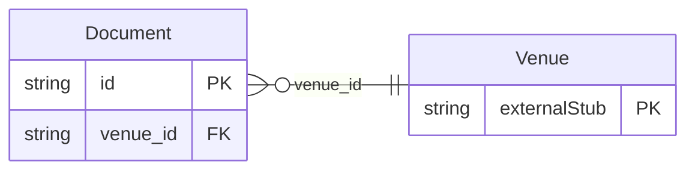

<!-- Code generated by protoc-gen-store. DO NOT EDIT. -->

# `aperio/document/document/` — Prisma schema

Generated from Protobuf by protoc-gen-store. Source of truth is the `.proto` files — regenerate rather than editing.

| Models | Enums |
| ---: | ---: |
| 1 | 2 |

## Entity relationships

Schema file: [`document.postgres.prisma`](./document.postgres.prisma)

### `Document` → `resource`

A Document is a file kept at a venue: the floor plan of the ballroom, the parking layout, the Wi-Fi and network sheet, the fire licence, a signed contract, a guest's ID at check-in, the menu card. The file is in object storage; the document is its record -- what it is, what it is about, who may see it, and when it lapses -- so a venue's papers are found in one place, by category or by what they concern.

| Column | Type | Null |
| --- | --- | --- |
| `id` | `CHAR(26)` | not null |
| `name` | `VARCHAR(255)` | not null |
| `display_name` | `VARCHAR(255)` | not null |
| `category` | `Category` | not null |
| `subject` | `VARCHAR(255)` | nullable |
| `uri` | `VARCHAR(255)` | not null |
| `mime_type` | `VARCHAR(255)` | nullable |
| `size_bytes` | `BIGINT` | nullable |
| `sha256` | `VARCHAR(255)` | nullable |
| `visibility` | `Visibility` | nullable |
| `expiry_date` | `DATE` | nullable |
| `tags` | `VARCHAR(255)[]` | nullable |
| `notes` | `VARCHAR(255)` | nullable |
| `create_time` | `TIMESTAMPTZ` | not null |
| `update_time` | `TIMESTAMPTZ` | not null |
| `etag` | `VARCHAR(255)` | nullable |
| `venue_id` | `CHAR(26)` | not null |

### Enums

- `Category`: FLOOR_PLAN, PARKING, IT_NETWORK, SAFETY, LICENCE, INSURANCE, CONTRACT, IDENTITY, MENU, BROCHURE, MEDIA, OTHER
- `Visibility`: STAFF, GUEST, PUBLIC
