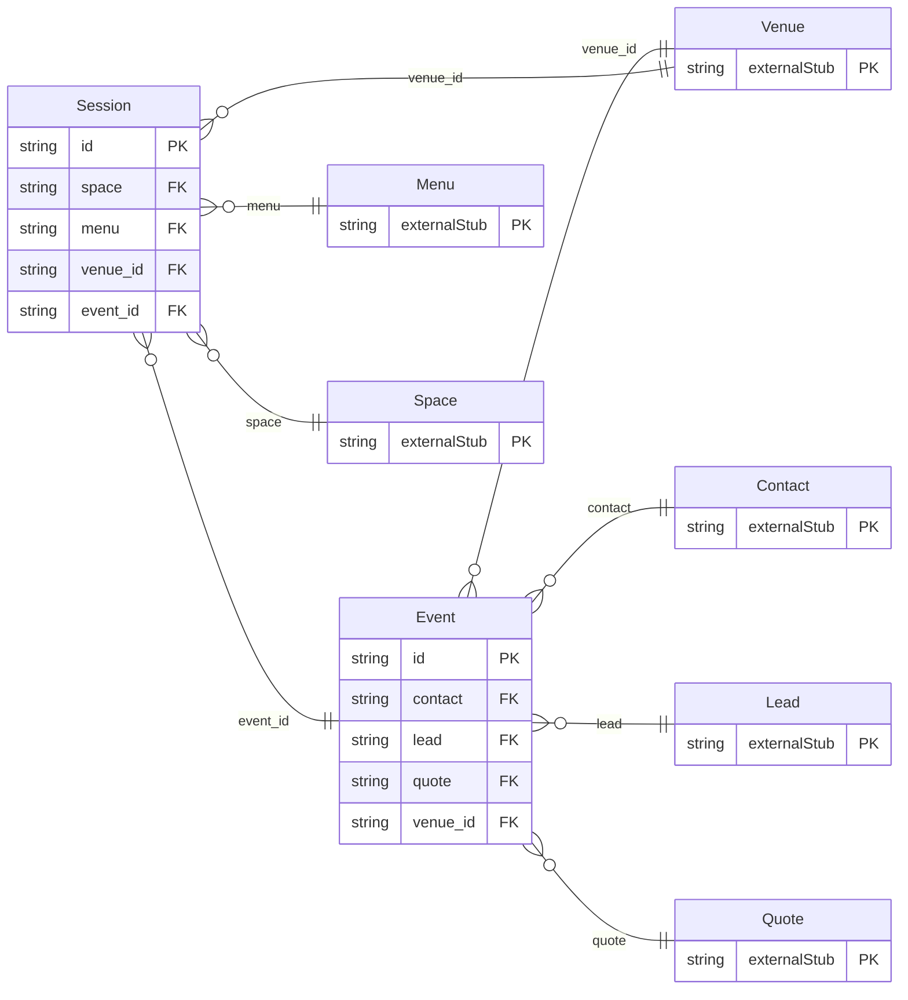

<!-- Code generated by protoc-gen-store. DO NOT EDIT. -->

# `aperio/event/event/` — Prisma schema

Generated from Protobuf by protoc-gen-store. Source of truth is the `.proto` files — regenerate rather than editing.

| Models | Enums |
| ---: | ---: |
| 2 | 1 |

## Entity relationships

Schema file: [`event.postgres.prisma`](./event.postgres.prisma)

### `Event` → `resource`

An Event is an occasion held at a venue: a wedding, a conference, a birthday. It is the booking a hall lead becomes, and it may run over days, as its sessions do -- a wedding is a mehendi, a sangeet, a ceremony and a reception, each in its own space at its own time. Rooms for its guests are reservations naming the event.

| Column | Type | Null |
| --- | --- | --- |
| `id` | `CHAR(26)` | not null |
| `name` | `VARCHAR(255)` | not null |
| `display_name` | `VARCHAR(255)` | not null |
| `contact` | `CHAR(26)` | not null |
| `lead` | `CHAR(26)` | nullable |
| `event_type` | `EventType` | not null |
| `state` | `EventState` | nullable |
| `dates` | `JSONB` | not null |
| `guests` | `INTEGER` | nullable |
| `quote` | `VARCHAR(255)` | nullable |
| `special_requests` | `JSONB` | nullable |
| `coordinator` | `VARCHAR(255)` | nullable |
| `notes` | `VARCHAR(255)` | nullable |
| `cancel_reason` | `VARCHAR(255)` | nullable |
| `cancel_time` | `TIMESTAMPTZ` | nullable |
| `create_time` | `TIMESTAMPTZ` | not null |
| `update_time` | `TIMESTAMPTZ` | not null |
| `etag` | `VARCHAR(255)` | nullable |
| `venue_id` | `CHAR(26)` | not null |

### `Session` → `sessions`

A Session is one part of an event, in one space at one time -- what an Indian wedding calls a function: the sangeet on the lawn on Friday evening, the reception in the ballroom on Saturday night; a conference's keynote and its gala dinner. Each has its own layout, headcount and menu, and its own dietary counts for the kitchen. (Not "Function": that word is reserved in too many languages to be a field name.)

| Column | Type | Null |
| --- | --- | --- |
| `id` | `CHAR(26)` | not null |
| `name` | `VARCHAR(255)` | not null |
| `display_name` | `VARCHAR(255)` | not null |
| `event_type` | `EventType` | nullable |
| `space` | `VARCHAR(255)` | not null |
| `start_time` | `TIMESTAMPTZ` | not null |
| `end_time` | `TIMESTAMPTZ` | not null |
| `setup_time` | `TIMESTAMPTZ` | nullable |
| `teardown_time` | `TIMESTAMPTZ` | nullable |
| `layout` | `Layout` | nullable |
| `guests` | `INTEGER` | not null |
| `guaranteed_guests` | `INTEGER` | nullable |
| `menu` | `VARCHAR(255)` | nullable |
| `dietary_requirements` | `JSONB` | nullable |
| `special_requests` | `JSONB` | nullable |
| `freebusy_reservation` | `VARCHAR(255)` | nullable |
| `notes` | `VARCHAR(255)` | nullable |
| `create_time` | `TIMESTAMPTZ` | not null |
| `update_time` | `TIMESTAMPTZ` | not null |
| `etag` | `VARCHAR(255)` | nullable |
| `venue_id` | `CHAR(26)` | not null |
| `event_id` | `CHAR(26)` | not null |

### Enums

- `EventState`: TENTATIVE, CONFIRMED, COMPLETED, CANCELLED
