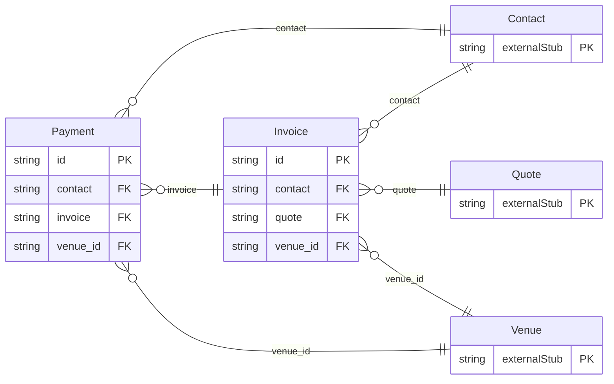

<!-- Code generated by protoc-gen-store. DO NOT EDIT. -->

# `aperio/finance/finance/` — Prisma schema

Generated from Protobuf by protoc-gen-store. Source of truth is the `.proto` files — regenerate rather than editing.

| Models | Enums |
| ---: | ---: |
| 2 | 2 |

## Entity relationships

Schema file: [`finance.postgres.prisma`](./finance.postgres.prisma)

### `Invoice` → `invoices`

An Invoice is a GST document a venue issues: a tax invoice for what it supplied, a proforma before it, a receipt for an advance, or a credit note correcting an issued invoice. A draft is edited freely. IssueInvoice gives it the next number in the venue's series, dates it and fixes it: an issued invoice never changes, and a mistake in one is corrected by a credit note (CreditInvoice), as the law requires. Each line carries its HSN or SAC code and rate; the GST is split into CGST and SGST when the place of supply is in the venue's state, and charged as IGST when it is not.

| Column | Type | Null |
| --- | --- | --- |
| `id` | `CHAR(26)` | not null |
| `name` | `VARCHAR(255)` | not null |
| `number` | `VARCHAR(255)` | nullable |
| `kind` | `InvoiceKind` | not null |
| `state` | `InvoiceState` | nullable |
| `contact` | `CHAR(26)` | not null |
| `buyer_gst` | `JSONB` | nullable |
| `billing_address` | `JSONB` | nullable |
| `booking` | `VARCHAR(255)` | nullable |
| `quote` | `VARCHAR(255)` | nullable |
| `corrects` | `VARCHAR(255)` | nullable |
| `supply_state_code` | `VARCHAR(255)` | not null |
| `lines` | `JSONB` | not null |
| `taxable_total` | `JSONB` | nullable |
| `cgst` | `JSONB` | nullable |
| `sgst` | `JSONB` | nullable |
| `igst` | `JSONB` | nullable |
| `total` | `JSONB` | nullable |
| `paid` | `JSONB` | nullable |
| `due` | `JSONB` | nullable |
| `issue_date` | `DATE` | nullable |
| `due_date` | `DATE` | nullable |
| `irn` | `VARCHAR(255)` | nullable |
| `notes` | `VARCHAR(255)` | nullable |
| `cancel_reason` | `VARCHAR(255)` | nullable |
| `create_time` | `TIMESTAMPTZ` | not null |
| `update_time` | `TIMESTAMPTZ` | not null |
| `etag` | `VARCHAR(255)` | nullable |
| `venue_id` | `CHAR(26)` | not null |

### `Payment` → `payments`

A Payment is one movement of money between a venue and a guest: an advance through the payment gateway, a balance in cash at check-out, a bank transfer from a company, an amount a channel collected, or a refund. It is a ledger: payments are recorded, never edited away, and what a guest owes is what their invoices total less what their payments do. A payment may be in any currency; exchange_rate converts it to the venue's, and base_amount is what the books count. The gateway writes its payments itself, from its webhook; everything paid another way is recorded by staff.

| Column | Type | Null |
| --- | --- | --- |
| `id` | `CHAR(26)` | not null |
| `name` | `VARCHAR(255)` | not null |
| `contact` | `CHAR(26)` | not null |
| `invoice` | `VARCHAR(255)` | nullable |
| `booking` | `VARCHAR(255)` | nullable |
| `kind` | `PaymentKind` | not null |
| `method` | `PaymentMethod` | not null |
| `channel` | `Channel` | nullable |
| `amount` | `JSONB` | not null |
| `exchange_rate` | `NUMERIC` | nullable |
| `base_amount` | `JSONB` | nullable |
| `state` | `PaymentState` | nullable |
| `gateway` | `VARCHAR(255)` | nullable |
| `gateway_reference` | `VARCHAR(255)` | nullable |
| `reference` | `VARCHAR(255)` | nullable |
| `receive_time` | `TIMESTAMPTZ` | nullable |
| `recorder` | `VARCHAR(255)` | nullable |
| `refunds` | `VARCHAR(255)` | nullable |
| `notes` | `VARCHAR(255)` | nullable |
| `create_time` | `TIMESTAMPTZ` | not null |
| `update_time` | `TIMESTAMPTZ` | not null |
| `etag` | `VARCHAR(255)` | nullable |
| `venue_id` | `CHAR(26)` | not null |

### Enums

- `InvoiceState`: DRAFT, ISSUED, PAID, CANCELLED
- `PaymentState`: PENDING, SUCCEEDED, FAILED, VOIDED
