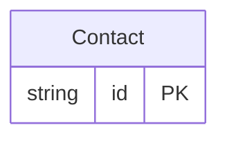

<!-- Code generated by protoc-gen-store. DO NOT EDIT. -->

# `aperio/guest/guest/` — Prisma schema

Generated from Protobuf by protoc-gen-store. Source of truth is the `.proto` files — regenerate rather than editing.

| Models | Enums |
| ---: | ---: |
| 1 | 0 |

## Entity relationships

Schema file: [`guest.postgres.prisma`](./guest.postgres.prisma)

### `Contact` → `contacts`

A Contact is a person or a company aperio deals with: a guest, a couple booking their wedding, a company booking an offsite, an agent. Leads, bookings, quotes, invoices and payments all name one, so a guest who comes back is the same contact with their history. A person's name and address are OpenTravel's PersonName and Address, the shapes channels send guests in, so a booking from Booking.com fills a contact without translation.

| Column | Type | Null |
| --- | --- | --- |
| `id` | `CHAR(26)` | not null |
| `name` | `VARCHAR(255)` | not null |
| `kind` | `ContactKind` | not null |
| `display_name` | `VARCHAR(255)` | not null |
| `name_parts` | `JSONB` | nullable |
| `company_display_name` | `VARCHAR(255)` | nullable |
| `phones` | `JSONB` | nullable |
| `emails` | `VARCHAR(255)[]` | nullable |
| `addresses` | `JSONB` | nullable |
| `gst` | `JSONB` | nullable |
| `dietary_requirements` | `JSONB` | nullable |
| `marketing_consent` | `BOOLEAN` | nullable |
| `tags` | `VARCHAR(255)[]` | nullable |
| `notes` | `VARCHAR(255)` | nullable |
| `create_time` | `TIMESTAMPTZ` | not null |
| `update_time` | `TIMESTAMPTZ` | not null |
| `etag` | `VARCHAR(255)` | nullable |
| `phone_numbers` | `VARCHAR(255)[]` | nullable |
