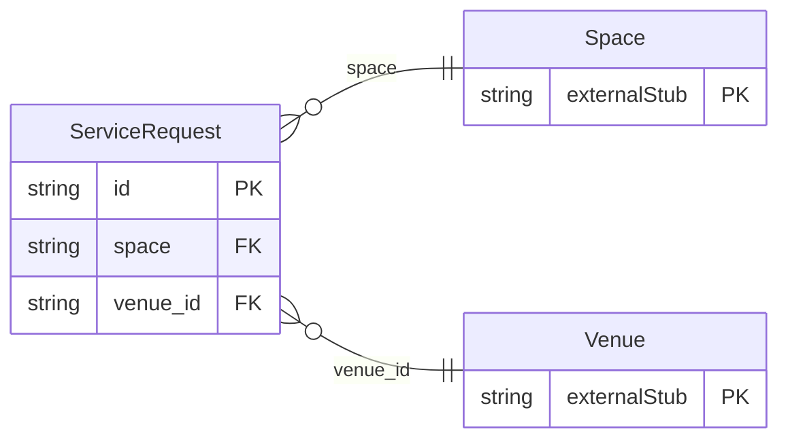

<!-- Code generated by protoc-gen-store. DO NOT EDIT. -->

# `aperio/operations/operations/` — Prisma schema

Generated from Protobuf by protoc-gen-store. Source of truth is the `.proto` files — regenerate rather than editing.

| Models | Enums |
| ---: | ---: |
| 1 | 3 |

## Entity relationships

Schema file: [`operations.postgres.prisma`](./operations.postgres.prisma)

### `ServiceRequest` → `service_requests`

A ServiceRequest is something wanted in a room, now or by a time: four black coffees and six waters to Conference Room B, extra chairs on the lawn, a fused bulb in 204, a cake to the bridal suite at midnight. It goes to one department, which is told the moment it is made -- each change is an event (aperio.operations.service_request.*) delivered to the staff's phones or a pantry screen -- and is worked through ACKNOWLEDGED, IN_PROGRESS and DONE, so nobody walks up and down to ask. A guest's request is charged to their booking; a meeting's is not.

| Column | Type | Null |
| --- | --- | --- |
| `id` | `CHAR(26)` | not null |
| `name` | `VARCHAR(255)` | not null |
| `summary` | `VARCHAR(255)` | not null |
| `department` | `Department` | not null |
| `space` | `VARCHAR(255)` | nullable |
| `location` | `VARCHAR(255)` | nullable |
| `items` | `JSONB` | nullable |
| `priority` | `Priority` | nullable |
| `due_time` | `TIMESTAMPTZ` | nullable |
| `requester` | `VARCHAR(255)` | nullable |
| `assignee` | `VARCHAR(255)` | nullable |
| `booking` | `VARCHAR(255)` | nullable |
| `charge` | `JSONB` | nullable |
| `state` | `OperationsState` | nullable |
| `notes` | `VARCHAR(255)` | nullable |
| `acknowledge_time` | `TIMESTAMPTZ` | nullable |
| `complete_time` | `TIMESTAMPTZ` | nullable |
| `create_time` | `TIMESTAMPTZ` | not null |
| `update_time` | `TIMESTAMPTZ` | not null |
| `etag` | `VARCHAR(255)` | nullable |
| `venue_id` | `CHAR(26)` | not null |

### Enums

- `Department`: PANTRY, KITCHEN, HOUSEKEEPING, MAINTENANCE, IT_AV, FRONT_DESK, BANQUET, SECURITY
- `Priority`: LOW, NORMAL, URGENT
- `OperationsState`: OPEN, ACKNOWLEDGED, IN_PROGRESS, DONE, CANCELLED
