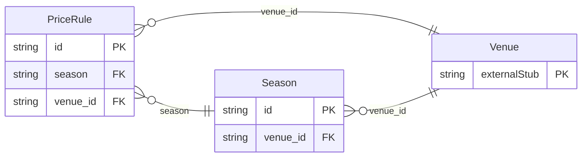

<!-- Code generated by protoc-gen-store. DO NOT EDIT. -->

# `aperio/pricing/pricing/` — Prisma schema

Generated from Protobuf by protoc-gen-store. Source of truth is the `.proto` files — regenerate rather than editing.

| Models | Enums |
| ---: | ---: |
| 2 | 1 |

## Entity relationships

Schema file: [`pricing.postgres.prisma`](./pricing.postgres.prisma)

### `Season` → `seasons`

A Season is a named set of dates prices change on: "Wedding season" (November to February), "Diwali week", "Monsoon", "Weekends". Seasons say when; price rules say how much. A season that recurs yearly is matched on month and day, so "Wedding season, 1 Nov -- 28 Feb" is next year's too without anyone editing it.

| Column | Type | Null |
| --- | --- | --- |
| `id` | `CHAR(26)` | not null |
| `name` | `VARCHAR(255)` | not null |
| `display_name` | `VARCHAR(255)` | not null |
| `dates` | `JSONB` | nullable |
| `recurs_yearly` | `BOOLEAN` | nullable |
| `weekdays` | `` | nullable |
| `create_time` | `TIMESTAMPTZ` | not null |
| `update_time` | `TIMESTAMPTZ` | not null |
| `etag` | `VARCHAR(255)` | nullable |
| `venue_id` | `CHAR(26)` | not null |

### `PriceRule` → `price_rules`

A PriceRule changes the price of what a venue sells in a season: "plate menus +15% in wedding season", "the ballroom ₹2,50,000 on weekends", "Deluxe rooms -20% in monsoon", "₹100 off a plate above 500 guests". Prices are never stored per date. The price of anything on a date is its base price with the one matching rule of the highest priority applied -- matching its target, its season and its guest count -- so prices change on their own as the seasons turn, and changing a rule changes every price it covers at once. A quote fixes its prices when it is sent, so a later rule does not change what a guest was offered.

| Column | Type | Null |
| --- | --- | --- |
| `id` | `CHAR(26)` | not null |
| `name` | `VARCHAR(255)` | not null |
| `display_name` | `VARCHAR(255)` | not null |
| `season` | `VARCHAR(255)` | nullable |
| `target` | `PriceTarget` | not null |
| `min_guests` | `INTEGER` | nullable |
| `fixed_price` | `JSONB` | nullable |
| `percent` | `NUMERIC` | nullable |
| `amount` | `JSONB` | nullable |
| `priority` | `INTEGER` | nullable |
| `active` | `BOOLEAN` | nullable |
| `create_time` | `TIMESTAMPTZ` | not null |
| `update_time` | `TIMESTAMPTZ` | not null |
| `etag` | `VARCHAR(255)` | nullable |
| `adjustment_case` | `PriceRuleAdjustmentCase` | nullable |
| `venue_id` | `CHAR(26)` | not null |
| `items` | `VARCHAR(255)[]` | nullable |

### Enums

- `PriceRuleAdjustmentCase`: FIXED_PRICE, PERCENT, AMOUNT
