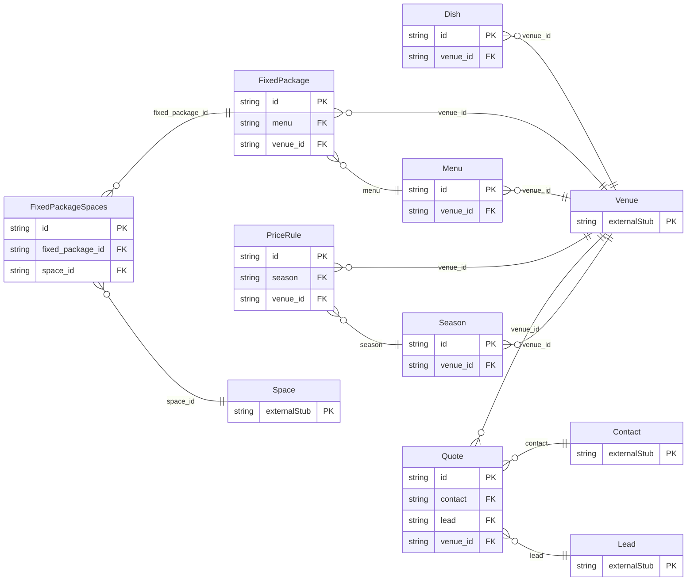

<!-- Code generated by protoc-gen-store. DO NOT EDIT. -->

# `aperio/sales/sales/` — Prisma schema

Generated from Protobuf by protoc-gen-store. Source of truth is the `.proto` files — regenerate rather than editing.

| Models | Enums |
| ---: | ---: |
| 7 | 2 |

## Entity relationships

Schema file: [`sales.postgres.prisma`](./sales.postgres.prisma)

### `Dish` → `dishes`

A Dish is one item a venue's kitchen makes: paneer tikka, dal makhani, a live chaat counter, a mocktail. It is the catalogue menus are made from, so a dish is described once -- its course, the diets it suits, its allergens -- and every menu that offers it says the same. A dish has its own price only when it is sold on its own: à la carte, room service, an add-on to a menu.

| Column | Type | Null |
| --- | --- | --- |
| `id` | `CHAR(26)` | not null |
| `name` | `VARCHAR(255)` | not null |
| `display_name` | `VARCHAR(255)` | not null |
| `description` | `VARCHAR(255)` | nullable |
| `course` | `Course` | not null |
| `cuisine` | `VARCHAR(255)` | nullable |
| `diets` | `` | nullable |
| `allergens` | `` | nullable |
| `price` | `JSONB` | nullable |
| `tax` | `JSONB` | nullable |
| `image_uri` | `VARCHAR(255)` | nullable |
| `available` | `BOOLEAN` | nullable |
| `create_time` | `TIMESTAMPTZ` | not null |
| `update_time` | `TIMESTAMPTZ` | not null |
| `etag` | `VARCHAR(255)` | nullable |
| `venue_id` | `CHAR(26)` | not null |

### `Menu` → `menus`

A Menu is a plate menu sold for events at a price per plate: "Silver Vegetarian -- 2 welcome drinks, any 3 of 6 starters, 4 mains, breads, rice, 2 desserts". It is a set of courses, each a choice among dishes, with add-ons priced per plate on top. Its plate_price is the base price. What a plate costs on a given date is the base price with the venue's price rules applied (PriceRule), so a wedding-season surcharge needs no edit to the menu.

| Column | Type | Null |
| --- | --- | --- |
| `id` | `CHAR(26)` | not null |
| `name` | `VARCHAR(255)` | not null |
| `display_name` | `VARCHAR(255)` | not null |
| `description` | `VARCHAR(255)` | nullable |
| `diets` | `` | nullable |
| `courses` | `JSONB` | not null |
| `add_ons` | `JSONB` | nullable |
| `plate_price` | `JSONB` | not null |
| `min_plates` | `INTEGER` | nullable |
| `tax` | `JSONB` | not null |
| `active` | `BOOLEAN` | nullable |
| `create_time` | `TIMESTAMPTZ` | not null |
| `update_time` | `TIMESTAMPTZ` | not null |
| `etag` | `VARCHAR(255)` | nullable |
| `venue_id` | `CHAR(26)` | not null |

### `FixedPackage` → `fixed_packages`

A FixedPackage is a fixed-price bundle: "Wedding Gold -- the ballroom for 8 hours, stage and floral decor, DJ, 300 plates of Silver Vegetarian". It includes so many guests, and charges each guest beyond them. Its price is the base price; what it costs on a date is the base price with the venue's price rules applied, as a menu's is.

| Column | Type | Null |
| --- | --- | --- |
| `id` | `CHAR(26)` | not null |
| `name` | `VARCHAR(255)` | not null |
| `display_name` | `VARCHAR(255)` | not null |
| `description` | `VARCHAR(255)` | nullable |
| `duration` | `INTERVAL` | nullable |
| `menu` | `VARCHAR(255)` | nullable |
| `inclusions` | `JSONB` | nullable |
| `included_guests` | `INTEGER` | not null |
| `price` | `JSONB` | not null |
| `extra_guest_price` | `JSONB` | nullable |
| `tax` | `JSONB` | not null |
| `active` | `BOOLEAN` | nullable |
| `create_time` | `TIMESTAMPTZ` | not null |
| `update_time` | `TIMESTAMPTZ` | not null |
| `etag` | `VARCHAR(255)` | nullable |
| `venue_id` | `CHAR(26)` | not null |

### `Season` → `seasons`

A Season is a named set of dates prices change on: "Wedding season" (November to February), "Diwali week", "Monsoon", "Weekends". Seasons say when; price rules say how much. A season that recurs yearly is matched on month and day, so "Wedding season, 1 Nov -- 28 Feb" is next year's too without anyone editing it.

| Column | Type | Null |
| --- | --- | --- |
| `id` | `CHAR(26)` | not null |
| `name` | `VARCHAR(255)` | not null |
| `display_name` | `VARCHAR(255)` | not null |
| `dates` | `JSONB` | nullable |
| `recurs_yearly` | `BOOLEAN` | nullable |
| `weekdays` | `` | nullable |
| `create_time` | `TIMESTAMPTZ` | not null |
| `update_time` | `TIMESTAMPTZ` | not null |
| `etag` | `VARCHAR(255)` | nullable |
| `venue_id` | `CHAR(26)` | not null |

### `PriceRule` → `price_rules`

A PriceRule changes the price of what a venue sells in a season: "plate menus +15% in wedding season", "the ballroom ₹2,50,000 on weekends", "Deluxe rooms -20% in monsoon", "₹100 off a plate above 500 guests". Prices are never stored per date. The price of anything on a date is its base price with the one matching rule of the highest priority applied -- matching its target, its season and its guest count -- so prices change on their own as the seasons turn, and changing a rule changes every price it covers at once. A quote fixes its prices when it is sent, so a later rule does not change what a guest was offered.

| Column | Type | Null |
| --- | --- | --- |
| `id` | `CHAR(26)` | not null |
| `name` | `VARCHAR(255)` | not null |
| `display_name` | `VARCHAR(255)` | not null |
| `season` | `VARCHAR(255)` | nullable |
| `target` | `PriceTarget` | not null |
| `min_guests` | `INTEGER` | nullable |
| `fixed_price` | `JSONB` | nullable |
| `percent` | `NUMERIC` | nullable |
| `amount` | `JSONB` | nullable |
| `priority` | `INTEGER` | nullable |
| `active` | `BOOLEAN` | nullable |
| `create_time` | `TIMESTAMPTZ` | not null |
| `update_time` | `TIMESTAMPTZ` | not null |
| `etag` | `VARCHAR(255)` | nullable |
| `adjustment_case` | `PriceRuleAdjustmentCase` | nullable |
| `venue_id` | `CHAR(26)` | not null |
| `items` | `VARCHAR(255)[]` | nullable |

### `Quote` → `quotes`

A Quote is a priced proposal to a guest: the spaces, rooms, menus and packages they asked for, at the prices of their dates, with GST. A lead usually has several, one superseding the next as the negotiation goes; accepting one makes the booking. A draft's line prices follow the price rules as they change. Sending the quote fixes them, so the guest is held to what they were offered and no rule changed after can change it.

| Column | Type | Null |
| --- | --- | --- |
| `id` | `CHAR(26)` | not null |
| `name` | `VARCHAR(255)` | not null |
| `display_name` | `VARCHAR(255)` | not null |
| `contact` | `CHAR(26)` | not null |
| `lead` | `CHAR(26)` | nullable |
| `supersedes` | `VARCHAR(255)` | nullable |
| `state` | `SalesState` | nullable |
| `event_type` | `EventType` | nullable |
| `dates` | `JSONB` | not null |
| `guests` | `INTEGER` | nullable |
| `lines` | `JSONB` | not null |
| `supply_state_code` | `VARCHAR(255)` | nullable |
| `subtotal` | `JSONB` | nullable |
| `tax_total` | `JSONB` | nullable |
| `total` | `JSONB` | nullable |
| `advance` | `JSONB` | nullable |
| `terms` | `VARCHAR(255)` | nullable |
| `expire_time` | `TIMESTAMPTZ` | nullable |
| `send_time` | `TIMESTAMPTZ` | nullable |
| `accept_time` | `TIMESTAMPTZ` | nullable |
| `booking` | `VARCHAR(255)` | nullable |
| `decline_reason` | `VARCHAR(255)` | nullable |
| `create_time` | `TIMESTAMPTZ` | not null |
| `update_time` | `TIMESTAMPTZ` | not null |
| `etag` | `VARCHAR(255)` | nullable |
| `ttl` | `INTERVAL` | nullable |
| `venue_id` | `CHAR(26)` | not null |

### `FixedPackageSpaces` → `fixed_package_spaces`

Join table for the many-to-many relation FixedPackage.spaces ↔ Space.

| Column | Type | Null |
| --- | --- | --- |
| `id` | `CHAR(26)` | not null |
| `fixed_package_id` | `CHAR(26)` | not null |
| `space_id` | `CHAR(26)` | not null |
| `space_name` | `TEXT` | not null |

### Enums

- `PriceRuleAdjustmentCase`: FIXED_PRICE, PERCENT, AMOUNT
- `SalesState`: DRAFT, SENT, ACCEPTED, DECLINED, EXPIRED, SUPERSEDED
