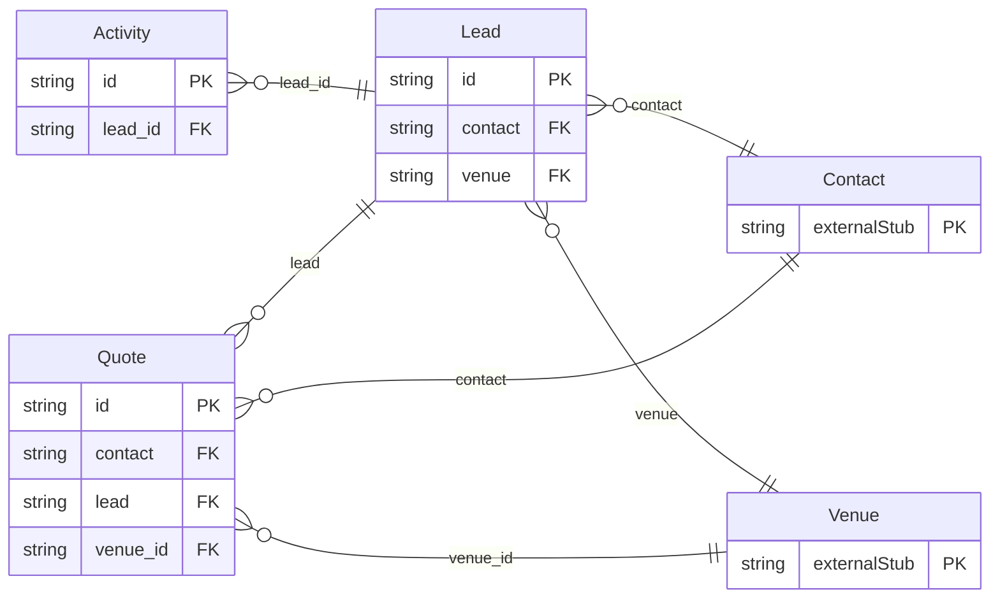

<!-- Code generated by protoc-gen-store. DO NOT EDIT. -->

# `aperio/sales/sales/` — Prisma schema

Generated from Protobuf by protoc-gen-store. Source of truth is the `.proto` files — regenerate rather than editing.

| Models | Enums |
| ---: | ---: |
| 3 | 1 |

## Entity relationships

Schema file: [`sales.postgres.prisma`](./sales.postgres.prisma)

### `Lead` → `leads`

A Lead is an enquiry that may become a booking: a couple asking about a December wedding, a company asking for an offsite with forty rooms, a family asking about a week at the resort. It covers both venues and every kind of booking -- a stay, an event, or both, as a wedding with rooms for its guests is. A lead moves through a sales pipeline, from NEW to WON or LOST, owned by one salesperson with a follow-up date. While it is negotiated its dates can be held in freebusy (`hold`), so they are not sold under it; winning it turns the accepted quote into the booking.

| Column | Type | Null |
| --- | --- | --- |
| `id` | `CHAR(26)` | not null |
| `name` | `VARCHAR(255)` | not null |
| `display_name` | `VARCHAR(255)` | not null |
| `contact` | `CHAR(26)` | not null |
| `venue` | `CHAR(26)` | nullable |
| `kind` | `LeadKind` | not null |
| `event_type` | `EventType` | nullable |
| `source` | `Channel` | nullable |
| `source_detail` | `VARCHAR(255)` | nullable |
| `stage` | `Stage` | nullable |
| `dates` | `JSONB` | nullable |
| `dates_flexible` | `BOOLEAN` | nullable |
| `guests` | `INTEGER` | nullable |
| `rooms` | `INTEGER` | nullable |
| `budget` | `JSONB` | nullable |
| `requirements` | `VARCHAR(255)` | nullable |
| `owner` | `VARCHAR(255)` | nullable |
| `next_follow_up_time` | `TIMESTAMPTZ` | nullable |
| `lost_reason` | `LostReason` | nullable |
| `lost_detail` | `VARCHAR(255)` | nullable |
| `hold` | `VARCHAR(255)` | nullable |
| `bookings` | `VARCHAR(255)[]` | nullable |
| `close_time` | `TIMESTAMPTZ` | nullable |
| `create_time` | `TIMESTAMPTZ` | not null |
| `update_time` | `TIMESTAMPTZ` | not null |
| `etag` | `VARCHAR(255)` | nullable |
| `spaces` | `VARCHAR(255)[]` | nullable |

### `Activity` → `activities`

An Activity is one touch on a lead: a call, a WhatsApp, a site visit, a quote sent. The activities of a lead are its history, newest first.

| Column | Type | Null |
| --- | --- | --- |
| `id` | `CHAR(26)` | not null |
| `name` | `VARCHAR(255)` | not null |
| `kind` | `ActivityKind` | not null |
| `occur_time` | `TIMESTAMPTZ` | not null |
| `summary` | `VARCHAR(255)` | not null |
| `details` | `VARCHAR(255)` | nullable |
| `author` | `VARCHAR(255)` | nullable |
| `create_time` | `TIMESTAMPTZ` | not null |
| `update_time` | `TIMESTAMPTZ` | not null |
| `etag` | `VARCHAR(255)` | nullable |
| `lead_id` | `CHAR(26)` | not null |

### `Quote` → `quotes`

A Quote is a priced proposal to a guest: the spaces, rooms, menus and packages they asked for, at the prices of their dates, with GST. A lead usually has several, one superseding the next as the negotiation goes; accepting one makes the booking. A draft's line prices follow the price rules as they change. Sending the quote fixes them, so the guest is held to what they were offered and no rule changed after can change it.

| Column | Type | Null |
| --- | --- | --- |
| `id` | `CHAR(26)` | not null |
| `name` | `VARCHAR(255)` | not null |
| `display_name` | `VARCHAR(255)` | not null |
| `contact` | `CHAR(26)` | not null |
| `lead` | `CHAR(26)` | nullable |
| `supersedes` | `VARCHAR(255)` | nullable |
| `state` | `SalesState` | nullable |
| `event_type` | `EventType` | nullable |
| `dates` | `JSONB` | not null |
| `guests` | `INTEGER` | nullable |
| `lines` | `JSONB` | not null |
| `supply_state_code` | `VARCHAR(255)` | nullable |
| `subtotal` | `JSONB` | nullable |
| `tax_total` | `JSONB` | nullable |
| `total` | `JSONB` | nullable |
| `advance` | `JSONB` | nullable |
| `terms` | `VARCHAR(255)` | nullable |
| `expire_time` | `TIMESTAMPTZ` | nullable |
| `send_time` | `TIMESTAMPTZ` | nullable |
| `accept_time` | `TIMESTAMPTZ` | nullable |
| `booking` | `VARCHAR(255)` | nullable |
| `decline_reason` | `VARCHAR(255)` | nullable |
| `create_time` | `TIMESTAMPTZ` | not null |
| `update_time` | `TIMESTAMPTZ` | not null |
| `etag` | `VARCHAR(255)` | nullable |
| `ttl` | `INTERVAL` | nullable |
| `venue_id` | `CHAR(26)` | not null |

### Enums

- `SalesState`: DRAFT, SENT, ACCEPTED, DECLINED, EXPIRED, SUPERSEDED
