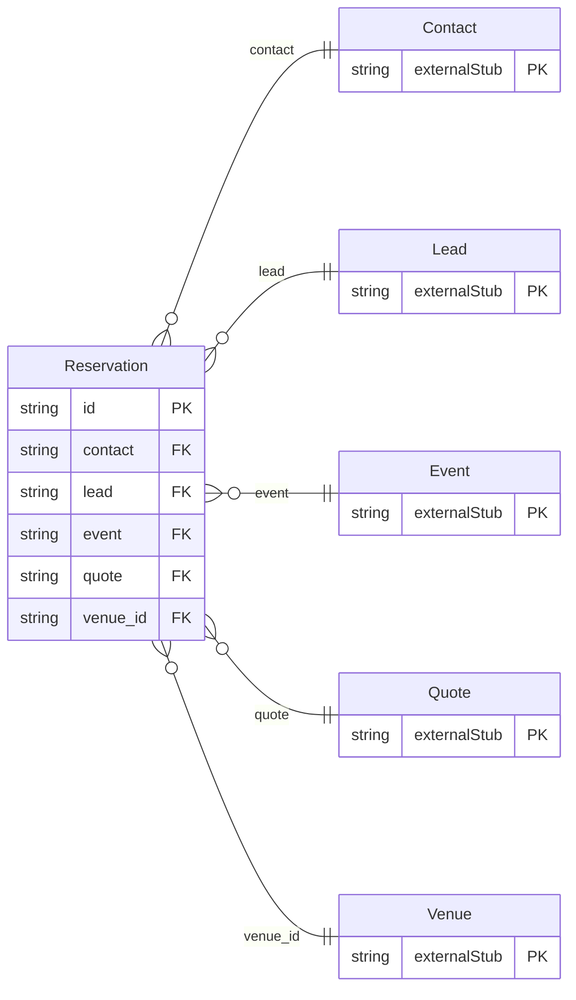

<!-- Code generated by protoc-gen-store. DO NOT EDIT. -->

# `aperio/stay/stay/` — Prisma schema

Generated from Protobuf by protoc-gen-store. Source of truth is the `.proto` files — regenerate rather than editing.

| Models | Enums |
| ---: | ---: |
| 1 | 1 |

## Entity relationships

Schema file: [`stay.postgres.prisma`](./stay.postgres.prisma)

### `Reservation` → `reservations`

A Reservation is a stay: rooms at a venue for a span of nights, booked directly, from a lead, or by a channel. What is searched and reported on is aperio's own -- the dates, the rooms, the channel, the state -- and is stored as columns, so "who arrives today" is one indexed read. What a channel sends is kept as it sent it: the room stays and guests are OpenTravel's RoomStay and ResGuest, so an OTA_HotelResNotif from Booking.com is stored without translation and sent back unchanged. The rooms are freebusy's: a reservation is a freebusy hold made into a freebusy reservation for each room line, named in freebusy_reservations.

| Column | Type | Null |
| --- | --- | --- |
| `id` | `CHAR(26)` | not null |
| `name` | `VARCHAR(255)` | not null |
| `contact` | `CHAR(26)` | not null |
| `lead` | `CHAR(26)` | nullable |
| `event` | `VARCHAR(255)` | nullable |
| `channel` | `Channel` | not null |
| `channel_reference` | `VARCHAR(255)` | nullable |
| `state` | `StayState` | nullable |
| `arrival_date` | `DATE` | not null |
| `departure_date` | `DATE` | not null |
| `adults` | `INTEGER` | not null |
| `children` | `INTEGER` | nullable |
| `rooms` | `JSONB` | not null |
| `room_stays` | `JSONB` | nullable |
| `res_guests` | `JSONB` | nullable |
| `dietary_requirements` | `JSONB` | nullable |
| `special_requests` | `JSONB` | nullable |
| `total` | `JSONB` | nullable |
| `quote` | `VARCHAR(255)` | nullable |
| `notes` | `VARCHAR(255)` | nullable |
| `cancel_reason` | `VARCHAR(255)` | nullable |
| `arrive_time` | `TIMESTAMPTZ` | nullable |
| `depart_time` | `TIMESTAMPTZ` | nullable |
| `cancel_time` | `TIMESTAMPTZ` | nullable |
| `create_time` | `TIMESTAMPTZ` | not null |
| `update_time` | `TIMESTAMPTZ` | not null |
| `etag` | `VARCHAR(255)` | nullable |
| `spaces` | `VARCHAR(255)[]` | nullable |
| `venue_id` | `CHAR(26)` | not null |
| `freebusy_reservations` | `VARCHAR(255)[]` | nullable |

### Enums

- `StayState`: PENDING, CONFIRMED, CHECKED_IN, CHECKED_OUT, CANCELLED, NO_SHOW
