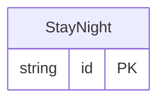

<!-- Code generated by protoc-gen-store. DO NOT EDIT. -->

# `aperio/stay/stay_night/` — Prisma schema

Generated from Protobuf by protoc-gen-store. Source of truth is the `.proto` files — regenerate rather than editing.

| Models | Enums |
| ---: | ---: |
| 1 | 0 |

## Entity relationships

Schema file: [`stay_night.postgres.prisma`](./stay_night.postgres.prisma)

### `StayNight` → `stay_nights`

A StayNight is one night of one stay: the read model the front desk's day, occupancy and a guest's history are read from, instead of every reservation there is -- "who stays tonight" is the rows of one day, under one index. Storage-only, and derived: no RPC takes or returns it. It is a projection of the reservations, rewritten in the same transaction as every write to one: a stay has a row for each night from arrival to the night before departure, and none once it is cancelled or a no-show.

| Column | Type | Null |
| --- | --- | --- |
| `id` | `TEXT` | not null |
| `reservation` | `TEXT` | not null |
| `venue` | `TEXT` | not null |
| `day` | `DATE` | not null |
| `contact` | `TEXT` | not null |
| `spaces` | `TEXT[]` | not null |
| `rooms` | `INTEGER` | not null |
| `guests` | `INTEGER` | not null |
| `first_night` | `BOOLEAN` | not null |
| `last_night` | `BOOLEAN` | not null |
| `state` | `TEXT` | not null |
| `row_version` | `BIGINT` | not null |
