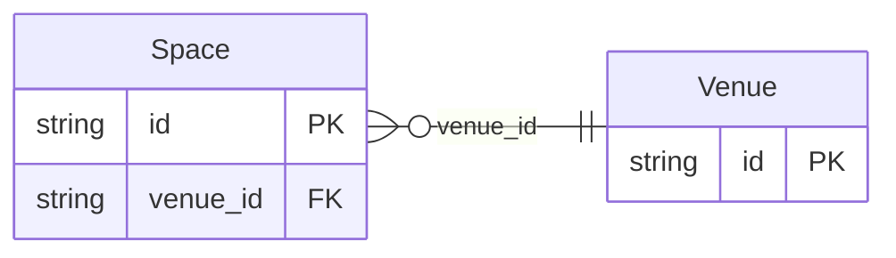

<!-- Code generated by protoc-gen-store. DO NOT EDIT. -->

# `aperio/venue/venue/` — Prisma schema

Generated from Protobuf by protoc-gen-store. Source of truth is the `.proto` files — regenerate rather than editing.

| Models | Enums |
| ---: | ---: |
| 2 | 0 |

## Entity relationships

Schema file: [`venue.postgres.prisma`](./venue.postgres.prisma)

### `Venue` → `resource`

A Venue is one property aperio sells: a resort whose rooms are booked by the night, or a hall whose spaces are booked for events. Everything else hangs off a venue -- its spaces, reservations, events, menus, packages, quotes, invoices, payments and documents -- because each venue is its own place of business: its own GSTIN and its own invoice series. The venue is aperio's record; its availability is freebusy's. The venue's rooms and halls are freebusy resources, named by its spaces (Space.resources), and every booking aperio takes is a freebusy hold and reservation on them first.

| Column | Type | Null |
| --- | --- | --- |
| `id` | `CHAR(26)` | not null |
| `name` | `VARCHAR(255)` | not null |
| `display_name` | `VARCHAR(255)` | not null |
| `kind` | `VenueKind` | not null |
| `address` | `JSONB` | not null |
| `time_zone` | `VARCHAR(255)` | not null |
| `currency_code` | `VARCHAR(255)` | not null |
| `gst` | `JSONB` | not null |
| `hotel_info` | `JSONB` | nullable |
| `create_time` | `TIMESTAMPTZ` | not null |
| `update_time` | `TIMESTAMPTZ` | not null |
| `etag` | `VARCHAR(255)` | nullable |

### `Space` → `spaces`

A Space is what a venue sells a booking of: a room type at the resort, a hall, a lawn, a conference room. A room type stands for many rooms, each a freebusy resource; a hall is usually one.

| Column | Type | Null |
| --- | --- | --- |
| `id` | `CHAR(26)` | not null |
| `name` | `VARCHAR(255)` | not null |
| `display_name` | `VARCHAR(255)` | not null |
| `kind` | `SpaceKind` | not null |
| `capacity` | `JSONB` | nullable |
| `inventory_code` | `VARCHAR(255)` | nullable |
| `create_time` | `TIMESTAMPTZ` | not null |
| `update_time` | `TIMESTAMPTZ` | not null |
| `etag` | `VARCHAR(255)` | nullable |
| `venue_id` | `CHAR(26)` | not null |
| `resources` | `VARCHAR(255)[]` | nullable |
