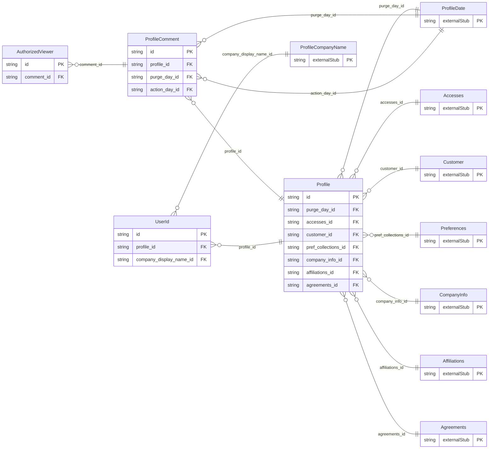

<!-- Code generated by protoc-gen-store. DO NOT EDIT. -->

# `ota/opentravel/common/profile/profile/` — Prisma schema

Generated from Protobuf by protoc-gen-store. Source of truth is the `.proto` files — regenerate rather than editing.

| Models | Enums |
| ---: | ---: |
| 4 | 1 |

## Entity relationships

Schema file: [`profile.postgres.prisma`](./profile.postgres.prisma)

### `Profile` → `resource`

Details of the profile. A collection resource, named "profiles/{profile}". OTA: OTA_ProfileCreateRQ/Profile.

| Column | Type | Null |
| --- | --- | --- |
| `id` | `CHAR(26)` | not null |
| `name` | `VARCHAR(255)` | not null |
| `uid` | `VARCHAR(255)` | nullable |
| `etag` | `VARCHAR(255)` | nullable |
| `delete_time` | `TIMESTAMPTZ` | nullable |
| `expire_time` | `TIMESTAMPTZ` | nullable |
| `create_time` | `TIMESTAMPTZ` | not null |
| `update_time` | `TIMESTAMPTZ` | not null |
| `share_all_synch_ind` | `YesNo` | nullable |
| `share_all_market_ind` | `YesNo` | nullable |
| `share_all_opt_out_ind` | `YesNo` | nullable |
| `optin_status` | `OptInChoice` | nullable |
| `optin_time` | `TIMESTAMPTZ` | nullable |
| `opt_out_time` | `TIMESTAMPTZ` | nullable |
| `profile_type` | `ProfileType` | nullable |
| `creator_id` | `VARCHAR(255)` | nullable |
| `last_modifier_id` | `VARCHAR(255)` | nullable |
| `rph` | `VARCHAR(255)` | nullable |
| `status_codes` | `` | nullable |
| `purge_day_id` | `CHAR(26)` | nullable |
| `accesses_id` | `CHAR(26)` | nullable |
| `customer_id` | `CHAR(26)` | nullable |
| `pref_collections_id` | `CHAR(26)` | nullable |
| `company_info_id` | `CHAR(26)` | nullable |
| `affiliations_id` | `CHAR(26)` | nullable |
| `agreements_id` | `CHAR(26)` | nullable |

### `UserId` → `user_ids`

The user ids and pin numbers of the profile.

| Column | Type | Null |
| --- | --- | --- |
| `uri` | `VARCHAR(255)` | nullable |
| `type` | `ProfileUniqueIdType` | not null |
| `instance` | `VARCHAR(255)` | nullable |
| `id` | `VARCHAR(255)` | not null |
| `id_context` | `VARCHAR(255)` | nullable |
| `pin_number` | `VARCHAR(255)` | nullable |
| `profile_id` | `CHAR(26)` | not null |
| `company_display_name_id` | `CHAR(26)` | nullable |

### `ProfileComment` → `comments`

Comment details.

| Column | Type | Null |
| --- | --- | --- |
| `id` | `CHAR(26)` | not null |
| `name` | `VARCHAR(255)` | nullable |
| `paragraph_number` | `INTEGER` | nullable |
| `create_date_time` | `TIMESTAMPTZ` | nullable |
| `creator_id` | `VARCHAR(255)` | nullable |
| `last_modify_date_time` | `TIMESTAMPTZ` | nullable |
| `last_modifier_id` | `VARCHAR(255)` | nullable |
| `language_code` | `VARCHAR(255)` | nullable |
| `comment_originator_code` | `VARCHAR(255)` | nullable |
| `guest_viewable` | `BOOLEAN` | nullable |
| `category` | `VARCHAR(255)` | nullable |
| `airline_vendor_pref_rph` | `VARCHAR(255)` | nullable |
| `transfer_action` | `TransferAction` | nullable |
| `images` | `VARCHAR(255)[]` | nullable |
| `uris` | `VARCHAR(255)[]` | nullable |
| `profile_id` | `CHAR(26)` | not null |
| `purge_day_id` | `CHAR(26)` | nullable |
| `action_day_id` | `CHAR(26)` | nullable |

### `AuthorizedViewer` → `authorized_viewers`

Specifies those authorized to view a comment.

| Column | Type | Null |
| --- | --- | --- |
| `id` | `CHAR(26)` | not null |
| `viewer_code` | `VARCHAR(255)` | nullable |
| `comment_id` | `CHAR(26)` | not null |

### Enums

- `OptInChoice`: OPTED_IN, OPTED_OUT, UNKNOWN
