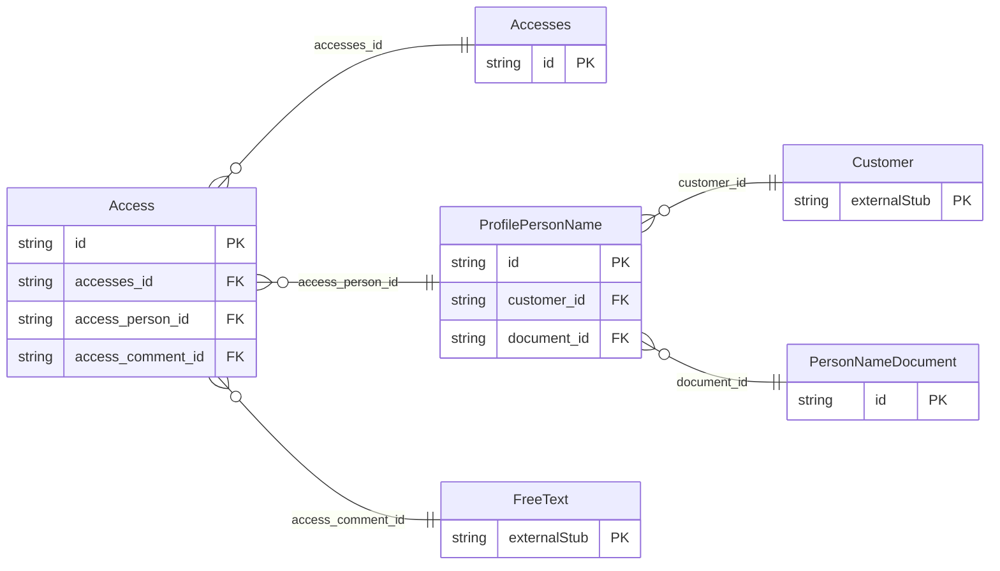

<!-- Code generated by protoc-gen-store. DO NOT EDIT. -->

# `ota/opentravel/common/profile/v1/types/accesses/` — Prisma schema

Generated from Protobuf by protoc-gen-store. Source of truth is the `.proto` files — regenerate rather than editing.

| Models | Enums |
| ---: | ---: |
| 4 | 3 |

## Entity relationships

Schema file: [`accesses.postgres.prisma`](./accesses.postgres.prisma)

### `Accesses` → `accesses`

Element to capture creation and last update data.

| Column | Type | Null |
| --- | --- | --- |
| `id` | `CHAR(26)` | not null |
| `share_synch_ind` | `AccessesShareSynchInd` | nullable |
| `share_market_ind` | `AccessesShareMarketInd` | nullable |
| `create_date_time` | `TIMESTAMPTZ` | nullable |

### `Access` → `access`

Describes the action taken on the record.

| Column | Type | Null |
| --- | --- | --- |
| `action_type` | `ProfileActionType` | nullable |
| `action_date_time` | `TIMESTAMPTZ` | nullable |
| `id` | `VARCHAR(255)` | not null |
| `accesses_id` | `CHAR(26)` | not null |
| `access_person_id` | `CHAR(26)` | nullable |
| `access_comment_id` | `CHAR(26)` | nullable |

### `ProfilePersonName` → `person_names`

This provides name information for a person.

| Column | Type | Null |
| --- | --- | --- |
| `id` | `CHAR(26)` | not null |
| `share_synch_ind` | `AccessesShareSynchInd` | nullable |
| `share_market_ind` | `AccessesShareMarketInd` | nullable |
| `name_type` | `ProfileNameType` | nullable |
| `language_code` | `VARCHAR(255)` | nullable |
| `default_value` | `BOOLEAN` | nullable |
| `name_prefixes` | `VARCHAR(255)[]` | nullable |
| `given_names` | `VARCHAR(255)[]` | nullable |
| `middle_names` | `VARCHAR(255)[]` | nullable |
| `surname_prefix` | `VARCHAR(255)` | nullable |
| `surname` | `VARCHAR(255)` | not null |
| `name_suffixes` | `VARCHAR(255)[]` | nullable |
| `name_titles` | `VARCHAR(255)[]` | nullable |
| `customer_id` | `CHAR(26)` | not null |
| `document_id` | `CHAR(26)` | nullable |

### `PersonNameDocument` → `person_name_documents`

Document information for verification purposes and also used for additional filtering for common names.

| Column | Type | Null |
| --- | --- | --- |
| `id` | `CHAR(26)` | not null |
| `doc_id` | `VARCHAR(255)` | nullable |
| `doc_type` | `ProfileDocumentType` | nullable |

### Enums

- `AccessesShareSynchInd`: YES, NO, INHERIT
- `AccessesShareMarketInd`: YES, NO, INHERIT
- `ProfileActionType`: CREATE, READ, UPDATE, DELETE
