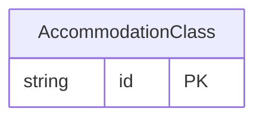

<!-- Code generated by protoc-gen-store. DO NOT EDIT. -->

# `ota/opentravel/common/profile/v1/types/accommodation_class/` — Prisma schema

Generated from Protobuf by protoc-gen-store. Source of truth is the `.proto` files — regenerate rather than editing.

| Models | Enums |
| ---: | ---: |
| 1 | 0 |

## Entity relationships

Schema file: [`accommodation_class.postgres.prisma`](./accommodation_class.postgres.prisma)

### `AccommodationClass` → `accommodation_class`

Rail accommodation class with an associated attribute to capture additional enumerated values as agreed upon between trading partners.

| Column | Type | Null |
| --- | --- | --- |
| `id` | `CHAR(26)` | not null |
| `extension` | `VARCHAR(255)` | nullable |
| `value` | `AccommodationClassEnum` | nullable |
