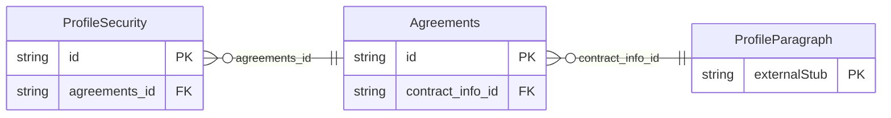

<!-- Code generated by protoc-gen-store. DO NOT EDIT. -->

# `ota/opentravel/common/profile/v1/types/agreements/` — Prisma schema

Generated from Protobuf by protoc-gen-store. Source of truth is the `.proto` files — regenerate rather than editing.

| Models | Enums |
| ---: | ---: |
| 2 | 2 |

## Entity relationships

Schema file: [`agreements.postgres.prisma`](./agreements.postgres.prisma)

### `Agreements` → `agreements`

Section of a business profile that contains information about trading partner agreements.

| Column | Type | Null |
| --- | --- | --- |
| `id` | `CHAR(26)` | not null |
| `share_synch_ind` | `AccessesShareSynchInd` | nullable |
| `share_market_ind` | `AccessesShareMarketInd` | nullable |
| `contract_info_id` | `CHAR(26)` | nullable |

### `ProfileSecurity` → `securities`

Grants access rights on a single booking to offices other than the creator and responsible offices.

| Column | Type | Null |
| --- | --- | --- |
| `id` | `CHAR(26)` | not null |
| `accessing_organization_type` | `AccessingOrganizationType` | nullable |
| `accessing_organization_id` | `VARCHAR(255)` | nullable |
| `access_type` | `AccessType` | nullable |
| `transfer_action` | `TransferAction` | nullable |
| `agreements_id` | `CHAR(26)` | not null |

### Enums

- `AccessingOrganizationType`: PROFILE_OWNER, IATA, OTHER
- `AccessType`: READ_ONLY, READ_WRITE, NO_ACCESS
