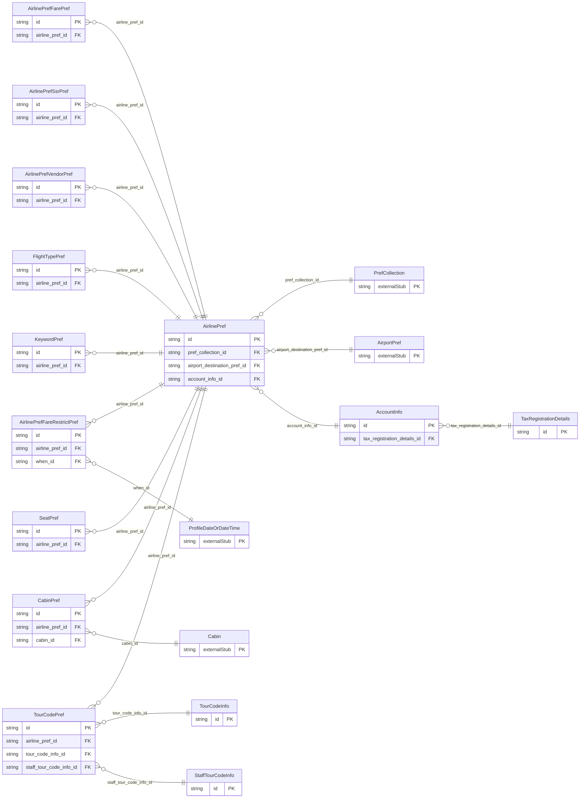

<!-- Code generated by protoc-gen-store. DO NOT EDIT. -->

# `ota/opentravel/common/profile/v1/types/airline_pref/` — Prisma schema

Generated from Protobuf by protoc-gen-store. Source of truth is the `.proto` files — regenerate rather than editing.

| Models | Enums |
| ---: | ---: |
| 14 | 5 |

## Entity relationships

Schema file: [`airline_pref.postgres.prisma`](./airline_pref.postgres.prisma)

### `AirlinePref` → `airline_prefs`

Identifies a collection of preferences for airline travel.

| Column | Type | Null |
| --- | --- | --- |
| `id` | `CHAR(26)` | not null |
| `share_synch_ind` | `AccessesShareSynchInd` | nullable |
| `share_market_ind` | `AccessesShareMarketInd` | nullable |
| `prefer_level` | `ProfilePreferLevel` | nullable |
| `smoking_allowed` | `BOOLEAN` | nullable |
| `passenger_type_code` | `VARCHAR(255)` | nullable |
| `air_ticket_type` | `EnumsTicket` | nullable |
| `pref_collection_id` | `CHAR(26)` | not null |
| `airport_destination_pref_id` | `CHAR(26)` | nullable |
| `account_info_id` | `CHAR(26)` | nullable |

### `AirlinePrefVendorPref` → `airline_pref_vendor_prefs`

Identifies the preferred airline carrier(s) by name.

| Column | Type | Null |
| --- | --- | --- |
| `id` | `CHAR(26)` | not null |
| `company_short_display_name` | `VARCHAR(255)` | nullable |
| `travel_sector` | `ProfileTravelSector` | nullable |
| `code` | `VARCHAR(255)` | nullable |
| `code_context` | `VARCHAR(255)` | nullable |
| `region_code` | `VARCHAR(255)` | nullable |
| `division` | `VARCHAR(255)` | nullable |
| `department` | `VARCHAR(255)` | nullable |
| `prefer_level` | `ProfilePreferLevel` | nullable |
| `rph` | `VARCHAR(255)` | nullable |
| `value` | `VARCHAR(255)` | nullable |
| `airline_pref_id` | `CHAR(26)` | not null |

### `AirlinePrefFareRestrictPref` → `airline_pref_fare_restrict_prefs`

Indicates preferred fare restrictions to be used in search.

| Column | Type | Null |
| --- | --- | --- |
| `id` | `CHAR(26)` | not null |
| `prefer_level` | `ProfilePreferLevel` | nullable |
| `fare_restriction` | `FareRestriction` | nullable |
| `airline_pref_id` | `CHAR(26)` | not null |
| `when_id` | `CHAR(26)` | nullable |

### `AirlinePrefFarePref` → `airline_pref_fare_prefs`

Indicates preferred fare.

| Column | Type | Null |
| --- | --- | --- |
| `id` | `CHAR(26)` | not null |
| `code` | `VARCHAR(255)` | nullable |
| `description` | `VARCHAR(255)` | nullable |
| `airline_vendor_pref_rphs` | `VARCHAR(255)[]` | nullable |
| `rate_category_code` | `RateCategory` | nullable |
| `transfer_action` | `TransferAction` | nullable |
| `airline_pref_id` | `CHAR(26)` | not null |

### `TourCodePref` → `tour_code_prefs`

Provides the contract code for a negotiated fare.

| Column | Type | Null |
| --- | --- | --- |
| `id` | `CHAR(26)` | not null |
| `passenger_type_code` | `VARCHAR(255)` | nullable |
| `airline_vendor_pref_rphs` | `VARCHAR(255)[]` | nullable |
| `transfer_action` | `TransferAction` | nullable |
| `tour_code_info_or_staff_tour_code_info_case` | `TourCodePrefTourCodeInfoOrStaffTourCodeInfoCase` | nullable |
| `airline_pref_id` | `CHAR(26)` | not null |
| `tour_code_info_id` | `CHAR(26)` | nullable |
| `staff_tour_code_info_id` | `CHAR(26)` | nullable |

### `FlightTypePref` → `flight_type_prefs`

Indicates preferred flight characteristics to be used in a search (e.g., connections, stopovers).

| Column | Type | Null |
| --- | --- | --- |
| `id` | `CHAR(26)` | not null |
| `prefer_level` | `ProfilePreferLevel` | nullable |
| `flight_type` | `FlightType` | nullable |
| `max_connections` | `INTEGER` | nullable |
| `non_scheduled_flt_info` | `NonScheduledFltInfo` | nullable |
| `backhaul_indicator` | `BOOLEAN` | nullable |
| `ground_transport_indicator` | `BOOLEAN` | nullable |
| `direct_and_non_stop_only` | `BOOLEAN` | nullable |
| `non_stops_only` | `BOOLEAN` | nullable |
| `online_connections_only` | `BOOLEAN` | nullable |
| `routing_type` | `AirlinePrefFlightTypePrefRoutingType` | nullable |
| `exclude_train` | `BOOLEAN` | nullable |
| `airline_pref_id` | `CHAR(26)` | not null |

### `CabinPref` → `cabin_prefs`

Indicates preferred cabin(s) to be used in a search.

| Column | Type | Null |
| --- | --- | --- |
| `id` | `CHAR(26)` | not null |
| `prefer_level` | `ProfilePreferLevel` | nullable |
| `airline_pref_id` | `CHAR(26)` | not null |
| `cabin_id` | `CHAR(26)` | nullable |

### `SeatPref` → `seat_prefs`

Indicates preferred seat characteristics. Refer to OpenTravel Code List Seat Preference (STP) for codes.

| Column | Type | Null |
| --- | --- | --- |
| `id` | `CHAR(26)` | not null |
| `prefer_level` | `ProfilePreferLevel` | nullable |
| `seat_number` | `VARCHAR(255)` | nullable |
| `seat_preferences` | `` | nullable |
| `deck_level` | `VARCHAR(255)` | nullable |
| `row_number` | `INTEGER` | nullable |
| `row_seat` | `VARCHAR(255)` | nullable |
| `smoking_allowed` | `BOOLEAN` | nullable |
| `flight_distance_qualifier` | `FlightDistanceQualifier` | nullable |
| `international_indicator` | `BOOLEAN` | nullable |
| `airline_vendor_pref_rphs` | `VARCHAR(255)[]` | nullable |
| `passenger_type_code` | `VARCHAR(255)` | nullable |
| `transfer_action` | `TransferAction` | nullable |
| `airline_pref_id` | `CHAR(26)` | not null |

### `AirlinePrefSsrPref` → `airline_pref_ssr_prefs`

Indicates Special Service Request preference type.

| Column | Type | Null |
| --- | --- | --- |
| `id` | `CHAR(26)` | not null |
| `prefer_level` | `ProfilePreferLevel` | nullable |
| `ssr_code` | `VARCHAR(255)` | nullable |
| `vendor_code` | `VARCHAR(255)` | nullable |
| `party_size` | `INTEGER` | nullable |
| `default_status_code` | `VARCHAR(255)` | nullable |
| `remark` | `VARCHAR(255)` | nullable |
| `lookup_key` | `VARCHAR(255)` | nullable |
| `airline_vendor_pref_rphs` | `VARCHAR(255)[]` | nullable |
| `transfer_action_type` | `TransferAction` | nullable |
| `airline_pref_id` | `CHAR(26)` | not null |

### `AccountInfo` → `account_infos`

Information related to back office accounting information for the travel agency.

| Column | Type | Null |
| --- | --- | --- |
| `id` | `CHAR(26)` | not null |
| `number` | `VARCHAR(255)` | nullable |
| `cost_center` | `VARCHAR(255)` | nullable |
| `company_number` | `VARCHAR(255)` | nullable |
| `client_reference` | `VARCHAR(255)` | nullable |
| `tax_registration_details_id` | `CHAR(26)` | nullable |

### `KeywordPref` → `keyword_prefs`

This element stores data about an airline marketing keyword.

| Column | Type | Null |
| --- | --- | --- |
| `id` | `CHAR(26)` | not null |
| `vendor_code` | `VARCHAR(255)` | nullable |
| `description` | `VARCHAR(255)` | nullable |
| `keyword` | `VARCHAR(255)` | nullable |
| `status_code` | `StatusCode` | nullable |
| `party_size` | `INTEGER` | nullable |
| `airline_vendor_rphs` | `VARCHAR(255)[]` | nullable |
| `transfer_action` | `TransferAction` | nullable |
| `airline_pref_id` | `CHAR(26)` | not null |

### `TourCodeInfo` → `tour_code_infos`

Provides the tour code.

| Column | Type | Null |
| --- | --- | --- |
| `id` | `CHAR(26)` | not null |
| `tour_type_code` | `VARCHAR(255)` | nullable |
| `year_num` | `INTEGER` | nullable |
| `promotion_code` | `VARCHAR(255)` | nullable |
| `promotion_vendor_codes` | `VARCHAR(255)[]` | nullable |
| `party_id` | `VARCHAR(255)` | nullable |

### `StaffTourCodeInfo` → `staff_tour_code_infos`

Provides a tour code for airline staff.

| Column | Type | Null |
| --- | --- | --- |
| `id` | `CHAR(26)` | not null |
| `staff_type` | `StaffType` | nullable |
| `employee_id` | `VARCHAR(255)` | nullable |
| `vendor_code` | `VARCHAR(255)` | nullable |
| `description` | `VARCHAR(255)` | nullable |

### `TaxRegistrationDetails` → `tax_registration_details`

Ticketing Goods and Services Tax (GST) details (typically the Australian market).

| Column | Type | Null |
| --- | --- | --- |
| `id` | `CHAR(26)` | not null |
| `tax_id` | `VARCHAR(255)` | nullable |
| `recipient_display_name` | `VARCHAR(255)` | nullable |
| `recipient_address` | `VARCHAR(255)` | nullable |

### Enums

- `TourCodePrefTourCodeInfoOrStaffTourCodeInfoCase`: TOUR_CODE_INFO, STAFF_TOUR_CODE_INFO
- `NonScheduledFltInfo`: CHARTERS_ONLY, EXCLUDE_CHARTERS, ALL
- `AirlinePrefFlightTypePrefRoutingType`: NORMAL, MIRROR
- `FlightDistanceQualifier`: LONG_HAUL, SHORT_HAUL
- `StaffType`: CURRENT, DUTY, CABIN_CREW, RETIRED, TECH_CREW, UNACCOMPANIED_FAMILY_MEMBER, OTHER_AIRLINE_PERSONNEL
