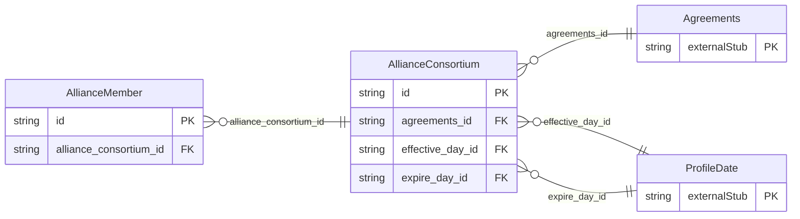

<!-- Code generated by protoc-gen-store. DO NOT EDIT. -->

# `ota/opentravel/common/profile/v1/types/alliance_consortium/` — Prisma schema

Generated from Protobuf by protoc-gen-store. Source of truth is the `.proto` files — regenerate rather than editing.

| Models | Enums |
| ---: | ---: |
| 2 | 0 |

## Entity relationships

Schema file: [`alliance_consortium.postgres.prisma`](./alliance_consortium.postgres.prisma)

### `AllianceConsortium` → `alliance_consortiums`

Provides information about alliance partnerships and consortiums of members grouped together to obtain trading partner agreements for travel service and privileges.

| Column | Type | Null |
| --- | --- | --- |
| `id` | `VARCHAR(255)` | not null |
| `expire_date_exclusive` | `BOOLEAN` | nullable |
| `agreements_id` | `CHAR(26)` | not null |
| `effective_day_id` | `CHAR(26)` | nullable |
| `expire_day_id` | `CHAR(26)` | nullable |

### `AllianceMember` → `alliance_members`

Identification of a company that participates in an alliance or consortium to which the primary business entity identified in this profile belongs.

| Column | Type | Null |
| --- | --- | --- |
| `id` | `CHAR(26)` | not null |
| `company_short_display_name` | `VARCHAR(255)` | nullable |
| `travel_sector` | `ProfileTravelSector` | nullable |
| `code` | `VARCHAR(255)` | nullable |
| `code_context` | `VARCHAR(255)` | nullable |
| `region_code` | `VARCHAR(255)` | nullable |
| `division` | `VARCHAR(255)` | nullable |
| `department` | `VARCHAR(255)` | nullable |
| `member_code` | `VARCHAR(255)` | nullable |
| `value` | `VARCHAR(255)` | nullable |
| `alliance_consortium_id` | `VARCHAR(255)` | not null |
