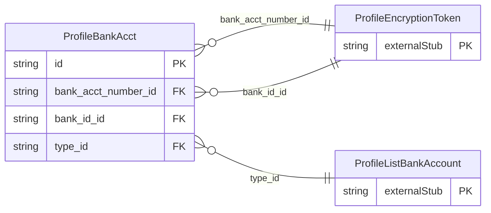

<!-- Code generated by protoc-gen-store. DO NOT EDIT. -->

# `ota/opentravel/common/profile/v1/types/bank_acct/` — Prisma schema

Generated from Protobuf by protoc-gen-store. Source of truth is the `.proto` files — regenerate rather than editing.

| Models | Enums |
| ---: | ---: |
| 1 | 0 |

## Entity relationships

Schema file: [`bank_acct.postgres.prisma`](./bank_acct.postgres.prisma)

### `ProfileBankAcct` → `bank_accts`

Customer bank account definition.

| Column | Type | Null |
| --- | --- | --- |
| `id` | `CHAR(26)` | not null |
| `checks_accepted` | `BOOLEAN` | nullable |
| `share_synch_ind` | `AccessesShareSynchInd` | nullable |
| `share_market_ind` | `AccessesShareMarketInd` | nullable |
| `check_number` | `VARCHAR(255)` | nullable |
| `bank_acct_display_name` | `VARCHAR(255)` | nullable |
| `bank_acct_number_id` | `CHAR(26)` | nullable |
| `bank_id_id` | `CHAR(26)` | nullable |
| `type_id` | `CHAR(26)` | nullable |
