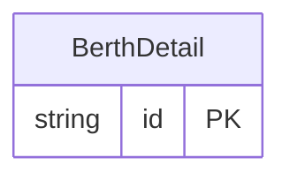

<!-- Code generated by protoc-gen-store. DO NOT EDIT. -->

# `ota/opentravel/common/profile/v1/types/berth_detail/` — Prisma schema

Generated from Protobuf by protoc-gen-store. Source of truth is the `.proto` files — regenerate rather than editing.

| Models | Enums |
| ---: | ---: |
| 1 | 0 |

## Entity relationships

Schema file: [`berth_detail.postgres.prisma`](./berth_detail.postgres.prisma)

### `BerthDetail` → `berth_details`

Defines information about a berth sleeper.

| Column | Type | Null |
| --- | --- | --- |
| `id` | `CHAR(26)` | not null |
| `number` | `VARCHAR(255)` | nullable |
| `position` | `BerthPosition` | nullable |
| `value` | `BerthAccommodation` | nullable |
