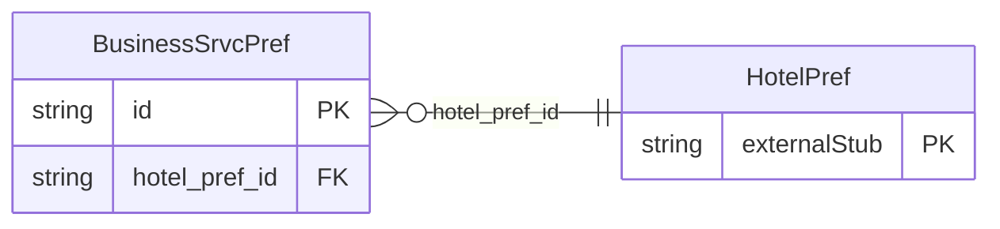

<!-- Code generated by protoc-gen-store. DO NOT EDIT. -->

# `ota/opentravel/common/profile/v1/types/business_srvc_pref/` — Prisma schema

Generated from Protobuf by protoc-gen-store. Source of truth is the `.proto` files — regenerate rather than editing.

| Models | Enums |
| ---: | ---: |
| 1 | 0 |

## Entity relationships

Schema file: [`business_srvc_pref.postgres.prisma`](./business_srvc_pref.postgres.prisma)

### `BusinessSrvcPref` → `business_srvc_prefs`

Indicates preferences for type of business services in a hotel.

| Column | Type | Null |
| --- | --- | --- |
| `id` | `CHAR(26)` | not null |
| `prefer_level` | `ProfilePreferLevel` | nullable |
| `business_srvc_type` | `ProfileBusinessSrvcType` | nullable |
| `value` | `VARCHAR(255)` | nullable |
| `hotel_pref_id` | `CHAR(26)` | not null |
