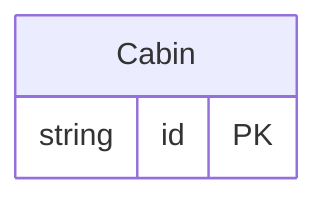

<!-- Code generated by protoc-gen-store. DO NOT EDIT. -->

# `ota/opentravel/common/profile/v1/types/cabin/` — Prisma schema

Generated from Protobuf by protoc-gen-store. Source of truth is the `.proto` files — regenerate rather than editing.

| Models | Enums |
| ---: | ---: |
| 1 | 2 |

## Entity relationships

Schema file: [`cabin.postgres.prisma`](./cabin.postgres.prisma)

### `Cabin` → `cabins`

Specifies the cabin type (e.g. first, business, economy).

| Column | Type | Null |
| --- | --- | --- |
| `id` | `CHAR(26)` | not null |
| `text` | `VARCHAR(255)` | nullable |
| `cabin` | `CabinCabin` | nullable |
| `value_case` | `CabinValueCase` | nullable |

### Enums

- `CabinCabin`: COCKPIT, SUITE, FIRST, PREMIUM_BUSINESS, BUSINESS, PREMIUM_ECONOMY, ECONOMY, ALL
- `CabinValueCase`: TEXT, CABIN
