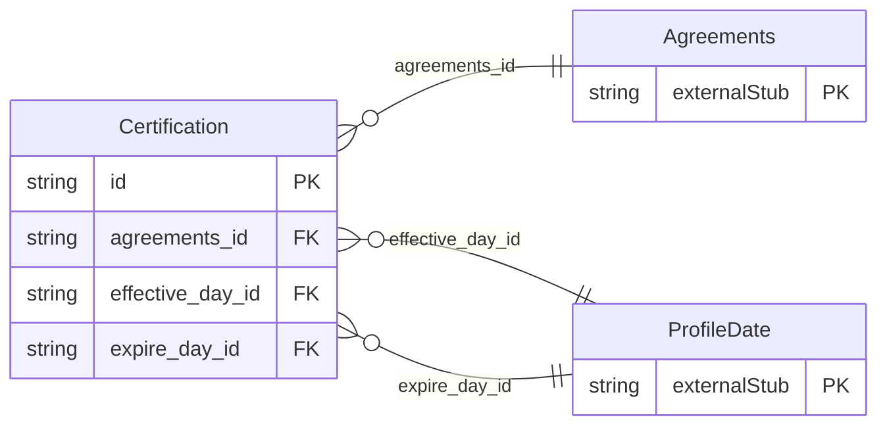

<!-- Code generated by protoc-gen-store. DO NOT EDIT. -->

# `ota/opentravel/common/profile/v1/types/certification/` — Prisma schema

Generated from Protobuf by protoc-gen-store. Source of truth is the `.proto` files — regenerate rather than editing.

| Models | Enums |
| ---: | ---: |
| 1 | 0 |

## Entity relationships

Schema file: [`certification.postgres.prisma`](./certification.postgres.prisma)

### `Certification` → `certifications`

Information about certifications or accreditation held by the company.

| Column | Type | Null |
| --- | --- | --- |
| `language_code` | `VARCHAR(255)` | nullable |
| `id` | `VARCHAR(255)` | not null |
| `single_vendor_ind` | `LoyaltyProgramSingleVendorInd` | nullable |
| `expire_date_exclusive` | `BOOLEAN` | nullable |
| `value` | `VARCHAR(255)` | nullable |
| `agreements_id` | `CHAR(26)` | not null |
| `effective_day_id` | `CHAR(26)` | nullable |
| `expire_day_id` | `CHAR(26)` | nullable |
