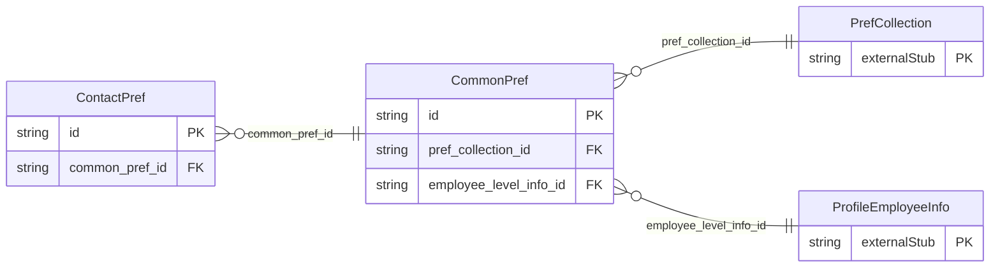

<!-- Code generated by protoc-gen-store. DO NOT EDIT. -->

# `ota/opentravel/common/profile/v1/types/common_pref/` — Prisma schema

Generated from Protobuf by protoc-gen-store. Source of truth is the `.proto` files — regenerate rather than editing.

| Models | Enums |
| ---: | ---: |
| 2 | 0 |

## Entity relationships

Schema file: [`common_pref.postgres.prisma`](./common_pref.postgres.prisma)

### `CommonPref` → `common_prefs`

Identifies preferences for common travel needs not associated with a specific travel service.

| Column | Type | Null |
| --- | --- | --- |
| `id` | `CHAR(26)` | not null |
| `share_synch_ind` | `AccessesShareSynchInd` | nullable |
| `share_market_ind` | `AccessesShareMarketInd` | nullable |
| `smoking_allowed` | `BOOLEAN` | nullable |
| `primary_lang_id` | `VARCHAR(255)` | nullable |
| `alt_lang_id` | `VARCHAR(255)` | nullable |
| `pref_collection_id` | `CHAR(26)` | not null |
| `employee_level_info_id` | `CHAR(26)` | nullable |

### `ContactPref` → `contact_prefs`

The traveller's preferred means of being contacted.

| Column | Type | Null |
| --- | --- | --- |
| `id` | `CHAR(26)` | not null |
| `prefer_level` | `ProfilePreferLevel` | nullable |
| `contact_method_code` | `ProfileDistributionType` | nullable |
| `common_pref_id` | `CHAR(26)` | not null |
