<!-- Code generated by protoc-gen-store. DO NOT EDIT. -->

# `ota/opentravel/common/profile/v1/types/company_info/` — Prisma schema

Generated from Protobuf by protoc-gen-store. Source of truth is the `.proto` files — regenerate rather than editing.

| Models | Enums |
| ---: | ---: |
| 6 | 1 |

## Entity relationships

```mermaid
erDiagram
    direction LR
    CompanyInfo {
        string id PK
    }
    CompanyInfoAddressInfo {
        string id PK
        string company_info_id FK
        string street_nmbr_id FK
        string state_prov_id FK
        string country_display_name_id FK
    }
    CompanyInfoEmail {
        string id PK
        string company_info_id FK
    }
    CompanyInfoPaymentForm {
        string id PK
        string company_info_id FK
        string payment_card_id FK
        string bank_acct_id FK
        string direct_bill_id FK
        string voucher_id FK
        string loyalty_redemption_id FK
        string misc_charge_order_id FK
        string ticket_id FK
        string cash_id FK
    }
    TelephoneInfo {
        string id PK
        string company_info_id FK
    }
    TripPurpose {
        string id PK
        string company_info_id FK
    }
    ProfileBankAcct {
        string externalStub PK
    }
    ProfileCash {
        string externalStub PK
    }
    ProfileCountryName {
        string externalStub PK
    }
    ProfileDirectBill {
        string externalStub PK
    }
    ProfileLoyaltyRedemption {
        string externalStub PK
    }
    ProfileMiscChargeOrder {
        string externalStub PK
    }
    ProfilePaymentCard {
        string externalStub PK
    }
    ProfileStateProv {
        string externalStub PK
    }
    ProfileStreetNmbr {
        string externalStub PK
    }
    ProfileTicket {
        string externalStub PK
    }
    ProfileVoucher {
        string externalStub PK
    }
    CompanyInfoAddressInfo }o--|| CompanyInfo : "company_info_id"
    CompanyInfoAddressInfo }o--|| ProfileStreetNmbr : "street_nmbr_id"
    CompanyInfoAddressInfo }o--|| ProfileStateProv : "state_prov_id"
    CompanyInfoAddressInfo }o--|| ProfileCountryName : "country_display_name_id"
    CompanyInfoEmail }o--|| CompanyInfo : "company_info_id"
    CompanyInfoPaymentForm }o--|| CompanyInfo : "company_info_id"
    CompanyInfoPaymentForm }o--|| ProfilePaymentCard : "payment_card_id"
    CompanyInfoPaymentForm }o--|| ProfileBankAcct : "bank_acct_id"
    CompanyInfoPaymentForm }o--|| ProfileDirectBill : "direct_bill_id"
    CompanyInfoPaymentForm }o--|| ProfileVoucher : "voucher_id"
    CompanyInfoPaymentForm }o--|| ProfileLoyaltyRedemption : "loyalty_redemption_id"
    CompanyInfoPaymentForm }o--|| ProfileMiscChargeOrder : "misc_charge_order_id"
    CompanyInfoPaymentForm }o--|| ProfileTicket : "ticket_id"
    CompanyInfoPaymentForm }o--|| ProfileCash : "cash_id"
    TelephoneInfo }o--|| CompanyInfo : "company_info_id"
    TripPurpose }o--|| CompanyInfo : "company_info_id"
```

Schema file: [`company_info.postgres.prisma`](./company_info.postgres.prisma)

### `CompanyInfo` → `company_infos`

Detailed information about a company.

| Column | Type | Null |
| --- | --- | --- |
| `id` | `CHAR(26)` | not null |
| `currency_code` | `VARCHAR(255)` | nullable |
| `decimal_places` | `INTEGER` | nullable |

### `CompanyInfoAddressInfo` → `company_info_address_infos`

Detailed information on an address for the company.

| Column | Type | Null |
| --- | --- | --- |
| `id` | `CHAR(26)` | not null |
| `formatted` | `BOOLEAN` | nullable |
| `share_synch_ind` | `AccessesShareSynchInd` | nullable |
| `share_market_ind` | `AccessesShareMarketInd` | nullable |
| `type` | `ProfileCommunicationLocationType` | nullable |
| `remark` | `VARCHAR(255)` | nullable |
| `language_code` | `VARCHAR(255)` | nullable |
| `valid` | `BOOLEAN` | nullable |
| `default_value` | `BOOLEAN` | nullable |
| `use_type` | `ProfileAddressUseType` | nullable |
| `rph` | `VARCHAR(255)` | nullable |
| `transfer_action` | `TransferAction` | nullable |
| `address_lines` | `VARCHAR(255)[]` | nullable |
| `city_display_name` | `VARCHAR(255)` | nullable |
| `postal_code` | `VARCHAR(255)` | nullable |
| `county` | `VARCHAR(255)` | nullable |
| `company_info_id` | `CHAR(26)` | not null |
| `street_nmbr_id` | `CHAR(26)` | nullable |
| `state_prov_id` | `CHAR(26)` | nullable |
| `country_display_name_id` | `CHAR(26)` | nullable |

### `TelephoneInfo` → `telephone_infos`

Information on a telephone number for the company.

| Column | Type | Null |
| --- | --- | --- |
| `id` | `CHAR(26)` | not null |
| `rph` | `VARCHAR(255)` | nullable |
| `share_synch_ind` | `CustomerTelephoneShareSynchInd` | nullable |
| `share_market_ind` | `CustomerTelephoneShareMarketInd` | nullable |
| `phone_location_type` | `ProfilePhoneLocationType` | nullable |
| `phone_tech_type` | `ProfilePhoneTechnologyType` | nullable |
| `phone_use_type` | `ProfilePhoneUseType` | nullable |
| `country_access_code` | `VARCHAR(255)` | nullable |
| `area_city_code` | `VARCHAR(255)` | nullable |
| `phone_number` | `VARCHAR(255)` | not null |
| `extension` | `VARCHAR(255)` | nullable |
| `pin` | `VARCHAR(255)` | nullable |
| `remark` | `VARCHAR(255)` | nullable |
| `formatted` | `BOOLEAN` | nullable |
| `default_value` | `BOOLEAN` | nullable |
| `transfer_action` | `TransferAction` | nullable |
| `company_info_id` | `CHAR(26)` | not null |

### `CompanyInfoEmail` → `company_info_emails`

Information on an email address for the company.

| Column | Type | Null |
| --- | --- | --- |
| `id` | `CHAR(26)` | not null |
| `share_synch_ind` | `AccessesShareSynchInd` | nullable |
| `share_market_ind` | `AccessesShareMarketInd` | nullable |
| `default_value` | `BOOLEAN` | nullable |
| `email_type` | `ProfileEmailAddressType` | nullable |
| `rph` | `VARCHAR(255)` | nullable |
| `remark` | `VARCHAR(255)` | nullable |
| `valid` | `BOOLEAN` | nullable |
| `text_format` | `CustomerEmailTextFormat` | nullable |
| `transfer_action` | `TransferAction` | nullable |
| `value` | `VARCHAR(255)` | nullable |
| `company_info_id` | `CHAR(26)` | not null |

### `CompanyInfoPaymentForm` → `company_info_payment_forms`

Method of providing funds for travel by the company.

| Column | Type | Null |
| --- | --- | --- |
| `id` | `CHAR(26)` | not null |
| `share_synch_ind` | `AccessesShareSynchInd` | nullable |
| `share_market_ind` | `AccessesShareMarketInd` | nullable |
| `cost_center_id` | `VARCHAR(255)` | nullable |
| `rph` | `VARCHAR(255)` | nullable |
| `payment_transaction_type_code` | `ProfilePaymentTransactionTypeCode` | nullable |
| `guarantee_indicator` | `BOOLEAN` | nullable |
| `guarantee_type_code` | `ProfilePaymentType` | nullable |
| `guarantee_id` | `VARCHAR(255)` | nullable |
| `remark` | `VARCHAR(255)` | nullable |
| `transfer_action` | `TransferAction` | nullable |
| `payment_card_choice_case` | `CompanyInfoPaymentFormPaymentCardChoiceCase` | nullable |
| `company_info_id` | `CHAR(26)` | not null |
| `payment_card_id` | `CHAR(26)` | nullable |
| `bank_acct_id` | `CHAR(26)` | nullable |
| `direct_bill_id` | `CHAR(26)` | nullable |
| `voucher_id` | `VARCHAR(255)` | nullable |
| `loyalty_redemption_id` | `CHAR(26)` | nullable |
| `misc_charge_order_id` | `CHAR(26)` | nullable |
| `ticket_id` | `CHAR(26)` | nullable |
| `cash_id` | `CHAR(26)` | nullable |

### `TripPurpose` → `trip_purposes`

Trip purpose codes used by this company.

| Column | Type | Null |
| --- | --- | --- |
| `id` | `CHAR(26)` | not null |
| `code` | `VARCHAR(255)` | nullable |
| `description` | `VARCHAR(255)` | nullable |
| `company_info_id` | `CHAR(26)` | not null |

### Enums

- `CompanyInfoPaymentFormPaymentCardChoiceCase`: PAYMENT_CARD, BANK_ACCT, DIRECT_BILL, VOUCHER, LOYALTY_REDEMPTION, MISC_CHARGE_ORDER, TICKET, CASH
