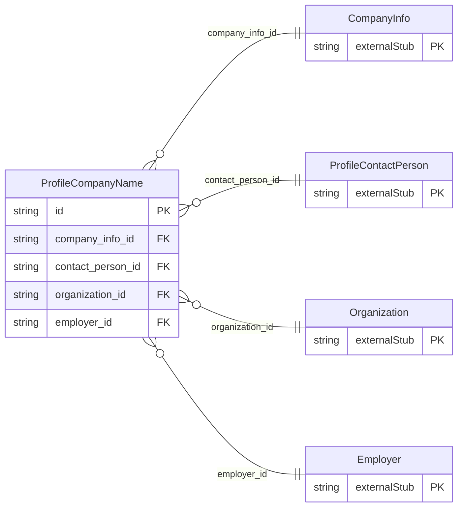

<!-- Code generated by protoc-gen-store. DO NOT EDIT. -->

# `ota/opentravel/common/profile/v1/types/company_name/` — Prisma schema

Generated from Protobuf by protoc-gen-store. Source of truth is the `.proto` files — regenerate rather than editing.

| Models | Enums |
| ---: | ---: |
| 1 | 0 |

## Entity relationships

Schema file: [`company_name.postgres.prisma`](./company_name.postgres.prisma)

### `ProfileCompanyName` → `company_names`

Identifies a company by name.

| Column | Type | Null |
| --- | --- | --- |
| `id` | `CHAR(26)` | not null |
| `company_short_display_name` | `VARCHAR(255)` | nullable |
| `travel_sector` | `ProfileTravelSector` | nullable |
| `code` | `VARCHAR(255)` | nullable |
| `code_context` | `VARCHAR(255)` | nullable |
| `region_code` | `VARCHAR(255)` | nullable |
| `division` | `VARCHAR(255)` | nullable |
| `department` | `VARCHAR(255)` | nullable |
| `value` | `VARCHAR(255)` | nullable |
| `company_info_id` | `CHAR(26)` | not null |
| `contact_person_id` | `CHAR(26)` | not null |
| `organization_id` | `CHAR(26)` | not null |
| `employer_id` | `CHAR(26)` | not null |
