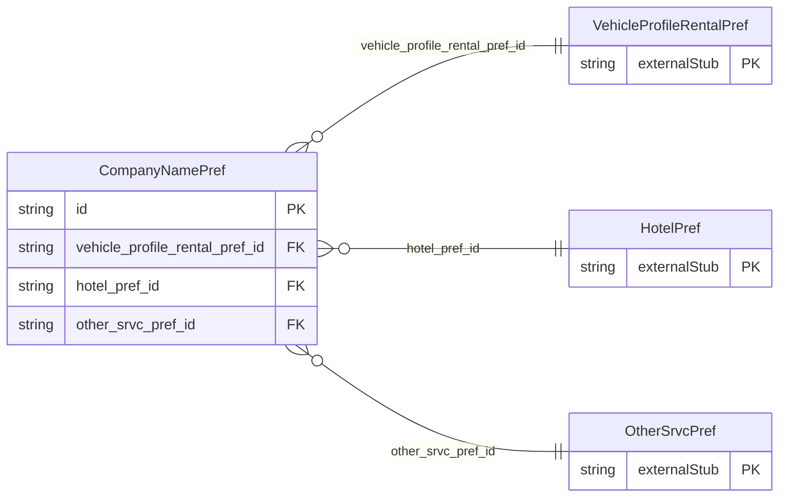

<!-- Code generated by protoc-gen-store. DO NOT EDIT. -->

# `ota/opentravel/common/profile/v1/types/company_name_pref/` — Prisma schema

Generated from Protobuf by protoc-gen-store. Source of truth is the `.proto` files — regenerate rather than editing.

| Models | Enums |
| ---: | ---: |
| 1 | 0 |

## Entity relationships

Schema file: [`company_name_pref.postgres.prisma`](./company_name_pref.postgres.prisma)

### `CompanyNamePref` → `company_name_prefs`

Identifies a preferred company by name.

| Column | Type | Null |
| --- | --- | --- |
| `id` | `CHAR(26)` | not null |
| `company_short_display_name` | `VARCHAR(255)` | nullable |
| `travel_sector` | `ProfileTravelSector` | nullable |
| `code` | `VARCHAR(255)` | nullable |
| `code_context` | `VARCHAR(255)` | nullable |
| `region_code` | `VARCHAR(255)` | nullable |
| `division` | `VARCHAR(255)` | nullable |
| `department` | `VARCHAR(255)` | nullable |
| `prefer_level` | `ProfilePreferLevel` | nullable |
| `value` | `VARCHAR(255)` | nullable |
| `vehicle_profile_rental_pref_id` | `CHAR(26)` | not null |
| `hotel_pref_id` | `CHAR(26)` | not null |
| `other_srvc_pref_id` | `CHAR(26)` | not null |
