<!-- Code generated by protoc-gen-store. DO NOT EDIT. -->

# `ota/opentravel/common/profile/v1/types/customer/` — Prisma schema

Generated from Protobuf by protoc-gen-store. Source of truth is the `.proto` files — regenerate rather than editing.

| Models | Enums |
| ---: | ---: |
| 47 | 21 |

## Entity relationships

```mermaid
erDiagram
    direction LR
    AdditionalLanguage {
        string id PK
        string customer_id FK
    }
    AdditionalReward {
        string id PK
        string member_preferences_id FK
        string company_display_name_id FK
        string name_id FK
    }
    AssociatedSupplier {
        string id PK
    }
    CitizenCountryName {
        string id PK
        string customer_id FK
    }
    Communication {
        string id PK
        string offer_id FK
    }
    Customer {
        string id PK
        string birth_day_id FK
        string employer_info_id FK
    }
    CustomerAddress {
        string id PK
        string customer_id FK
        string effective_day_id FK
        string expire_day_id FK
        string street_nmbr_id FK
        string state_prov_id FK
        string country_display_name_id FK
        string company_display_name_id FK
        string addressee_display_name_id FK
    }
    CustomerCustLoyalty {
        string id PK
        string customer_id FK
        string signup_day_id FK
        string effective_day_id FK
        string expire_day_id FK
        string member_preferences_id FK
        string security_info_id FK
    }
    CustomerEmail {
        string id PK
        string customer_id FK
    }
    CustomerPaymentForm {
        string id PK
        string customer_id FK
        string payment_card_id FK
        string bank_acct_id FK
        string direct_bill_id FK
        string voucher_id FK
        string loyalty_redemption_id FK
        string misc_charge_order_id FK
        string ticket_id FK
        string cash_id FK
        string associated_supplier_id FK
    }
    CustomerTelephone {
        string id PK
        string customer_id FK
        string effective_day_id FK
        string expire_day_id FK
    }
    CustomerUrl {
        string id PK
        string customer_id FK
    }
    MemberPreferences {
        string id PK
    }
    PasswordHint {
        string id PK
        string security_info_id FK
    }
    PaymentCardCustLoyalty {
        string id PK
        string payment_card_id FK
        string signup_day_id FK
        string effective_day_id FK
        string expire_day_id FK
    }
    PhysChallName {
        string id PK
        string customer_id FK
    }
    ProfileAddress {
        string id PK
        string company_info_id FK
        string street_nmbr_id FK
        string state_prov_id FK
        string country_display_name_id FK
    }
    ProfileAddressInfo {
        string id PK
        string contact_person_id FK
        string street_nmbr_id FK
        string state_prov_id FK
        string country_display_name_id FK
    }
    ProfileAuthenticationVerificationValue {
        string id PK
        string secure_id FK
    }
    ProfileBillingAccountName {
        string id PK
    }
    ProfileBldgRoom {
        string id PK
        string address_id FK
        string address_info_id FK
    }
    ProfileCash {
        string id PK
    }
    ProfileConjunctionTicketNbr {
        string id PK
        string ticket_id FK
    }
    ProfileContactPerson {
        string id PK
        string customer_id FK
        string company_info_id FK
        string birth_day_id FK
        string person_display_name_id FK
    }
    ProfileContactPersonTelephone {
        string id PK
        string contact_person_id FK
    }
    ProfileDirectBill {
        string id PK
        string company_display_name_id FK
        string address_id FK
        string email_id FK
        string telephone_id FK
    }
    ProfileDirectBillCompanyName {
        string id PK
    }
    ProfileDirectBillTelephone {
        string id PK
    }
    ProfileDocument {
        string id PK
        string customer_id FK
        string birth_day_id FK
        string effective_day_id FK
        string expire_day_id FK
        string doc_holder_formatted_display_name_id FK
    }
    ProfileEmail {
        string id PK
        string contact_person_id FK
        string payment_card_id FK
    }
    ProfileGateway {
        string id PK
        string authentication_verification_value_id FK
        string transaction_password_id FK
    }
    ProfileIssuer {
        string id PK
    }
    ProfileLoyaltyCertificate {
        string id PK
        string loyalty_redemption_id FK
        string effective_day_id FK
        string expire_day_id FK
    }
    ProfileLoyaltyRedemption {
        string id PK
    }
    ProfileMiscChargeOrder {
        string id PK
        string original_issue_day_id FK
    }
    ProfileOffer {
        string id PK
        string member_preferences_id FK
    }
    ProfilePaymentCard {
        string id PK
        string card_code_id FK
        string card_type_id FK
        string issuer_id FK
        string card_holder_name_details_id FK
        string address_id FK
        string card_number_id FK
        string series_code_id FK
        string three_domain_security_id FK
        string signature_on_file_id FK
    }
    ProfilePaymentCardTelephone {
        string id PK
        string payment_card_id FK
    }
    ProfileResults {
        string id PK
    }
    ProfileSignatureOnFile {
        string id PK
        string effective_day_id FK
        string expire_day_id FK
    }
    ProfileStreetNmbr {
        string id PK
    }
    ProfileThreeDomainSecurity {
        string id PK
        string gateway_id FK
        string results_id FK
    }
    ProfileTicket {
        string id PK
        string original_issue_day_id FK
    }
    ProfileTransactionPassword {
        string id PK
        string secure_id FK
    }
    ProfileVoucher {
        string id PK
        string effective_day_id FK
        string expire_day_id FK
        string billing_account_display_name_id FK
        string billing_account_address_id FK
    }
    SecurityInfo {
        string id PK
    }
    SubAccountBalance {
        string id PK
        string cust_loyalty_id FK
    }
    CompanyInfo {
        string externalStub PK
    }
    CompanyInfoAddressInfo {
        string externalStub PK
    }
    ProfileBankAcct {
        string externalStub PK
    }
    ProfileCompanyName {
        string externalStub PK
    }
    ProfileCountryName {
        string externalStub PK
    }
    ProfileDate {
        string externalStub PK
    }
    ProfileEncryptionToken {
        string externalStub PK
    }
    ProfileListPaymentCardIssuer {
        string externalStub PK
    }
    ProfilePaymentCardCode {
        string externalStub PK
    }
    ProfilePersonName {
        string externalStub PK
    }
    ProfileStateProv {
        string externalStub PK
    }
    AdditionalLanguage }o--|| Customer : "customer_id"
    AdditionalReward }o--|| MemberPreferences : "member_preferences_id"
    AdditionalReward }o--|| ProfileCompanyName : "company_display_name_id"
    AdditionalReward }o--|| ProfilePersonName : "name_id"
    CitizenCountryName }o--|| Customer : "customer_id"
    Communication }o--|| ProfileOffer : "offer_id"
    Customer }o--|| ProfileDate : "birth_day_id"
    Customer }o--|| ProfileCompanyName : "employer_info_id"
    CustomerAddress }o--|| Customer : "customer_id"
    CustomerAddress }o--|| ProfileDate : "effective_day_id"
    CustomerAddress }o--|| ProfileDate : "expire_day_id"
    CustomerAddress }o--|| ProfileStreetNmbr : "street_nmbr_id"
    CustomerAddress }o--|| ProfileStateProv : "state_prov_id"
    CustomerAddress }o--|| ProfileCountryName : "country_display_name_id"
    CustomerAddress }o--|| ProfileCompanyName : "company_display_name_id"
    CustomerAddress }o--|| ProfilePersonName : "addressee_display_name_id"
    CustomerCustLoyalty }o--|| Customer : "customer_id"
    CustomerCustLoyalty }o--|| ProfileDate : "signup_day_id"
    CustomerCustLoyalty }o--|| ProfileDate : "effective_day_id"
    CustomerCustLoyalty }o--|| ProfileDate : "expire_day_id"
    CustomerCustLoyalty }o--|| MemberPreferences : "member_preferences_id"
    CustomerCustLoyalty }o--|| SecurityInfo : "security_info_id"
    CustomerEmail }o--|| Customer : "customer_id"
    CustomerPaymentForm }o--|| Customer : "customer_id"
    CustomerPaymentForm }o--|| ProfilePaymentCard : "payment_card_id"
    CustomerPaymentForm }o--|| ProfileBankAcct : "bank_acct_id"
    CustomerPaymentForm }o--|| ProfileDirectBill : "direct_bill_id"
    CustomerPaymentForm }o--|| ProfileVoucher : "voucher_id"
    CustomerPaymentForm }o--|| ProfileLoyaltyRedemption : "loyalty_redemption_id"
    CustomerPaymentForm }o--|| ProfileMiscChargeOrder : "misc_charge_order_id"
    CustomerPaymentForm }o--|| ProfileTicket : "ticket_id"
    CustomerPaymentForm }o--|| ProfileCash : "cash_id"
    CustomerPaymentForm }o--|| AssociatedSupplier : "associated_supplier_id"
    CustomerTelephone }o--|| Customer : "customer_id"
    CustomerTelephone }o--|| ProfileDate : "effective_day_id"
    CustomerTelephone }o--|| ProfileDate : "expire_day_id"
    CustomerUrl }o--|| Customer : "customer_id"
    PasswordHint }o--|| SecurityInfo : "security_info_id"
    PaymentCardCustLoyalty }o--|| ProfilePaymentCard : "payment_card_id"
    PaymentCardCustLoyalty }o--|| ProfileDate : "signup_day_id"
    PaymentCardCustLoyalty }o--|| ProfileDate : "effective_day_id"
    PaymentCardCustLoyalty }o--|| ProfileDate : "expire_day_id"
    PhysChallName }o--|| Customer : "customer_id"
    ProfileAddress }o--|| CompanyInfo : "company_info_id"
    ProfileAddress }o--|| ProfileStreetNmbr : "street_nmbr_id"
    ProfileAddress }o--|| ProfileStateProv : "state_prov_id"
    ProfileAddress }o--|| ProfileCountryName : "country_display_name_id"
    ProfileAddressInfo }o--|| ProfileContactPerson : "contact_person_id"
    ProfileAddressInfo }o--|| ProfileStreetNmbr : "street_nmbr_id"
    ProfileAddressInfo }o--|| ProfileStateProv : "state_prov_id"
    ProfileAddressInfo }o--|| ProfileCountryName : "country_display_name_id"
    ProfileAuthenticationVerificationValue }o--|| ProfileEncryptionToken : "secure_id"
    ProfileBldgRoom }o--|| CustomerAddress : "address_id"
    ProfileBldgRoom }o--|| CompanyInfoAddressInfo : "address_info_id"
    ProfileConjunctionTicketNbr }o--|| ProfileTicket : "ticket_id"
    ProfileContactPerson }o--|| Customer : "customer_id"
    ProfileContactPerson }o--|| CompanyInfo : "company_info_id"
    ProfileContactPerson }o--|| ProfileDate : "birth_day_id"
    ProfileContactPerson }o--|| ProfilePersonName : "person_display_name_id"
    ProfileContactPersonTelephone }o--|| ProfileContactPerson : "contact_person_id"
    ProfileDirectBill }o--|| ProfileDirectBillCompanyName : "company_display_name_id"
    ProfileDirectBill }o--|| ProfileAddressInfo : "address_id"
    ProfileDirectBill }o--|| ProfileEmail : "email_id"
    ProfileDirectBill }o--|| ProfileDirectBillTelephone : "telephone_id"
    ProfileDocument }o--|| Customer : "customer_id"
    ProfileDocument }o--|| ProfileDate : "birth_day_id"
    ProfileDocument }o--|| ProfileDate : "effective_day_id"
    ProfileDocument }o--|| ProfileDate : "expire_day_id"
    ProfileDocument }o--|| ProfilePersonName : "doc_holder_formatted_display_name_id"
    ProfileEmail }o--|| ProfileContactPerson : "contact_person_id"
    ProfileEmail }o--|| ProfilePaymentCard : "payment_card_id"
    ProfileGateway }o--|| ProfileAuthenticationVerificationValue : "authentication_verification_value_id"
    ProfileGateway }o--|| ProfileTransactionPassword : "transaction_password_id"
    ProfileLoyaltyCertificate }o--|| ProfileLoyaltyRedemption : "loyalty_redemption_id"
    ProfileLoyaltyCertificate }o--|| ProfileDate : "effective_day_id"
    ProfileLoyaltyCertificate }o--|| ProfileDate : "expire_day_id"
    ProfileMiscChargeOrder }o--|| ProfileDate : "original_issue_day_id"
    ProfileOffer }o--|| MemberPreferences : "member_preferences_id"
    ProfilePaymentCard }o--|| ProfilePaymentCardCode : "card_code_id"
    ProfilePaymentCard }o--|| ProfileListPaymentCardIssuer : "card_type_id"
    ProfilePaymentCard }o--|| ProfileIssuer : "issuer_id"
    ProfilePaymentCard }o--|| ProfilePersonName : "card_holder_name_details_id"
    ProfilePaymentCard }o--|| ProfileAddress : "address_id"
    ProfilePaymentCard }o--|| ProfileEncryptionToken : "card_number_id"
    ProfilePaymentCard }o--|| ProfileEncryptionToken : "series_code_id"
    ProfilePaymentCard }o--|| ProfileThreeDomainSecurity : "three_domain_security_id"
    ProfilePaymentCard }o--|| ProfileSignatureOnFile : "signature_on_file_id"
    ProfilePaymentCardTelephone }o--|| ProfilePaymentCard : "payment_card_id"
    ProfileSignatureOnFile }o--|| ProfileDate : "effective_day_id"
    ProfileSignatureOnFile }o--|| ProfileDate : "expire_day_id"
    ProfileThreeDomainSecurity }o--|| ProfileGateway : "gateway_id"
    ProfileThreeDomainSecurity }o--|| ProfileResults : "results_id"
    ProfileTicket }o--|| ProfileDate : "original_issue_day_id"
    ProfileTransactionPassword }o--|| ProfileEncryptionToken : "secure_id"
    ProfileVoucher }o--|| ProfileDate : "effective_day_id"
    ProfileVoucher }o--|| ProfileDate : "expire_day_id"
    ProfileVoucher }o--|| ProfileBillingAccountName : "billing_account_display_name_id"
    ProfileVoucher }o--|| ProfileAddress : "billing_account_address_id"
    SubAccountBalance }o--|| CustomerCustLoyalty : "cust_loyalty_id"
```

Schema file: [`customer.postgres.prisma`](./customer.postgres.prisma)

### `Customer` → `customers`

Contains basic data on the customer's identity, location, relationships, finances, memberships, etc.

| Column | Type | Null |
| --- | --- | --- |
| `id` | `CHAR(26)` | not null |
| `gender` | `ProfileGender` | nullable |
| `deceased` | `BOOLEAN` | nullable |
| `lockout_type` | `VARCHAR(255)` | nullable |
| `currency_code` | `VARCHAR(255)` | nullable |
| `decimal_places` | `INTEGER` | nullable |
| `vip_indicator` | `BOOLEAN` | nullable |
| `text` | `VARCHAR(255)` | nullable |
| `language_code` | `VARCHAR(255)` | nullable |
| `customer_value` | `VARCHAR(255)` | nullable |
| `marital_status` | `MaritalCondition` | nullable |
| `previously_married_indicator` | `BOOLEAN` | nullable |
| `child_quantity` | `INTEGER` | nullable |
| `pet_info` | `VARCHAR(255)[]` | nullable |
| `birth_day_id` | `CHAR(26)` | nullable |
| `employer_info_id` | `CHAR(26)` | nullable |

### `CustomerTelephone` → `customer_telephones`

Information on a telephone number for the customer.

| Column | Type | Null |
| --- | --- | --- |
| `id` | `CHAR(26)` | not null |
| `expire_date_exclusive` | `BOOLEAN` | nullable |
| `rph` | `VARCHAR(255)` | nullable |
| `share_synch_ind` | `CustomerTelephoneShareSynchInd` | nullable |
| `share_market_ind` | `CustomerTelephoneShareMarketInd` | nullable |
| `phone_location_type` | `ProfilePhoneLocationType` | nullable |
| `phone_tech_type` | `ProfilePhoneTechnologyType` | nullable |
| `phone_use_type` | `ProfilePhoneUseType` | nullable |
| `country_access_code` | `VARCHAR(255)` | nullable |
| `area_city_code` | `VARCHAR(255)` | nullable |
| `phone_number` | `VARCHAR(255)` | not null |
| `extension` | `VARCHAR(255)` | nullable |
| `pin` | `VARCHAR(255)` | nullable |
| `remark` | `VARCHAR(255)` | nullable |
| `formatted` | `BOOLEAN` | nullable |
| `default_value` | `BOOLEAN` | nullable |
| `transfer_action` | `TransferAction` | nullable |
| `parent_company_ref` | `VARCHAR(255)` | nullable |
| `customer_id` | `CHAR(26)` | not null |
| `effective_day_id` | `CHAR(26)` | nullable |
| `expire_day_id` | `CHAR(26)` | nullable |

### `CustomerEmail` → `customer_emails`

Information on an email address for the customer.

| Column | Type | Null |
| --- | --- | --- |
| `id` | `CHAR(26)` | not null |
| `share_synch_ind` | `AccessesShareSynchInd` | nullable |
| `share_market_ind` | `AccessesShareMarketInd` | nullable |
| `default_value` | `BOOLEAN` | nullable |
| `email_type` | `ProfileEmailAddressType` | nullable |
| `rph` | `VARCHAR(255)` | nullable |
| `remark` | `VARCHAR(255)` | nullable |
| `valid` | `BOOLEAN` | nullable |
| `text_format` | `CustomerEmailTextFormat` | nullable |
| `transfer_action` | `TransferAction` | nullable |
| `parent_company_ref` | `VARCHAR(255)` | nullable |
| `value` | `VARCHAR(255)` | nullable |
| `customer_id` | `CHAR(26)` | not null |

### `CustomerAddress` → `customer_address`

Detailed information on an address for the customer.

| Column | Type | Null |
| --- | --- | --- |
| `id` | `CHAR(26)` | not null |
| `formatted` | `BOOLEAN` | nullable |
| `share_synch_ind` | `AccessesShareSynchInd` | nullable |
| `share_market_ind` | `AccessesShareMarketInd` | nullable |
| `type` | `ProfileCommunicationLocationType` | nullable |
| `remark` | `VARCHAR(255)` | nullable |
| `language_code` | `VARCHAR(255)` | nullable |
| `valid` | `BOOLEAN` | nullable |
| `default_value` | `BOOLEAN` | nullable |
| `use_type` | `ProfileAddressUseType` | nullable |
| `rph` | `VARCHAR(255)` | nullable |
| `expire_date_exclusive` | `BOOLEAN` | nullable |
| `validation_status` | `AddressValidation` | nullable |
| `transfer_action` | `TransferAction` | nullable |
| `parent_company_ref` | `VARCHAR(255)` | nullable |
| `address_lines` | `VARCHAR(255)[]` | nullable |
| `city_display_name` | `VARCHAR(255)` | nullable |
| `postal_code` | `VARCHAR(255)` | nullable |
| `county` | `VARCHAR(255)` | nullable |
| `customer_id` | `CHAR(26)` | not null |
| `effective_day_id` | `CHAR(26)` | nullable |
| `expire_day_id` | `CHAR(26)` | nullable |
| `street_nmbr_id` | `CHAR(26)` | nullable |
| `state_prov_id` | `CHAR(26)` | nullable |
| `country_display_name_id` | `CHAR(26)` | nullable |
| `company_display_name_id` | `CHAR(26)` | nullable |
| `addressee_display_name_id` | `CHAR(26)` | nullable |

### `CustomerUrl` → `customer_urls`

Information on a URL for the customer.

| Column | Type | Null |
| --- | --- | --- |
| `id` | `CHAR(26)` | not null |
| `type` | `VARCHAR(255)` | nullable |
| `default_value` | `BOOLEAN` | nullable |
| `transfer_action` | `TransferAction` | nullable |
| `value` | `VARCHAR(255)` | nullable |
| `customer_id` | `CHAR(26)` | not null |

### `CitizenCountryName` → `citizen_country_names`

Name of the (self-professed) country that is claimed for citizenship.

| Column | Type | Null |
| --- | --- | --- |
| `id` | `CHAR(26)` | not null |
| `default_value` | `BOOLEAN` | nullable |
| `region_code` | `VARCHAR(255)` | nullable |
| `customer_id` | `CHAR(26)` | not null |

### `PhysChallName` → `phys_chall_names`

Describes the customer's physical challenge.

| Column | Type | Null |
| --- | --- | --- |
| `id` | `CHAR(26)` | not null |
| `phys_chall` | `BOOLEAN` | nullable |
| `value` | `VARCHAR(255)` | nullable |
| `customer_id` | `CHAR(26)` | not null |

### `CustomerPaymentForm` → `customer_payment_forms`

Methods of providing funds and guarantees for travel by the customer.

| Column | Type | Null |
| --- | --- | --- |
| `id` | `CHAR(26)` | not null |
| `share_synch_ind` | `AccessesShareSynchInd` | nullable |
| `share_market_ind` | `AccessesShareMarketInd` | nullable |
| `cost_center_id` | `VARCHAR(255)` | nullable |
| `rph` | `VARCHAR(255)` | nullable |
| `payment_transaction_type_code` | `ProfilePaymentTransactionTypeCode` | nullable |
| `guarantee_indicator` | `BOOLEAN` | nullable |
| `guarantee_type_code` | `ProfilePaymentType` | nullable |
| `guarantee_id` | `VARCHAR(255)` | nullable |
| `remark` | `VARCHAR(255)` | nullable |
| `transfer_action` | `TransferAction` | nullable |
| `default_value` | `BOOLEAN` | nullable |
| `parent_company_ref` | `VARCHAR(255)` | nullable |
| `payment_card_choice_case` | `CustomerPaymentFormPaymentCardChoiceCase` | nullable |
| `customer_id` | `CHAR(26)` | not null |
| `payment_card_id` | `CHAR(26)` | nullable |
| `bank_acct_id` | `CHAR(26)` | nullable |
| `direct_bill_id` | `CHAR(26)` | nullable |
| `voucher_id` | `VARCHAR(255)` | nullable |
| `loyalty_redemption_id` | `CHAR(26)` | nullable |
| `misc_charge_order_id` | `CHAR(26)` | nullable |
| `ticket_id` | `CHAR(26)` | nullable |
| `cash_id` | `CHAR(26)` | nullable |
| `associated_supplier_id` | `CHAR(26)` | nullable |

### `ProfileContactPerson` → `contact_persons`

Name of an individual and appropriate contact information. May be contact information for the customer or someone affiliated with the customer.

| Column | Type | Null |
| --- | --- | --- |
| `id` | `CHAR(26)` | not null |
| `share_synch_ind` | `AccessesShareSynchInd` | nullable |
| `share_market_ind` | `AccessesShareMarketInd` | nullable |
| `default_value` | `BOOLEAN` | nullable |
| `contact_type` | `VARCHAR(255)` | nullable |
| `relation` | `VARCHAR(255)` | nullable |
| `emergency_flag` | `BOOLEAN` | nullable |
| `rph` | `VARCHAR(255)` | nullable |
| `communication_method_code` | `ProfileDistributionType` | nullable |
| `document_distrib_method_code` | `ProfileDistributionType` | nullable |
| `customer_id` | `CHAR(26)` | not null |
| `company_info_id` | `CHAR(26)` | not null |
| `birth_day_id` | `CHAR(26)` | nullable |
| `person_display_name_id` | `CHAR(26)` | nullable |

### `ProfileDocument` → `documents`

Provides information on a specific document.

| Column | Type | Null |
| --- | --- | --- |
| `id` | `CHAR(26)` | not null |
| `share_synch_ind` | `AccessesShareSynchInd` | nullable |
| `share_market_ind` | `AccessesShareMarketInd` | nullable |
| `doc_issue_authority` | `VARCHAR(255)` | nullable |
| `doc_issue_location` | `VARCHAR(255)` | nullable |
| `doc_id` | `VARCHAR(255)` | nullable |
| `doc_type` | `ProfileDocumentType` | nullable |
| `gender` | `ProfileGender` | nullable |
| `expire_date_exclusive` | `BOOLEAN` | nullable |
| `doc_issue_state_prov` | `VARCHAR(255)` | nullable |
| `doc_issue_region_code` | `VARCHAR(255)` | nullable |
| `birth_region_code` | `VARCHAR(255)` | nullable |
| `birth_place` | `VARCHAR(255)` | nullable |
| `doc_holder_nationality_region_code` | `VARCHAR(255)` | nullable |
| `contact_display_name` | `VARCHAR(255)` | nullable |
| `holder_type` | `HolderType` | nullable |
| `remark` | `VARCHAR(255)` | nullable |
| `postal_code` | `VARCHAR(255)` | nullable |
| `doc_holder_display_name` | `VARCHAR(255)` | nullable |
| `doc_limitations` | `VARCHAR(255)[]` | nullable |
| `additional_person_names` | `VARCHAR(255)[]` | nullable |
| `doc_holder_display_name_or_doc_holder_formatted_displa_049c2806` | `DocumentDocHolderDisplayNameOrDocHolderFormattedDisplayNameCase` | nullable |
| `customer_id` | `CHAR(26)` | not null |
| `birth_day_id` | `CHAR(26)` | nullable |
| `effective_day_id` | `CHAR(26)` | nullable |
| `expire_day_id` | `CHAR(26)` | nullable |
| `doc_holder_formatted_display_name_id` | `CHAR(26)` | nullable |

### `CustomerCustLoyalty` → `customer_cust_loyalties`

Loyalty program information for the customer.

| Column | Type | Null |
| --- | --- | --- |
| `id` | `CHAR(26)` | not null |
| `share_synch_ind` | `ProfilePaymentCardCustLoyaltyShareSynchInd` | nullable |
| `share_market_ind` | `ProfilePaymentCardCustLoyaltyShareMarketInd` | nullable |
| `program_id` | `VARCHAR(255)` | nullable |
| `membership_id` | `VARCHAR(255)` | nullable |
| `travel_sector` | `ProfileTravelSector` | nullable |
| `vendor_codes` | `VARCHAR(255)[]` | nullable |
| `primary_loyalty_indicator` | `BOOLEAN` | nullable |
| `alliance_loyalty_level_display_name` | `VARCHAR(255)` | nullable |
| `customer_type` | `VARCHAR(255)` | nullable |
| `customer_value` | `VARCHAR(255)` | nullable |
| `password` | `VARCHAR(255)` | nullable |
| `loyal_level` | `VARCHAR(255)` | nullable |
| `loyal_level_code` | `INTEGER` | nullable |
| `single_vendor_ind` | `PaymentCardCustLoyaltySingleVendorInd` | nullable |
| `expire_date_exclusive_indicator` | `BOOLEAN` | nullable |
| `rph` | `VARCHAR(255)` | nullable |
| `remark` | `VARCHAR(255)` | nullable |
| `customer_id` | `CHAR(26)` | not null |
| `signup_day_id` | `CHAR(26)` | nullable |
| `effective_day_id` | `CHAR(26)` | nullable |
| `expire_day_id` | `CHAR(26)` | nullable |
| `member_preferences_id` | `CHAR(26)` | nullable |
| `security_info_id` | `CHAR(26)` | nullable |

### `AdditionalLanguage` → `additional_languages`

Additional languages spoken by the traveler.

| Column | Type | Null |
| --- | --- | --- |
| `id` | `CHAR(26)` | not null |
| `code` | `VARCHAR(255)` | nullable |
| `customer_id` | `CHAR(26)` | not null |

### `ProfileAddress` → `address`

Provides address information.

| Column | Type | Null |
| --- | --- | --- |
| `id` | `CHAR(26)` | not null |
| `formatted` | `BOOLEAN` | nullable |
| `share_synch_ind` | `AccessesShareSynchInd` | nullable |
| `share_market_ind` | `AccessesShareMarketInd` | nullable |
| `type` | `ProfileCommunicationLocationType` | nullable |
| `remark` | `VARCHAR(255)` | nullable |
| `language_code` | `VARCHAR(255)` | nullable |
| `valid` | `BOOLEAN` | nullable |
| `address_lines` | `VARCHAR(255)[]` | nullable |
| `city_display_name` | `VARCHAR(255)` | nullable |
| `postal_code` | `VARCHAR(255)` | nullable |
| `county` | `VARCHAR(255)` | nullable |
| `company_info_id` | `CHAR(26)` | not null |
| `street_nmbr_id` | `CHAR(26)` | nullable |
| `state_prov_id` | `CHAR(26)` | nullable |
| `country_display_name_id` | `CHAR(26)` | nullable |

### `ProfileStreetNmbr` → `street_nmbrs`

May contain the street number and optionally the street name.

| Column | Type | Null |
| --- | --- | --- |
| `id` | `CHAR(26)` | not null |
| `po_box` | `VARCHAR(255)` | nullable |
| `street_nmbr_suffix` | `VARCHAR(255)` | nullable |
| `street_direction` | `VARCHAR(255)` | nullable |
| `rural_route_nmbr` | `VARCHAR(255)` | nullable |
| `value` | `VARCHAR(255)` | nullable |

### `ProfileBldgRoom` → `bldg_rooms`

Building name, room, apartment, or suite number.

| Column | Type | Null |
| --- | --- | --- |
| `id` | `CHAR(26)` | not null |
| `bldg_name_indicator` | `BOOLEAN` | nullable |
| `value` | `VARCHAR(255)` | nullable |
| `address_id` | `CHAR(26)` | not null |
| `address_info_id` | `CHAR(26)` | not null |

### `ProfilePaymentCard` → `payment_cards`

Specific payment card information. OpenTravel Best Practice: Use of Encrypted, Masked or Tokenized Information: Certain OpenTravel schema may have combinations payment and/or account information with other personally identifying information, such as customer name and date of birth. For enhanced customer privacy and security, it is RECOMMENDED that the payment and account information be protected, using tokenization or some other encryption method and displayed in a masked format.

| Column | Type | Null |
| --- | --- | --- |
| `id` | `CHAR(26)` | not null |
| `extended_payment` | `BOOLEAN` | nullable |
| `secure` | `BOOLEAN` | nullable |
| `signature_on_file_held` | `BOOLEAN` | nullable |
| `share_synch_ind` | `AccessesShareSynchInd` | nullable |
| `share_market_ind` | `AccessesShareMarketInd` | nullable |
| `card_holder_rph` | `VARCHAR(255)` | nullable |
| `company_card_reference` | `VARCHAR(255)` | nullable |
| `issue_region_code` | `VARCHAR(255)` | nullable |
| `effective_month_year` | `VARCHAR(255)` | nullable |
| `expiry_month_year` | `VARCHAR(255)` | nullable |
| `remark` | `VARCHAR(255)` | nullable |
| `rph` | `VARCHAR(255)` | nullable |
| `card_holder_display_name` | `VARCHAR(255)` | nullable |
| `card_code_id` | `CHAR(26)` | nullable |
| `card_type_id` | `CHAR(26)` | nullable |
| `issuer_id` | `CHAR(26)` | nullable |
| `card_holder_name_details_id` | `CHAR(26)` | nullable |
| `address_id` | `CHAR(26)` | nullable |
| `card_number_id` | `CHAR(26)` | nullable |
| `series_code_id` | `CHAR(26)` | nullable |
| `three_domain_security_id` | `CHAR(26)` | nullable |
| `signature_on_file_id` | `CHAR(26)` | nullable |

### `ProfileDirectBill` → `direct_bills`

Company name and location for sending invoice for remittances for travel services.

| Column | Type | Null |
| --- | --- | --- |
| `id` | `CHAR(26)` | not null |
| `share_synch_ind` | `AccessesShareSynchInd` | nullable |
| `share_market_ind` | `AccessesShareMarketInd` | nullable |
| `direct_bill_id` | `VARCHAR(255)` | nullable |
| `billing_number` | `VARCHAR(255)` | nullable |
| `company_display_name_id` | `CHAR(26)` | nullable |
| `address_id` | `CHAR(26)` | nullable |
| `email_id` | `CHAR(26)` | nullable |
| `telephone_id` | `CHAR(26)` | nullable |

### `ProfileVoucher` → `vouchers`

Details of a paper or electronic document indicating prepayment.

| Column | Type | Null |
| --- | --- | --- |
| `series_code` | `VARCHAR(255)` | nullable |
| `expire_date_exclusive_indicator` | `BOOLEAN` | nullable |
| `billing_number` | `VARCHAR(255)` | nullable |
| `supplier_id` | `VARCHAR(255)` | nullable |
| `id` | `VARCHAR(255)` | not null |
| `value_type` | `VARCHAR(255)` | nullable |
| `electronic_indicator` | `BOOLEAN` | nullable |
| `group_days_apply` | `BOOLEAN` | nullable |
| `effective_day_id` | `CHAR(26)` | nullable |
| `expire_day_id` | `CHAR(26)` | nullable |
| `billing_account_display_name_id` | `CHAR(26)` | nullable |
| `billing_account_address_id` | `CHAR(26)` | nullable |

### `ProfileLoyaltyRedemption` → `loyalty_redemptions`

Details of a loyalty redemption arrangement. This is normally miles or points.

| Column | Type | Null |
| --- | --- | --- |
| `id` | `CHAR(26)` | not null |
| `certificate_number` | `VARCHAR(255)` | nullable |
| `member_number` | `VARCHAR(255)` | nullable |
| `program_display_name` | `VARCHAR(255)` | nullable |
| `promotion_code` | `VARCHAR(255)` | nullable |
| `promotion_vendor_codes` | `VARCHAR(255)[]` | nullable |
| `redemption_quantity` | `INTEGER` | nullable |

### `ProfileMiscChargeOrder` → `misc_charge_orders`

Details of a miscellaneous charge order (MCO).

| Column | Type | Null |
| --- | --- | --- |
| `id` | `CHAR(26)` | not null |
| `ticket_number` | `VARCHAR(255)` | nullable |
| `original_ticket_number` | `VARCHAR(255)` | nullable |
| `original_issue_place` | `VARCHAR(255)` | nullable |
| `original_issue_iata` | `VARCHAR(255)` | nullable |
| `original_payment_form` | `VARCHAR(255)` | nullable |
| `check_inhibitor_type` | `ProfileCheckInhibitorType` | nullable |
| `coupon_rphs` | `VARCHAR(255)[]` | nullable |
| `paper_mco_exist` | `BOOLEAN` | nullable |
| `original_issue_day_id` | `CHAR(26)` | nullable |

### `ProfileTicket` → `tickets`

Details of a ticket to be exchanged.

| Column | Type | Null |
| --- | --- | --- |
| `id` | `CHAR(26)` | not null |
| `ticket_number` | `VARCHAR(255)` | nullable |
| `original_ticket_number` | `VARCHAR(255)` | nullable |
| `original_issue_place` | `VARCHAR(255)` | nullable |
| `original_issue_iata` | `VARCHAR(255)` | nullable |
| `original_payment_form` | `VARCHAR(255)` | nullable |
| `check_inhibitor_type` | `ProfileCheckInhibitorType` | nullable |
| `coupon_rphs` | `VARCHAR(255)[]` | nullable |
| `rerouting_type` | `ProfileReroutingType` | nullable |
| `reroute_reason` | `VARCHAR(255)` | nullable |
| `original_issue_day_id` | `CHAR(26)` | nullable |

### `ProfileCash` → `cashes`

Used to indicate payment in cash.

| Column | Type | Null |
| --- | --- | --- |
| `id` | `CHAR(26)` | not null |
| `cash_indicator` | `BOOLEAN` | nullable |

### `AssociatedSupplier` → `associated_suppliers`

The supplier for whom this is the preferred method of payment.

| Column | Type | Null |
| --- | --- | --- |
| `id` | `CHAR(26)` | not null |
| `company_short_display_name` | `VARCHAR(255)` | nullable |
| `travel_sector` | `ProfileTravelSector` | nullable |
| `code` | `VARCHAR(255)` | nullable |
| `code_context` | `VARCHAR(255)` | nullable |
| `region_code` | `VARCHAR(255)` | nullable |

### `ProfileContactPersonTelephone` → `contact_person_telephones`

Information about a telephone number, including the actual number and its usage.

| Column | Type | Null |
| --- | --- | --- |
| `id` | `CHAR(26)` | not null |
| `rph` | `VARCHAR(255)` | nullable |
| `share_synch_ind` | `CustomerTelephoneShareSynchInd` | nullable |
| `share_market_ind` | `CustomerTelephoneShareMarketInd` | nullable |
| `phone_location_type` | `ProfilePhoneLocationType` | nullable |
| `phone_tech_type` | `ProfilePhoneTechnologyType` | nullable |
| `phone_use_type` | `ProfilePhoneUseType` | nullable |
| `country_access_code` | `VARCHAR(255)` | nullable |
| `area_city_code` | `VARCHAR(255)` | nullable |
| `phone_number` | `VARCHAR(255)` | not null |
| `extension` | `VARCHAR(255)` | nullable |
| `pin` | `VARCHAR(255)` | nullable |
| `remark` | `VARCHAR(255)` | nullable |
| `formatted` | `BOOLEAN` | nullable |
| `default_value` | `BOOLEAN` | nullable |
| `contact_person_id` | `CHAR(26)` | not null |

### `ProfileAddressInfo` → `address_infos`

Information about an address that identifies a location for a specific purposes.

| Column | Type | Null |
| --- | --- | --- |
| `id` | `CHAR(26)` | not null |
| `formatted` | `BOOLEAN` | nullable |
| `share_synch_ind` | `AccessesShareSynchInd` | nullable |
| `share_market_ind` | `AccessesShareMarketInd` | nullable |
| `type` | `ProfileCommunicationLocationType` | nullable |
| `remark` | `VARCHAR(255)` | nullable |
| `language_code` | `VARCHAR(255)` | nullable |
| `valid` | `BOOLEAN` | nullable |
| `default_value` | `BOOLEAN` | nullable |
| `use_type` | `ProfileAddressUseType` | nullable |
| `rph` | `VARCHAR(255)` | nullable |
| `address_lines` | `VARCHAR(255)[]` | nullable |
| `city_display_name` | `VARCHAR(255)` | nullable |
| `postal_code` | `VARCHAR(255)` | nullable |
| `county` | `VARCHAR(255)` | nullable |
| `contact_person_id` | `CHAR(26)` | not null |
| `street_nmbr_id` | `CHAR(26)` | nullable |
| `state_prov_id` | `CHAR(26)` | nullable |
| `country_display_name_id` | `CHAR(26)` | nullable |

### `ProfileEmail` → `emails`

Electronic email addresses, in IETF specified format.

| Column | Type | Null |
| --- | --- | --- |
| `id` | `CHAR(26)` | not null |
| `share_synch_ind` | `AccessesShareSynchInd` | nullable |
| `share_market_ind` | `AccessesShareMarketInd` | nullable |
| `default_value` | `BOOLEAN` | nullable |
| `email_type` | `ProfileEmailAddressType` | nullable |
| `rph` | `VARCHAR(255)` | nullable |
| `remark` | `VARCHAR(255)` | nullable |
| `valid` | `BOOLEAN` | nullable |
| `text_format` | `CustomerEmailTextFormat` | nullable |
| `value` | `VARCHAR(255)` | nullable |
| `contact_person_id` | `CHAR(26)` | not null |
| `payment_card_id` | `CHAR(26)` | not null |

### `MemberPreferences` → `member_preferences`

Loyalty program preferences specified by the enrolling member.

| Column | Type | Null |
| --- | --- | --- |
| `id` | `CHAR(26)` | not null |
| `awareness` | `VARCHAR(255)` | nullable |
| `promotion_code` | `VARCHAR(255)` | nullable |
| `promotion_vendor_codes` | `VARCHAR(255)[]` | nullable |
| `awards_preference` | `AwardsPreference` | nullable |

### `SecurityInfo` → `security_infos`

Information allowing member to securely access account.

| Column | Type | Null |
| --- | --- | --- |
| `id` | `CHAR(26)` | not null |
| `username` | `VARCHAR(255)` | nullable |
| `password` | `VARCHAR(255)` | nullable |

### `SubAccountBalance` → `sub_account_balances`

Used to specify a sub-account and its point balance associated with this loyalty account.

| Column | Type | Null |
| --- | --- | --- |
| `id` | `CHAR(26)` | not null |
| `type` | `VARCHAR(255)` | nullable |
| `balance` | `INTEGER` | nullable |
| `cust_loyalty_id` | `CHAR(26)` | not null |

### `ProfileIssuer` → `issuers`

Payment card issuer. Example: BritishAirwaysVisaSignatureCard

| Column | Type | Null |
| --- | --- | --- |
| `id` | `CHAR(26)` | not null |
| `removal` | `BOOLEAN` | nullable |
| `code` | `VARCHAR(255)` | nullable |
| `description` | `VARCHAR(255)` | nullable |
| `description_detail` | `VARCHAR(255)` | nullable |
| `source_display_name` | `VARCHAR(255)` | nullable |
| `source_uri` | `VARCHAR(255)` | nullable |
| `resource_display_name` | `VARCHAR(255)` | nullable |
| `resource_uri` | `VARCHAR(255)` | nullable |
| `unique_id` | `VARCHAR(255)` | nullable |
| `bank_id` | `VARCHAR(255)` | nullable |
| `value` | `ProfileListPaymentCardIssuerBase` | nullable |

### `ProfilePaymentCardTelephone` → `payment_card_telephones`

Card holder telephone number.

| Column | Type | Null |
| --- | --- | --- |
| `id` | `CHAR(26)` | not null |
| `rph` | `VARCHAR(255)` | nullable |
| `share_synch_ind` | `CustomerTelephoneShareSynchInd` | nullable |
| `share_market_ind` | `CustomerTelephoneShareMarketInd` | nullable |
| `phone_location_type` | `ProfilePhoneLocationType` | nullable |
| `phone_tech_type` | `ProfilePhoneTechnologyType` | nullable |
| `phone_use_type` | `ProfilePhoneUseType` | nullable |
| `country_access_code` | `VARCHAR(255)` | nullable |
| `area_city_code` | `VARCHAR(255)` | nullable |
| `phone_number` | `VARCHAR(255)` | not null |
| `extension` | `VARCHAR(255)` | nullable |
| `pin` | `VARCHAR(255)` | nullable |
| `remark` | `VARCHAR(255)` | nullable |
| `formatted` | `BOOLEAN` | nullable |
| `default_value` | `BOOLEAN` | nullable |
| `payment_card_id` | `CHAR(26)` | not null |

### `PaymentCardCustLoyalty` → `payment_card_cust_loyalties`

Card holder loyalty program.

| Column | Type | Null |
| --- | --- | --- |
| `id` | `CHAR(26)` | not null |
| `share_synch_ind` | `ProfilePaymentCardCustLoyaltyShareSynchInd` | nullable |
| `share_market_ind` | `ProfilePaymentCardCustLoyaltyShareMarketInd` | nullable |
| `program_id` | `VARCHAR(255)` | nullable |
| `membership_id` | `VARCHAR(255)` | nullable |
| `travel_sector` | `ProfileTravelSector` | nullable |
| `vendor_codes` | `VARCHAR(255)[]` | nullable |
| `primary_loyalty_indicator` | `BOOLEAN` | nullable |
| `alliance_loyalty_level_display_name` | `VARCHAR(255)` | nullable |
| `customer_type` | `VARCHAR(255)` | nullable |
| `customer_value` | `VARCHAR(255)` | nullable |
| `password` | `VARCHAR(255)` | nullable |
| `loyal_level` | `VARCHAR(255)` | nullable |
| `loyal_level_code` | `INTEGER` | nullable |
| `single_vendor_ind` | `PaymentCardCustLoyaltySingleVendorInd` | nullable |
| `expire_date_exclusive_indicator` | `BOOLEAN` | nullable |
| `rph` | `VARCHAR(255)` | nullable |
| `payment_card_id` | `CHAR(26)` | not null |
| `signup_day_id` | `CHAR(26)` | nullable |
| `effective_day_id` | `CHAR(26)` | nullable |
| `expire_day_id` | `CHAR(26)` | nullable |

### `ProfileThreeDomainSecurity` → `three_domain_securities`

3-D secure financial authorization information. Note: This contains 3-D Secure protocol information for online credit and debit card transactions for programs such as Verified by Visa, MasterCard SecureCode, J/Secure and SafeKey.

| Column | Type | Null |
| --- | --- | --- |
| `id` | `CHAR(26)` | not null |
| `gateway_id` | `CHAR(26)` | nullable |
| `results_id` | `CHAR(26)` | nullable |

### `ProfileSignatureOnFile` → `signature_on_files`

Signature on file. Note: This indicates if the signature is authorized as a form of guarantee. In some countries, the customer can sign the payment card slip as a form of guarantee.

| Column | Type | Null |
| --- | --- | --- |
| `id` | `CHAR(26)` | not null |
| `signature_on_file` | `BOOLEAN` | nullable |
| `expire_date_exclusive` | `BOOLEAN` | nullable |
| `effective_day_id` | `CHAR(26)` | nullable |
| `expire_day_id` | `CHAR(26)` | nullable |

### `ProfileDirectBillCompanyName` → `direct_bill_company_names`

Company name to whom remittance should be directed.

| Column | Type | Null |
| --- | --- | --- |
| `id` | `CHAR(26)` | not null |
| `company_short_display_name` | `VARCHAR(255)` | nullable |
| `travel_sector` | `ProfileTravelSector` | nullable |
| `code` | `VARCHAR(255)` | nullable |
| `code_context` | `VARCHAR(255)` | nullable |
| `region_code` | `VARCHAR(255)` | nullable |
| `division` | `VARCHAR(255)` | nullable |
| `department` | `VARCHAR(255)` | nullable |
| `contact_display_name` | `VARCHAR(255)` | nullable |
| `value` | `VARCHAR(255)` | nullable |

### `ProfileDirectBillTelephone` → `direct_bill_telephones`

Telephone number associated with company to whom remittance is being directed.

| Column | Type | Null |
| --- | --- | --- |
| `id` | `CHAR(26)` | not null |
| `rph` | `VARCHAR(255)` | nullable |
| `share_synch_ind` | `CustomerTelephoneShareSynchInd` | nullable |
| `share_market_ind` | `CustomerTelephoneShareMarketInd` | nullable |
| `phone_location_type` | `ProfilePhoneLocationType` | nullable |
| `phone_tech_type` | `ProfilePhoneTechnologyType` | nullable |
| `phone_use_type` | `ProfilePhoneUseType` | nullable |
| `country_access_code` | `VARCHAR(255)` | nullable |
| `area_city_code` | `VARCHAR(255)` | nullable |
| `phone_number` | `VARCHAR(255)` | not null |
| `extension` | `VARCHAR(255)` | nullable |
| `pin` | `VARCHAR(255)` | nullable |
| `remark` | `VARCHAR(255)` | nullable |
| `formatted` | `BOOLEAN` | nullable |
| `default_value` | `BOOLEAN` | nullable |

### `ProfileBillingAccountName` → `billing_account_names`

The name of the Billing Account for which the voucher has been issued.

| Column | Type | Null |
| --- | --- | --- |
| `id` | `CHAR(26)` | not null |
| `company_short_display_name` | `VARCHAR(255)` | nullable |
| `travel_sector` | `ProfileTravelSector` | nullable |
| `code` | `VARCHAR(255)` | nullable |
| `code_context` | `VARCHAR(255)` | nullable |
| `region_code` | `VARCHAR(255)` | nullable |
| `division` | `VARCHAR(255)` | nullable |
| `department` | `VARCHAR(255)` | nullable |
| `contact_display_name` | `VARCHAR(255)` | nullable |
| `value` | `VARCHAR(255)` | nullable |

### `ProfileLoyaltyCertificate` → `loyalty_certificates`

A certificate may be needed in order to redeem miles or points. Certificates may be used in combination with each other as part of a reservation.

| Column | Type | Null |
| --- | --- | --- |
| `id` | `VARCHAR(255)` | not null |
| `id_context` | `VARCHAR(255)` | nullable |
| `certificate_number` | `VARCHAR(255)` | nullable |
| `member_number` | `VARCHAR(255)` | nullable |
| `program_display_name` | `VARCHAR(255)` | nullable |
| `expire_date_exclusive_indicator` | `BOOLEAN` | nullable |
| `night_count` | `INTEGER` | nullable |
| `format` | `ProfileFormat` | nullable |
| `status` | `VARCHAR(255)` | nullable |
| `loyalty_redemption_id` | `CHAR(26)` | not null |
| `effective_day_id` | `CHAR(26)` | nullable |
| `expire_day_id` | `CHAR(26)` | nullable |

### `ProfileConjunctionTicketNbr` → `conjunction_ticket_nbrs`

Conjunction ticket number in case a conjunction ticket is exchanged.

| Column | Type | Null |
| --- | --- | --- |
| `id` | `CHAR(26)` | not null |
| `coupons` | `VARCHAR(255)[]` | nullable |
| `value` | `VARCHAR(255)` | nullable |
| `ticket_id` | `CHAR(26)` | not null |

### `AdditionalReward` → `additional_rewards`

Additional programs that are honored by the primary loyalty account.

| Column | Type | Null |
| --- | --- | --- |
| `id` | `CHAR(26)` | not null |
| `member_id` | `VARCHAR(255)` | nullable |
| `member_preferences_id` | `CHAR(26)` | not null |
| `company_display_name_id` | `CHAR(26)` | nullable |
| `name_id` | `CHAR(26)` | nullable |

### `ProfileOffer` → `offers`

Source from which members can receive information.

| Column | Type | Null |
| --- | --- | --- |
| `id` | `CHAR(26)` | not null |
| `type` | `CustomerCustLoyaltyMemberPreferencesOfferType` | nullable |
| `member_preferences_id` | `CHAR(26)` | not null |

### `PasswordHint` → `password_hints`

Alternate method to password for account access.

| Column | Type | Null |
| --- | --- | --- |
| `id` | `CHAR(26)` | not null |
| `hint` | `Hint` | nullable |
| `value` | `VARCHAR(255)` | nullable |
| `security_info_id` | `CHAR(26)` | not null |

### `ProfileGateway` → `gateways`

Merchant gateway information.

| Column | Type | Null |
| --- | --- | --- |
| `id` | `CHAR(26)` | not null |
| `eci` | `VARCHAR(255)` | nullable |
| `merchant_id` | `VARCHAR(255)` | nullable |
| `processor_id` | `VARCHAR(255)` | nullable |
| `uri` | `VARCHAR(255)` | nullable |
| `authentication_verification_value_id` | `CHAR(26)` | nullable |
| `transaction_password_id` | `CHAR(26)` | nullable |

### `ProfileResults` → `results`

Transaction results.

| Column | Type | Null |
| --- | --- | --- |
| `id` | `CHAR(26)` | not null |
| `cavv` | `VARCHAR(255)` | nullable |
| `pa_res_status` | `VARCHAR(255)` | nullable |
| `signature_verfication` | `VARCHAR(255)` | nullable |
| `transaction_id` | `VARCHAR(255)` | nullable |
| `xid` | `VARCHAR(255)` | nullable |

### `Communication` → `communications`

Preferred method of offer communication.

| Column | Type | Null |
| --- | --- | --- |
| `id` | `CHAR(26)` | not null |
| `distrib_type` | `ProfileDistributionType` | nullable |
| `offer_id` | `CHAR(26)` | not null |

### `ProfileAuthenticationVerificationValue` → `authentication_verification_values`

Cardholder authentication value information.

| Column | Type | Null |
| --- | --- | --- |
| `id` | `CHAR(26)` | not null |
| `plain_text` | `VARCHAR(255)` | nullable |
| `secure_or_plain_text_case` | `ProfileAuthenticationVerificationValueSecureOrPlainTextCase` | nullable |
| `secure_id` | `CHAR(26)` | nullable |

### `ProfileTransactionPassword` → `transaction_passwords`

Merchant transaction password information.

| Column | Type | Null |
| --- | --- | --- |
| `id` | `CHAR(26)` | not null |
| `plain_text` | `VARCHAR(255)` | nullable |
| `secure_or_plain_text_case` | `ProfileTransactionPasswordSecureOrPlainTextCase` | nullable |
| `secure_id` | `CHAR(26)` | nullable |

### Enums

- `ProfileGender`: MALE, FEMALE, UNKNOWN, MALE_NO_SHARE, FEMALE_NO_SHARE
- `MaritalCondition`: ANNULLED, CO_HABITATING, DIVORCED, ENGAGED, MARRIED, SEPARATED, SINGLE, WIDOWED, UNKNOWN
- `CustomerTelephoneShareSynchInd`: YES, NO, INHERIT
- `CustomerTelephoneShareMarketInd`: YES, NO, INHERIT
- `CustomerEmailTextFormat`: TEXT_HTML, TEXT_PLAIN
- `AddressValidation`: SYSTEM_VALIDATED, USER_VALIDATED, NOT_CHECKED
- `ProfilePaymentTransactionTypeCode`: CHARGE, RESERVE, REFUND
- `CustomerPaymentFormPaymentCardChoiceCase`: PAYMENT_CARD, BANK_ACCT, DIRECT_BILL, VOUCHER, LOYALTY_REDEMPTION, MISC_CHARGE_ORDER, TICKET, CASH
- `HolderType`: INFANT, HEAD_OF_HOUSEHOLD
- `DocumentDocHolderDisplayNameOrDocHolderFormattedDisplayNameCase`: DOC_HOLDER_DISPLAY_NAME, DOC_HOLDER_FORMATTED_DISPLAY_NAME
- `ProfilePaymentCardCustLoyaltyShareSynchInd`: YES, NO, INHERIT
- `ProfilePaymentCardCustLoyaltyShareMarketInd`: YES, NO, INHERIT
- `PaymentCardCustLoyaltySingleVendorInd`: SINGLE_VNDR, ALLIANCE
- `ProfileCheckInhibitorType`: CHECK_DIGIT, INTERLINE_AGREEMENT, BOTH
- `ProfileReroutingType`: VOLUNTARY, INVOLUNTARY
- `AwardsPreference`: POINTS, MILES
- `ProfileFormat`: PAPER, ELECTRONIC
- `CustomerCustLoyaltyMemberPreferencesOfferType`: PARTNER, LOYALTY
- `Hint`: QUESTION, ANSWER
- `ProfileAuthenticationVerificationValueSecureOrPlainTextCase`: SECURE, PLAIN_TEXT
- `ProfileTransactionPasswordSecureOrPlainTextCase`: SECURE, PLAIN_TEXT
