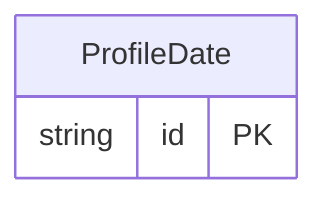

<!-- Code generated by protoc-gen-store. DO NOT EDIT. -->

# `ota/opentravel/common/profile/v1/types/date/` — Prisma schema

Generated from Protobuf by protoc-gen-store. Source of truth is the `.proto` files — regenerate rather than editing.

| Models | Enums |
| ---: | ---: |
| 1 | 0 |

## Entity relationships

Schema file: [`date.postgres.prisma`](./date.postgres.prisma)

### `ProfileDate` → `dates`

A calendar date with no time zone, after google.type.Date. A stay date is a date at the hotel; a Timestamp would invent an instant and a zone OTA never sent. See docs/decisions.md.

| Column | Type | Null |
| --- | --- | --- |
| `id` | `CHAR(26)` | not null |
| `year` | `INTEGER` | nullable |
| `month` | `INTEGER` | nullable |
| `day` | `INTEGER` | nullable |
