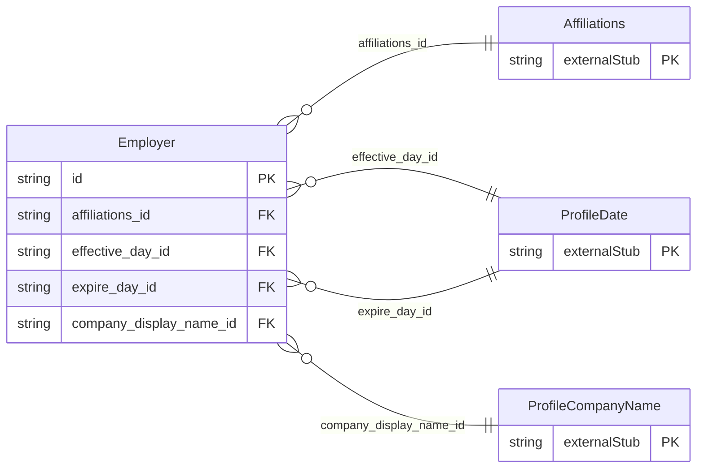

<!-- Code generated by protoc-gen-store. DO NOT EDIT. -->

# `ota/opentravel/common/profile/v1/types/employer/` — Prisma schema

Generated from Protobuf by protoc-gen-store. Source of truth is the `.proto` files — regenerate rather than editing.

| Models | Enums |
| ---: | ---: |
| 1 | 0 |

## Entity relationships

Schema file: [`employer.postgres.prisma`](./employer.postgres.prisma)

### `Employer` → `employers`

Company or organization that employs the customer.

| Column | Type | Null |
| --- | --- | --- |
| `id` | `CHAR(26)` | not null |
| `default_value` | `BOOLEAN` | nullable |
| `office_type` | `OfficeLocation` | nullable |
| `expire_date_exclusive` | `BOOLEAN` | nullable |
| `affiliations_id` | `CHAR(26)` | not null |
| `effective_day_id` | `CHAR(26)` | nullable |
| `expire_day_id` | `CHAR(26)` | nullable |
| `company_display_name_id` | `CHAR(26)` | nullable |
