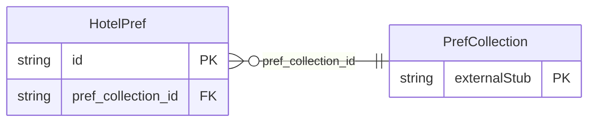

<!-- Code generated by protoc-gen-store. DO NOT EDIT. -->

# `ota/opentravel/common/profile/v1/types/hotel_pref/` — Prisma schema

Generated from Protobuf by protoc-gen-store. Source of truth is the `.proto` files — regenerate rather than editing.

| Models | Enums |
| ---: | ---: |
| 1 | 0 |

## Entity relationships

Schema file: [`hotel_pref.postgres.prisma`](./hotel_pref.postgres.prisma)

### `HotelPref` → `hotel_prefs`

These are the hotel preference elements used on an instance of a profile.

| Column | Type | Null |
| --- | --- | --- |
| `id` | `CHAR(26)` | not null |
| `prefer_level` | `ProfilePreferLevel` | nullable |
| `share_synch_ind` | `AccessesShareSynchInd` | nullable |
| `share_market_ind` | `AccessesShareMarketInd` | nullable |
| `smoking_allowed` | `BOOLEAN` | nullable |
| `rate_plan_code` | `VARCHAR(255)` | nullable |
| `hotel_guest_type` | `HotelGuestType` | nullable |
| `pref_collection_id` | `CHAR(26)` | not null |
