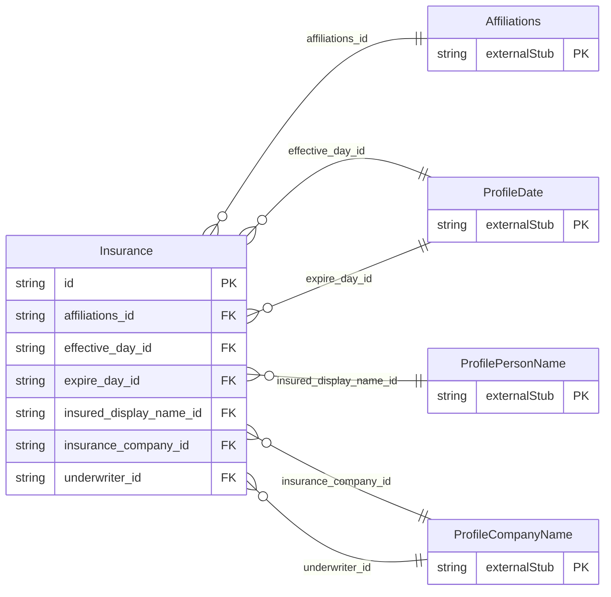

<!-- Code generated by protoc-gen-store. DO NOT EDIT. -->

# `ota/opentravel/common/profile/v1/types/insurance/` — Prisma schema

Generated from Protobuf by protoc-gen-store. Source of truth is the `.proto` files — regenerate rather than editing.

| Models | Enums |
| ---: | ---: |
| 1 | 0 |

## Entity relationships

Schema file: [`insurance.postgres.prisma`](./insurance.postgres.prisma)

### `Insurance` → `insurances`

Travel insurance carried by the customer or company.

| Column | Type | Null |
| --- | --- | --- |
| `id` | `CHAR(26)` | not null |
| `share_synch_ind` | `AccessesShareSynchInd` | nullable |
| `share_market_ind` | `AccessesShareMarketInd` | nullable |
| `insurance_type` | `VARCHAR(255)` | nullable |
| `policy_number` | `VARCHAR(255)` | not null |
| `expire_date_exclusive` | `BOOLEAN` | nullable |
| `rph` | `VARCHAR(255)` | nullable |
| `affiliations_id` | `CHAR(26)` | not null |
| `effective_day_id` | `CHAR(26)` | nullable |
| `expire_day_id` | `CHAR(26)` | nullable |
| `insured_display_name_id` | `CHAR(26)` | nullable |
| `insurance_company_id` | `CHAR(26)` | nullable |
| `underwriter_id` | `CHAR(26)` | nullable |
