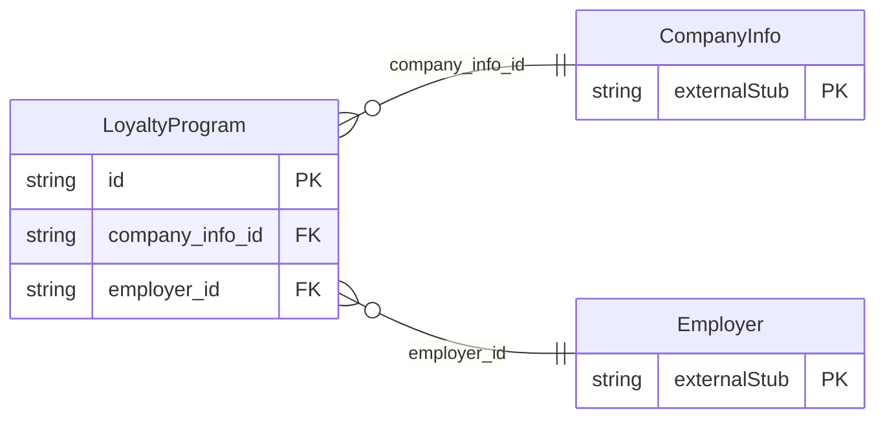

<!-- Code generated by protoc-gen-store. DO NOT EDIT. -->

# `ota/opentravel/common/profile/v1/types/loyalty_program/` — Prisma schema

Generated from Protobuf by protoc-gen-store. Source of truth is the `.proto` files — regenerate rather than editing.

| Models | Enums |
| ---: | ---: |
| 1 | 1 |

## Entity relationships

Schema file: [`loyalty_program.postgres.prisma`](./loyalty_program.postgres.prisma)

### `LoyaltyProgram` → `loyalty_programs`

Identifies a membership or loyalty program offered by the company by name of the program.

| Column | Type | Null |
| --- | --- | --- |
| `id` | `CHAR(26)` | not null |
| `program_code` | `VARCHAR(255)` | nullable |
| `single_vendor_ind` | `LoyaltyProgramSingleVendorInd` | nullable |
| `loyalty_level` | `VARCHAR(255)` | nullable |
| `rph` | `VARCHAR(255)` | nullable |
| `primary_loyalty_indicator` | `BOOLEAN` | nullable |
| `value` | `VARCHAR(255)` | nullable |
| `company_info_id` | `CHAR(26)` | not null |
| `employer_id` | `CHAR(26)` | not null |

### Enums

- `LoyaltyProgramSingleVendorInd`: SINGLE_VNDR, ALLIANCE
