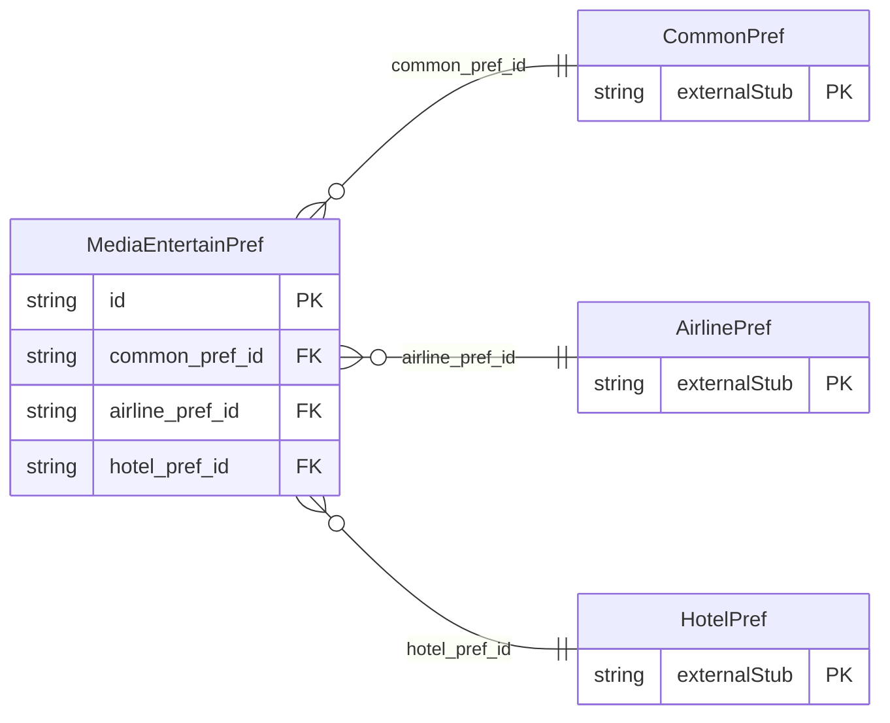

<!-- Code generated by protoc-gen-store. DO NOT EDIT. -->

# `ota/opentravel/common/profile/v1/types/media_entertain_pref/` — Prisma schema

Generated from Protobuf by protoc-gen-store. Source of truth is the `.proto` files — regenerate rather than editing.

| Models | Enums |
| ---: | ---: |
| 1 | 0 |

## Entity relationships

Schema file: [`media_entertain_pref.postgres.prisma`](./media_entertain_pref.postgres.prisma)

### `MediaEntertainPref` → `media_entertain_prefs`

Media and entertainment information preferences.

| Column | Type | Null |
| --- | --- | --- |
| `id` | `CHAR(26)` | not null |
| `prefer_level` | `ProfilePreferLevel` | nullable |
| `value` | `VARCHAR(255)` | nullable |
| `common_pref_id` | `CHAR(26)` | not null |
| `airline_pref_id` | `CHAR(26)` | not null |
| `hotel_pref_id` | `CHAR(26)` | not null |
