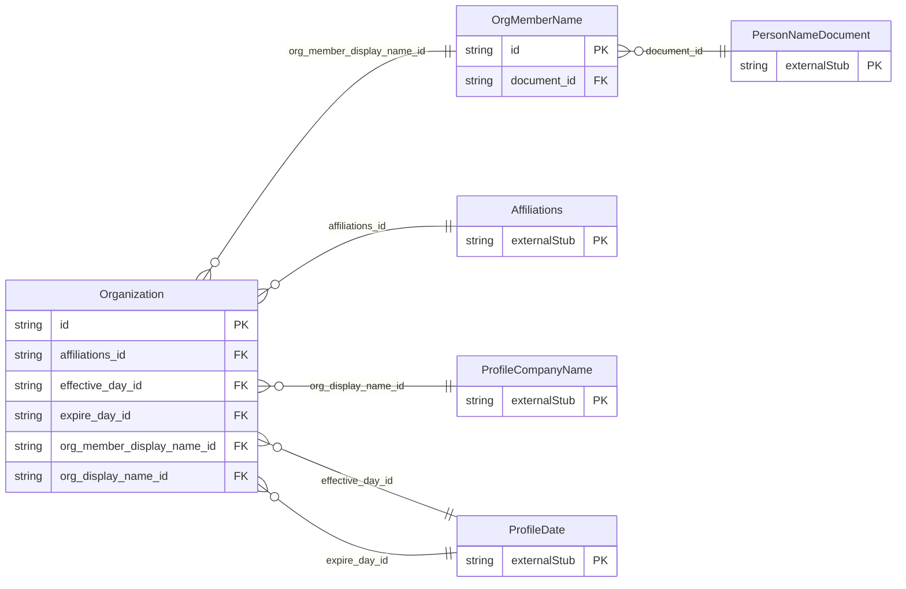

<!-- Code generated by protoc-gen-store. DO NOT EDIT. -->

# `ota/opentravel/common/profile/v1/types/organization/` — Prisma schema

Generated from Protobuf by protoc-gen-store. Source of truth is the `.proto` files — regenerate rather than editing.

| Models | Enums |
| ---: | ---: |
| 2 | 0 |

## Entity relationships

Schema file: [`organization.postgres.prisma`](./organization.postgres.prisma)

### `Organization` → `organizations`

Membership organization that has travel benefits, programs, or discounts.

| Column | Type | Null |
| --- | --- | --- |
| `id` | `CHAR(26)` | not null |
| `default_value` | `BOOLEAN` | nullable |
| `share_synch_ind` | `AccessesShareSynchInd` | nullable |
| `share_market_ind` | `AccessesShareMarketInd` | nullable |
| `expire_date_exclusive` | `BOOLEAN` | nullable |
| `office_type` | `OfficeLocation` | nullable |
| `affiliations_id` | `CHAR(26)` | not null |
| `effective_day_id` | `CHAR(26)` | nullable |
| `expire_day_id` | `CHAR(26)` | nullable |
| `org_member_display_name_id` | `VARCHAR(255)` | nullable |
| `org_display_name_id` | `CHAR(26)` | nullable |

### `OrgMemberName` → `org_member_names`

Name of the member of the organization, as listed among the options of customer names.

| Column | Type | Null |
| --- | --- | --- |
| `share_synch_ind` | `AccessesShareSynchInd` | nullable |
| `share_market_ind` | `AccessesShareMarketInd` | nullable |
| `name_type` | `ProfileNameType` | nullable |
| `language_code` | `VARCHAR(255)` | nullable |
| `default_value` | `BOOLEAN` | nullable |
| `id` | `VARCHAR(255)` | not null |
| `level` | `VARCHAR(255)` | nullable |
| `title` | `VARCHAR(255)` | nullable |
| `name_prefixes` | `VARCHAR(255)[]` | nullable |
| `given_names` | `VARCHAR(255)[]` | nullable |
| `middle_names` | `VARCHAR(255)[]` | nullable |
| `surname_prefix` | `VARCHAR(255)` | nullable |
| `surname` | `VARCHAR(255)` | not null |
| `name_suffixes` | `VARCHAR(255)[]` | nullable |
| `name_titles` | `VARCHAR(255)[]` | nullable |
| `document_id` | `CHAR(26)` | nullable |
