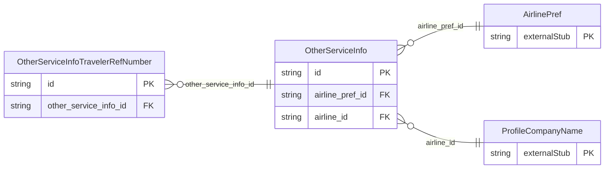

<!-- Code generated by protoc-gen-store. DO NOT EDIT. -->

# `ota/opentravel/common/profile/v1/types/other_service_info/` — Prisma schema

Generated from Protobuf by protoc-gen-store. Source of truth is the `.proto` files — regenerate rather than editing.

| Models | Enums |
| ---: | ---: |
| 2 | 0 |

## Entity relationships

Schema file: [`other_service_info.postgres.prisma`](./other_service_info.postgres.prisma)

### `OtherServiceInfo` → `other_service_infos`

Other Service Information (OSI) for relevant airlines

| Column | Type | Null |
| --- | --- | --- |
| `id` | `CHAR(26)` | not null |
| `code` | `VARCHAR(255)` | nullable |
| `text` | `VARCHAR(255)` | not null |
| `airline_pref_id` | `CHAR(26)` | not null |
| `airline_id` | `CHAR(26)` | not null |

### `OtherServiceInfoTravelerRefNumber` → `other_service_info_traveler_ref_numbers`

One or more travelers to whom this request applies.

| Column | Type | Null |
| --- | --- | --- |
| `id` | `CHAR(26)` | not null |
| `rph` | `VARCHAR(255)` | nullable |
| `surname_ref_number` | `VARCHAR(255)` | nullable |
| `other_service_info_id` | `CHAR(26)` | not null |
