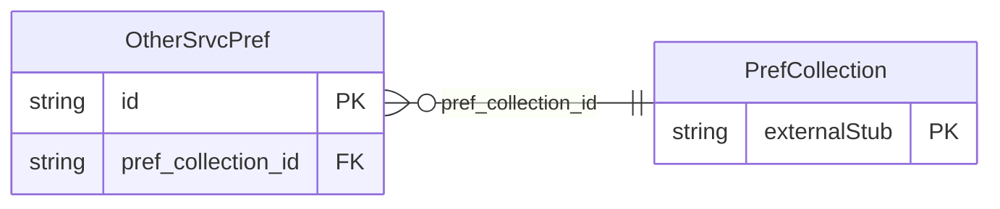

<!-- Code generated by protoc-gen-store. DO NOT EDIT. -->

# `ota/opentravel/common/profile/v1/types/other_srvc_pref/` — Prisma schema

Generated from Protobuf by protoc-gen-store. Source of truth is the `.proto` files — regenerate rather than editing.

| Models | Enums |
| ---: | ---: |
| 1 | 0 |

## Entity relationships

Schema file: [`other_srvc_pref.postgres.prisma`](./other_srvc_pref.postgres.prisma)

### `OtherSrvcPref` → `other_srvc_prefs`

Identifies other service preferences.

| Column | Type | Null |
| --- | --- | --- |
| `id` | `CHAR(26)` | not null |
| `prefer_level` | `ProfilePreferLevel` | nullable |
| `share_synch_ind` | `AccessesShareSynchInd` | nullable |
| `share_market_ind` | `AccessesShareMarketInd` | nullable |
| `travel_purpose` | `TravelPurpose` | nullable |
| `other_srvc_display_name` | `VARCHAR(255)` | not null |
| `pref_collection_id` | `CHAR(26)` | not null |
