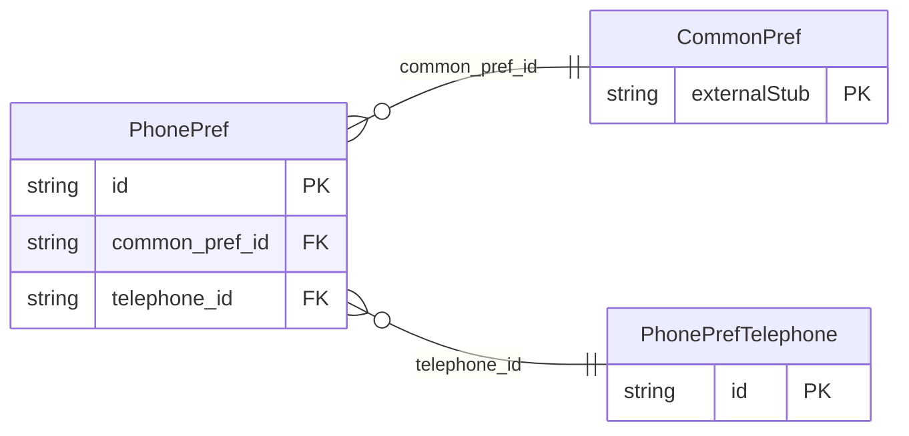

<!-- Code generated by protoc-gen-store. DO NOT EDIT. -->

# `ota/opentravel/common/profile/v1/types/phone_pref/` — Prisma schema

Generated from Protobuf by protoc-gen-store. Source of truth is the `.proto` files — regenerate rather than editing.

| Models | Enums |
| ---: | ---: |
| 2 | 0 |

## Entity relationships

Schema file: [`phone_pref.postgres.prisma`](./phone_pref.postgres.prisma)

### `PhonePref` → `phone_prefs`

Identifies a telephone number preference.

| Column | Type | Null |
| --- | --- | --- |
| `id` | `CHAR(26)` | not null |
| `common_pref_id` | `CHAR(26)` | not null |
| `telephone_id` | `CHAR(26)` | not null |

### `PhonePrefTelephone` → `phone_pref_telephones`

Identifies a telephone number.

| Column | Type | Null |
| --- | --- | --- |
| `id` | `CHAR(26)` | not null |
| `rph` | `VARCHAR(255)` | nullable |
| `share_synch_ind` | `CustomerTelephoneShareSynchInd` | nullable |
| `share_market_ind` | `CustomerTelephoneShareMarketInd` | nullable |
| `phone_location_type` | `ProfilePhoneLocationType` | nullable |
| `phone_tech_type` | `ProfilePhoneTechnologyType` | nullable |
| `phone_use_type` | `ProfilePhoneUseType` | nullable |
| `country_access_code` | `VARCHAR(255)` | nullable |
| `area_city_code` | `VARCHAR(255)` | nullable |
| `phone_number` | `VARCHAR(255)` | not null |
| `extension` | `VARCHAR(255)` | nullable |
| `pin` | `VARCHAR(255)` | nullable |
| `remark` | `VARCHAR(255)` | nullable |
| `formatted` | `BOOLEAN` | nullable |
| `default_value` | `BOOLEAN` | nullable |
