<!-- Code generated by protoc-gen-store. DO NOT EDIT. -->

# `ota/opentravel/common/profile/v1/types/rail_pref/` — Prisma schema

Generated from Protobuf by protoc-gen-store. Source of truth is the `.proto` files — regenerate rather than editing.

| Models | Enums |
| ---: | ---: |
| 19 | 3 |

## Entity relationships

```mermaid
erDiagram
    direction LR
    AccommodationPref {
        string id PK
        string rail_pref_id FK
        string seat_id FK
        string berth_id FK
        string class_value_id FK
        string compartment_id FK
        string car_id FK
    }
    AmenityPref {
        string id PK
        string rail_pref_id FK
    }
    AncillaryServicePref {
        string id PK
        string rail_pref_id FK
    }
    Car {
        string id PK
    }
    Compartment {
        string id PK
    }
    EquipmentPref {
        string id PK
        string rail_pref_id FK
    }
    OperatorPref {
        string id PK
        string rail_pref_id FK
    }
    OsiPref {
        string id PK
        string rail_pref_id FK
        string operator_id FK
    }
    PassengerInfoPref {
        string id PK
        string rail_pref_id FK
        string occupation_id FK
    }
    PassengerQualifyingInfo {
        string id PK
        string passenger_info_pref_id FK
    }
    RailPref {
        string id PK
        string pref_collection_id FK
    }
    RailPrefFarePref {
        string id PK
        string rail_pref_id FK
    }
    RailPrefFareRestrictPref {
        string id PK
        string rail_pref_id FK
        string start_id FK
        string end_id FK
    }
    RailPrefOsiPrefTravelerRefNumber {
        string id PK
        string osi_pref_id FK
    }
    RailPrefPaymentFormPref {
        string id PK
        string rail_pref_id FK
        string payment_card_id FK
        string bank_acct_id FK
        string direct_bill_id FK
        string voucher_id FK
        string loyalty_redemption_id FK
        string misc_charge_order_id FK
        string ticket_id FK
        string cash_id FK
    }
    RailPrefSsrPref {
        string id PK
        string rail_pref_id FK
    }
    RailPrefVendorPref {
        string id PK
        string rail_pref_id FK
    }
    TrainPref {
        string id PK
        string rail_pref_id FK
    }
    TransportModesPref {
        string id PK
        string train_pref_id FK
    }
    AccommodationClass {
        string externalStub PK
    }
    BerthDetail {
        string externalStub PK
    }
    PrefCollection {
        string externalStub PK
    }
    ProfileBankAcct {
        string externalStub PK
    }
    ProfileCash {
        string externalStub PK
    }
    ProfileCompanyName {
        string externalStub PK
    }
    ProfileDateOrTimeOrDateTime {
        string externalStub PK
    }
    ProfileDirectBill {
        string externalStub PK
    }
    ProfileLoyaltyRedemption {
        string externalStub PK
    }
    ProfileMiscChargeOrder {
        string externalStub PK
    }
    ProfilePaymentCard {
        string externalStub PK
    }
    ProfileTicket {
        string externalStub PK
    }
    ProfileVoucher {
        string externalStub PK
    }
    RailPassengerOccupation {
        string externalStub PK
    }
    SeatDetail {
        string externalStub PK
    }
    AccommodationPref }o--|| RailPref : "rail_pref_id"
    AccommodationPref }o--|| SeatDetail : "seat_id"
    AccommodationPref }o--|| BerthDetail : "berth_id"
    AccommodationPref }o--|| AccommodationClass : "class_value_id"
    AccommodationPref }o--|| Compartment : "compartment_id"
    AccommodationPref }o--|| Car : "car_id"
    AmenityPref }o--|| RailPref : "rail_pref_id"
    AncillaryServicePref }o--|| RailPref : "rail_pref_id"
    EquipmentPref }o--|| RailPref : "rail_pref_id"
    OperatorPref }o--|| RailPref : "rail_pref_id"
    OsiPref }o--|| RailPref : "rail_pref_id"
    OsiPref }o--|| ProfileCompanyName : "operator_id"
    PassengerInfoPref }o--|| RailPref : "rail_pref_id"
    PassengerInfoPref }o--|| RailPassengerOccupation : "occupation_id"
    PassengerQualifyingInfo }o--|| PassengerInfoPref : "passenger_info_pref_id"
    RailPref }o--|| PrefCollection : "pref_collection_id"
    RailPrefFarePref }o--|| RailPref : "rail_pref_id"
    RailPrefFareRestrictPref }o--|| RailPref : "rail_pref_id"
    RailPrefFareRestrictPref }o--|| ProfileDateOrTimeOrDateTime : "start_id"
    RailPrefFareRestrictPref }o--|| ProfileDateOrTimeOrDateTime : "end_id"
    RailPrefOsiPrefTravelerRefNumber }o--|| OsiPref : "osi_pref_id"
    RailPrefPaymentFormPref }o--|| RailPref : "rail_pref_id"
    RailPrefPaymentFormPref }o--|| ProfilePaymentCard : "payment_card_id"
    RailPrefPaymentFormPref }o--|| ProfileBankAcct : "bank_acct_id"
    RailPrefPaymentFormPref }o--|| ProfileDirectBill : "direct_bill_id"
    RailPrefPaymentFormPref }o--|| ProfileVoucher : "voucher_id"
    RailPrefPaymentFormPref }o--|| ProfileLoyaltyRedemption : "loyalty_redemption_id"
    RailPrefPaymentFormPref }o--|| ProfileMiscChargeOrder : "misc_charge_order_id"
    RailPrefPaymentFormPref }o--|| ProfileTicket : "ticket_id"
    RailPrefPaymentFormPref }o--|| ProfileCash : "cash_id"
    RailPrefSsrPref }o--|| RailPref : "rail_pref_id"
    RailPrefVendorPref }o--|| RailPref : "rail_pref_id"
    TrainPref }o--|| RailPref : "rail_pref_id"
    TransportModesPref }o--|| TrainPref : "train_pref_id"
```

Schema file: [`rail_pref.postgres.prisma`](./rail_pref.postgres.prisma)

### `RailPref` → `rail_prefs`

A collection of rail preferences.

| Column | Type | Null |
| --- | --- | --- |
| `id` | `CHAR(26)` | not null |
| `share_synch_ind` | `AccessesShareSynchInd` | nullable |
| `share_market_ind` | `AccessesShareMarketInd` | nullable |
| `prefer_level` | `ProfilePreferLevel` | nullable |
| `smoking_allowed` | `BOOLEAN` | nullable |
| `rail_ticket_type` | `EnumsTicket` | nullable |
| `pref_collection_id` | `CHAR(26)` | not null |

### `OperatorPref` → `operator_prefs`

Preferred rail operator network code(s).

| Column | Type | Null |
| --- | --- | --- |
| `id` | `CHAR(26)` | not null |
| `code` | `VARCHAR(255)` | nullable |
| `code_context` | `VARCHAR(255)` | nullable |
| `prefer_level` | `ProfilePreferLevel` | nullable |
| `rph` | `VARCHAR(255)` | nullable |
| `rail_pref_id` | `CHAR(26)` | not null |

### `RailPrefVendorPref` → `rail_pref_vendor_prefs`

Specifies any preferences in terms of the company operating the train service.

| Column | Type | Null |
| --- | --- | --- |
| `id` | `CHAR(26)` | not null |
| `company_short_display_name` | `VARCHAR(255)` | nullable |
| `division` | `VARCHAR(255)` | nullable |
| `department` | `VARCHAR(255)` | nullable |
| `prefer_level` | `ProfilePreferLevel` | nullable |
| `rph` | `VARCHAR(255)` | nullable |
| `rail_pref_id` | `CHAR(26)` | not null |

### `RailPrefPaymentFormPref` → `rail_pref_payment_form_prefs`

Preferred form(s) of payment.

| Column | Type | Null |
| --- | --- | --- |
| `id` | `CHAR(26)` | not null |
| `share_synch_ind` | `AccessesShareSynchInd` | nullable |
| `share_market_ind` | `AccessesShareMarketInd` | nullable |
| `cost_center_id` | `VARCHAR(255)` | nullable |
| `rph` | `VARCHAR(255)` | nullable |
| `payment_transaction_type_code` | `ProfilePaymentTransactionTypeCode` | nullable |
| `guarantee_indicator` | `BOOLEAN` | nullable |
| `guarantee_type_code` | `ProfilePaymentType` | nullable |
| `guarantee_id` | `VARCHAR(255)` | nullable |
| `remark` | `VARCHAR(255)` | nullable |
| `prefer_level` | `ProfilePreferLevel` | nullable |
| `payment_card_choice_case` | `RailPrefPaymentFormPrefPaymentCardChoiceCase` | nullable |
| `rail_pref_id` | `CHAR(26)` | not null |
| `payment_card_id` | `CHAR(26)` | nullable |
| `bank_acct_id` | `CHAR(26)` | nullable |
| `direct_bill_id` | `CHAR(26)` | nullable |
| `voucher_id` | `VARCHAR(255)` | nullable |
| `loyalty_redemption_id` | `CHAR(26)` | nullable |
| `misc_charge_order_id` | `CHAR(26)` | nullable |
| `ticket_id` | `CHAR(26)` | nullable |
| `cash_id` | `CHAR(26)` | nullable |

### `RailPrefFareRestrictPref` → `rail_pref_fare_restrict_prefs`

Preferred fare restriction(s).

| Column | Type | Null |
| --- | --- | --- |
| `id` | `CHAR(26)` | not null |
| `prefer_level` | `ProfilePreferLevel` | nullable |
| `fare_restriction` | `FareRestriction` | nullable |
| `duration` | `VARCHAR(255)` | nullable |
| `refundable` | `BOOLEAN` | nullable |
| `rail_pref_id` | `CHAR(26)` | not null |
| `start_id` | `CHAR(26)` | nullable |
| `end_id` | `CHAR(26)` | nullable |

### `RailPrefFarePref` → `rail_pref_fare_prefs`

Preferred fare preferences.

| Column | Type | Null |
| --- | --- | --- |
| `id` | `CHAR(26)` | not null |
| `code` | `VARCHAR(255)` | nullable |
| `description` | `VARCHAR(255)` | nullable |
| `vendor_pref_rphs` | `VARCHAR(255)[]` | nullable |
| `rate_category_code` | `RateCategory` | nullable |
| `prefer_level` | `ProfilePreferLevel` | nullable |
| `transfer_action` | `TransferAction` | nullable |
| `fare_basis_code` | `VARCHAR(255)` | nullable |
| `rail_pref_id` | `CHAR(26)` | not null |

### `TrainPref` → `train_prefs`

Train characteristic preferences.

| Column | Type | Null |
| --- | --- | --- |
| `id` | `CHAR(26)` | not null |
| `prefer_level` | `ProfilePreferLevel` | nullable |
| `train_type` | `TrainTypeCode` | nullable |
| `max_connections` | `INTEGER` | nullable |
| `direct_and_non_stop_only` | `BOOLEAN` | nullable |
| `non_stops_only` | `BOOLEAN` | nullable |
| `routing_type` | `RailPrefTrainPrefRoutingType` | nullable |
| `same_operator_only` | `BOOLEAN` | nullable |
| `rail_pref_id` | `CHAR(26)` | not null |

### `AmenityPref` → `amenity_prefs`

Amenity preferences.

| Column | Type | Null |
| --- | --- | --- |
| `id` | `CHAR(26)` | not null |
| `code` | `VARCHAR(255)` | nullable |
| `code_context` | `VARCHAR(255)` | nullable |
| `prefer_level` | `ProfilePreferLevel` | nullable |
| `rail_pref_id` | `CHAR(26)` | not null |

### `EquipmentPref` → `equipment_prefs`

Equipment preferences.

| Column | Type | Null |
| --- | --- | --- |
| `id` | `CHAR(26)` | not null |
| `code` | `VARCHAR(255)` | nullable |
| `code_context` | `VARCHAR(255)` | nullable |
| `prefer_level` | `ProfilePreferLevel` | nullable |
| `rail_pref_id` | `CHAR(26)` | not null |

### `AccommodationPref` → `accommodation_prefs`

Accommodation preferences.

| Column | Type | Null |
| --- | --- | --- |
| `id` | `CHAR(26)` | not null |
| `deck` | `Deck` | nullable |
| `prefer_level` | `ProfilePreferLevel` | nullable |
| `seat_or_berth_case` | `AccommodationPrefSeatOrBerthCase` | nullable |
| `rail_pref_id` | `CHAR(26)` | not null |
| `seat_id` | `CHAR(26)` | nullable |
| `berth_id` | `CHAR(26)` | nullable |
| `class_value_id` | `CHAR(26)` | nullable |
| `compartment_id` | `CHAR(26)` | nullable |
| `car_id` | `CHAR(26)` | nullable |

### `AncillaryServicePref` → `ancillary_service_prefs`

Specifies preferences of any service or product offered in conjunction with a basic rail accommodation, such as vehicle transport, pet transport and restaurant car service. Refer to OpenTravel Code List Rail Ancillary Service (RAN).

| Column | Type | Null |
| --- | --- | --- |
| `id` | `CHAR(26)` | not null |
| `ancillary_service_code` | `VARCHAR(255)` | nullable |
| `food_allergies` | `VARCHAR(255)` | nullable |
| `prefer_level` | `ProfilePreferLevel` | nullable |
| `remark` | `VARCHAR(255)` | nullable |
| `rail_pref_id` | `CHAR(26)` | not null |

### `PassengerInfoPref` → `passenger_info_prefs`

Occupation, passenger qualifying codes, rate qualifiers and disability requirement preferences.

| Column | Type | Null |
| --- | --- | --- |
| `id` | `CHAR(26)` | not null |
| `infant_accompanied` | `BOOLEAN` | nullable |
| `gender` | `ProfileGender` | nullable |
| `prefer_level` | `ProfilePreferLevel` | nullable |
| `ada_requirements` | `VARCHAR(255)[]` | nullable |
| `rail_pref_id` | `CHAR(26)` | not null |
| `occupation_id` | `CHAR(26)` | nullable |

### `RailPrefSsrPref` → `rail_pref_ssr_prefs`

Special Service Request preferences.

| Column | Type | Null |
| --- | --- | --- |
| `id` | `CHAR(26)` | not null |
| `prefer_level` | `ProfilePreferLevel` | nullable |
| `ssr_code` | `VARCHAR(255)` | nullable |
| `vendor_code` | `VARCHAR(255)` | nullable |
| `party_size` | `INTEGER` | nullable |
| `default_status_code` | `VARCHAR(255)` | nullable |
| `remark` | `VARCHAR(255)` | nullable |
| `lookup_key` | `VARCHAR(255)` | nullable |
| `vendor_pref_rphs` | `VARCHAR(255)[]` | nullable |
| `transfer_action_type` | `TransferAction` | nullable |
| `ada_requirement` | `VARCHAR(255)` | nullable |
| `rail_pref_id` | `CHAR(26)` | not null |

### `OsiPref` → `osi_prefs`

Other Service Information of the rail operators.

| Column | Type | Null |
| --- | --- | --- |
| `id` | `CHAR(26)` | not null |
| `code` | `VARCHAR(255)` | nullable |
| `text` | `VARCHAR(255)` | not null |
| `rail_pref_id` | `CHAR(26)` | not null |
| `operator_id` | `CHAR(26)` | not null |

### `TransportModesPref` → `transport_modes_prefs`

Additional modes of transportation prefences, e.g. bus.

| Column | Type | Null |
| --- | --- | --- |
| `id` | `CHAR(26)` | not null |
| `code` | `VARCHAR(255)` | nullable |
| `code_context` | `VARCHAR(255)` | nullable |
| `prefer_level` | `ProfilePreferLevel` | nullable |
| `train_pref_id` | `CHAR(26)` | not null |

### `Compartment` → `compartments`

Compartment accommodation information, including type and associated compartment attributes such as number and position.

| Column | Type | Null |
| --- | --- | --- |
| `id` | `CHAR(26)` | not null |
| `extension` | `VARCHAR(255)` | nullable |
| `number` | `VARCHAR(255)` | nullable |
| `position` | `CompartmentPosition` | nullable |
| `value` | `CompartmentTypeEnum` | nullable |

### `Car` → `cars`

Car information, such as car number.

| Column | Type | Null |
| --- | --- | --- |
| `id` | `CHAR(26)` | not null |
| `number` | `VARCHAR(255)` | nullable |

### `PassengerQualifyingInfo` → `passenger_qualifying_infos`

Age qualifying information for the passenger. Refer to OpenTravel code list Rail Passenger Type Code (PXC).

| Column | Type | Null |
| --- | --- | --- |
| `id` | `CHAR(26)` | not null |
| `code` | `VARCHAR(255)` | nullable |
| `code_context` | `VARCHAR(255)` | nullable |
| `passenger_info_pref_id` | `CHAR(26)` | not null |

### `RailPrefOsiPrefTravelerRefNumber` → `rail_pref_osi_pref_traveler_ref_numbers`

One or more travelers to whom this request applies

| Column | Type | Null |
| --- | --- | --- |
| `id` | `CHAR(26)` | not null |
| `rph` | `VARCHAR(255)` | nullable |
| `surname_ref_number` | `VARCHAR(255)` | nullable |
| `osi_pref_id` | `CHAR(26)` | not null |

### Enums

- `RailPrefPaymentFormPrefPaymentCardChoiceCase`: PAYMENT_CARD, BANK_ACCT, DIRECT_BILL, VOUCHER, LOYALTY_REDEMPTION, MISC_CHARGE_ORDER, TICKET, CASH
- `RailPrefTrainPrefRoutingType`: NORMAL, MIRROR
- `AccommodationPrefSeatOrBerthCase`: SEAT, BERTH
