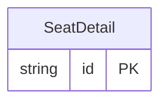

<!-- Code generated by protoc-gen-store. DO NOT EDIT. -->

# `ota/opentravel/common/profile/v1/types/seat_detail/` — Prisma schema

Generated from Protobuf by protoc-gen-store. Source of truth is the `.proto` files — regenerate rather than editing.

| Models | Enums |
| ---: | ---: |
| 1 | 0 |

## Entity relationships

Schema file: [`seat_detail.postgres.prisma`](./seat_detail.postgres.prisma)

### `SeatDetail` → `seat_details`

Defines information about a seat on a train.

| Column | Type | Null |
| --- | --- | --- |
| `id` | `CHAR(26)` | not null |
| `number` | `VARCHAR(255)` | nullable |
| `position` | `SeatPosition` | nullable |
| `direction` | `SeatDirection` | nullable |
| `value` | `SeatAccommodation` | nullable |
