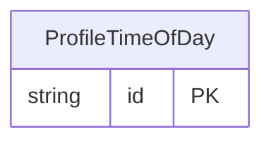

<!-- Code generated by protoc-gen-store. DO NOT EDIT. -->

# `ota/opentravel/common/profile/v1/types/time_of_day/` — Prisma schema

Generated from Protobuf by protoc-gen-store. Source of truth is the `.proto` files — regenerate rather than editing.

| Models | Enums |
| ---: | ---: |
| 1 | 0 |

## Entity relationships

Schema file: [`time_of_day.postgres.prisma`](./time_of_day.postgres.prisma)

### `ProfileTimeOfDay` → `time_of_days`

A time of day with no date or time zone, after google.type.TimeOfDay. Its fields are singular -- hour, not hours -- because AIP-142 reads seconds and nanos as claims that a field is a time.

| Column | Type | Null |
| --- | --- | --- |
| `id` | `CHAR(26)` | not null |
| `hour` | `INTEGER` | nullable |
| `minute` | `INTEGER` | nullable |
| `second` | `INTEGER` | nullable |
| `nanosecond` | `INTEGER` | nullable |
