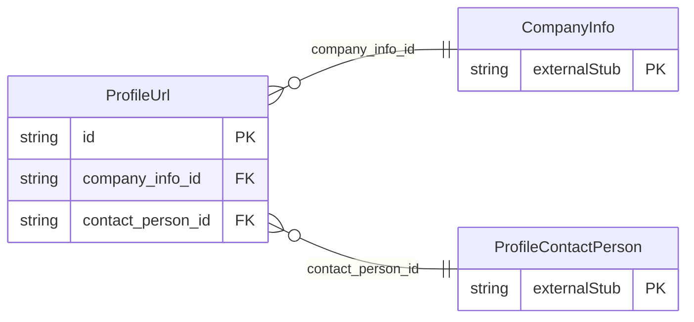

<!-- Code generated by protoc-gen-store. DO NOT EDIT. -->

# `ota/opentravel/common/profile/v1/types/url/` — Prisma schema

Generated from Protobuf by protoc-gen-store. Source of truth is the `.proto` files — regenerate rather than editing.

| Models | Enums |
| ---: | ---: |
| 1 | 0 |

## Entity relationships

Schema file: [`url.postgres.prisma`](./url.postgres.prisma)

### `ProfileUrl` → `urls`

Web site address, in IETF specified format.

| Column | Type | Null |
| --- | --- | --- |
| `id` | `CHAR(26)` | not null |
| `type` | `VARCHAR(255)` | nullable |
| `default_value` | `BOOLEAN` | nullable |
| `value` | `VARCHAR(255)` | nullable |
| `company_info_id` | `CHAR(26)` | not null |
| `contact_person_id` | `CHAR(26)` | not null |
