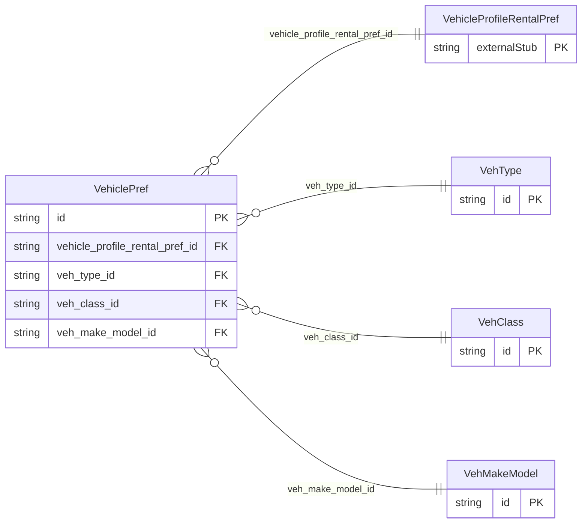

<!-- Code generated by protoc-gen-store. DO NOT EDIT. -->

# `ota/opentravel/common/profile/v1/types/vehicle_pref/` — Prisma schema

Generated from Protobuf by protoc-gen-store. Source of truth is the `.proto` files — regenerate rather than editing.

| Models | Enums |
| ---: | ---: |
| 4 | 2 |

## Entity relationships

Schema file: [`vehicle_pref.postgres.prisma`](./vehicle_pref.postgres.prisma)

### `VehiclePref` → `vehicle_prefs`

The VehiclePrefType complex type defines the information that is used when defining a preference of a vehicle.

| Column | Type | Null |
| --- | --- | --- |
| `id` | `CHAR(26)` | not null |
| `air_condition` | `BOOLEAN` | nullable |
| `transmission_type` | `VehicleTransmission` | nullable |
| `fuel_type` | `FuelType` | nullable |
| `drive_type` | `DriveType` | nullable |
| `type_pref` | `ProfilePreferLevel` | nullable |
| `class_pref` | `ProfilePreferLevel` | nullable |
| `air_condition_pref` | `ProfilePreferLevel` | nullable |
| `transmission_pref` | `ProfilePreferLevel` | nullable |
| `vendor_car_type` | `VARCHAR(255)` | nullable |
| `vehicle_qty` | `INTEGER` | nullable |
| `code` | `VARCHAR(255)` | nullable |
| `code_context` | `VARCHAR(255)` | nullable |
| `vehicle_profile_rental_pref_id` | `CHAR(26)` | not null |
| `veh_type_id` | `CHAR(26)` | nullable |
| `veh_class_id` | `CHAR(26)` | nullable |
| `veh_make_model_id` | `CHAR(26)` | nullable |

### `VehType` → `veh_types`

The type of vehicle, for example, truck, car.

| Column | Type | Null |
| --- | --- | --- |
| `id` | `CHAR(26)` | not null |
| `vehicle_category` | `VehicleCategory` | not null |
| `door_count` | `VARCHAR(255)` | nullable |

### `VehClass` → `veh_class`

The class of vehicle, for example, intermediate, compact.

| Column | Type | Null |
| --- | --- | --- |
| `id` | `CHAR(26)` | not null |
| `size` | `Size` | not null |

### `VehMakeModel` → `veh_make_models`

The make and model of the vehicle (e.g., Ford Focus). The Code attribute may be used for the SIPP code.

| Column | Type | Null |
| --- | --- | --- |
| `id` | `CHAR(26)` | not null |
| `name` | `VARCHAR(255)` | not null |
| `code` | `VARCHAR(255)` | nullable |
| `model_year` | `VARCHAR(255)` | nullable |

### Enums

- `FuelType`: UNSPECIFIED_1, DIESEL, HYBRID, ELECTRIC, LPG_COMPRESSED_GAS, HYDROGEN, MULTI_FUEL, PETROL, ETHANOL
- `DriveType`: AWD, DRIVE_TYPE_4_WD, UNSPECIFIED_3
