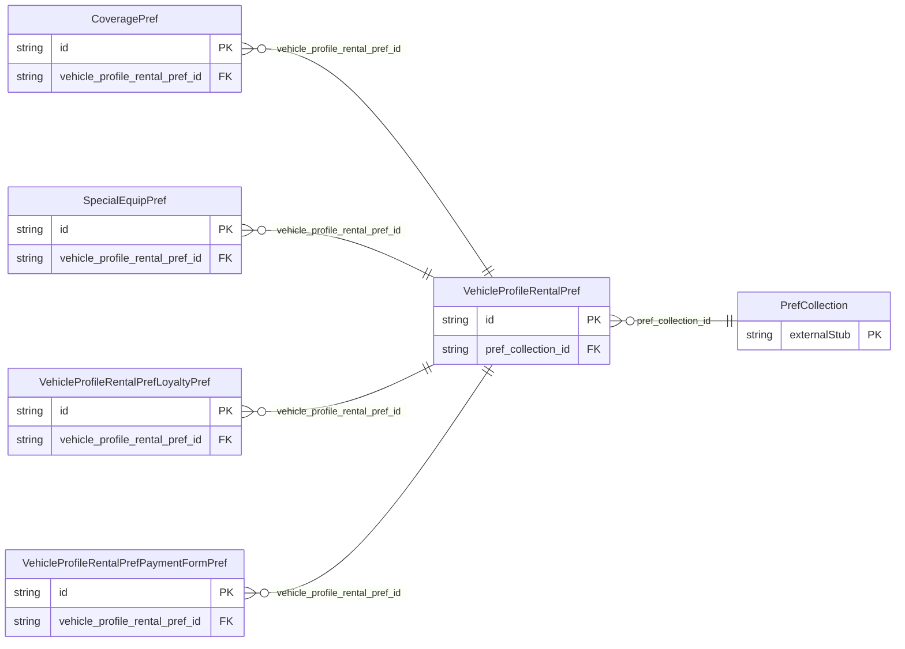

<!-- Code generated by protoc-gen-store. DO NOT EDIT. -->

# `ota/opentravel/common/profile/v1/types/vehicle_profile_rental_pref/` — Prisma schema

Generated from Protobuf by protoc-gen-store. Source of truth is the `.proto` files — regenerate rather than editing.

| Models | Enums |
| ---: | ---: |
| 5 | 0 |

## Entity relationships

Schema file: [`vehicle_profile_rental_pref.postgres.prisma`](./vehicle_profile_rental_pref.postgres.prisma)

### `VehicleProfileRentalPref` → `vehicle_profile_rental_prefs`

Vehicle rental preferences can be specified for customers or companies to indicate their preferences for types of vehicles to be rented in specific travel situations. Companies may wish to specify certain class or types of cars that their employees are allowed to rent, or indicate special business needs for trucks for hauling goods, etc. Personal travelers may wish to indicate preferences for types of vehicles such as vans or SUVs for family vacations, or smaller, more sporty models when travelling alone. A customer may prefer to have a convertible or sun roof in a warm destination, but request a ski rack when vacationing in the wintertime. The VehicleProfileRentalPrefType complex type has elements for specific features on rental cars including vehicle type (major category such as car, truck, SUV) and vehicle class (more precise kind of vehicle), air conditioning, transmission, and special equipment. In addition, the specification captures preferences for vendors and loyalty programs, insurance coverage, forms of payment for rental cars, and other special requirements.

| Column | Type | Null |
| --- | --- | --- |
| `id` | `CHAR(26)` | not null |
| `prefer_level` | `ProfilePreferLevel` | nullable |
| `share_synch_ind` | `AccessesShareSynchInd` | nullable |
| `share_market_ind` | `AccessesShareMarketInd` | nullable |
| `smoking_allowed` | `BOOLEAN` | nullable |
| `gas_pre_pay` | `BOOLEAN` | nullable |
| `pref_collection_id` | `CHAR(26)` | not null |

### `VehicleProfileRentalPrefLoyaltyPref` → `vehicle_profile_rental_pref_loyalty_prefs`

Indicates a preference for the loyalty program to be used for vehicle rental. The RPH (Reference Place Holder) attribute designates a specific loyalty program from a collection stored in the profile.

| Column | Type | Null |
| --- | --- | --- |
| `id` | `CHAR(26)` | not null |
| `prefer_level` | `ProfilePreferLevel` | nullable |
| `rph` | `VARCHAR(255)` | nullable |
| `vehicle_profile_rental_pref_id` | `CHAR(26)` | not null |

### `VehicleProfileRentalPrefPaymentFormPref` → `vehicle_profile_rental_pref_payment_form_prefs`

A preference for a payment indicates a specific type of payment, such as a credit card or direct bill, to be assigned to the car rental preference collection. The RPH (Reference Place Holder) attribute designates a specific payment form in a collection stored in the profile.

| Column | Type | Null |
| --- | --- | --- |
| `id` | `CHAR(26)` | not null |
| `prefer_level` | `ProfilePreferLevel` | nullable |
| `rph` | `VARCHAR(255)` | nullable |
| `vehicle_profile_rental_pref_id` | `CHAR(26)` | not null |

### `CoveragePref` → `coverage_prefs`

A preference for a specific type of vehicle coverage to be used when renting a car in a given travel situation.

| Column | Type | Null |
| --- | --- | --- |
| `id` | `CHAR(26)` | not null |
| `coverage_type` | `VehicleCoverageType` | not null |
| `code` | `VARCHAR(255)` | nullable |
| `prefer_level` | `ProfilePreferLevel` | nullable |
| `vehicle_profile_rental_pref_id` | `CHAR(26)` | not null |

### `SpecialEquipPref` → `special_equip_prefs`

Indicates a preference for special equipment in a rented car.

| Column | Type | Null |
| --- | --- | --- |
| `id` | `CHAR(26)` | not null |
| `equip_type` | `EquipmentType` | not null |
| `quantity` | `INTEGER` | nullable |
| `prefer_level` | `ProfilePreferLevel` | nullable |
| `action` | `ProfileAction` | nullable |
| `vehicle_profile_rental_pref_id` | `CHAR(26)` | not null |
